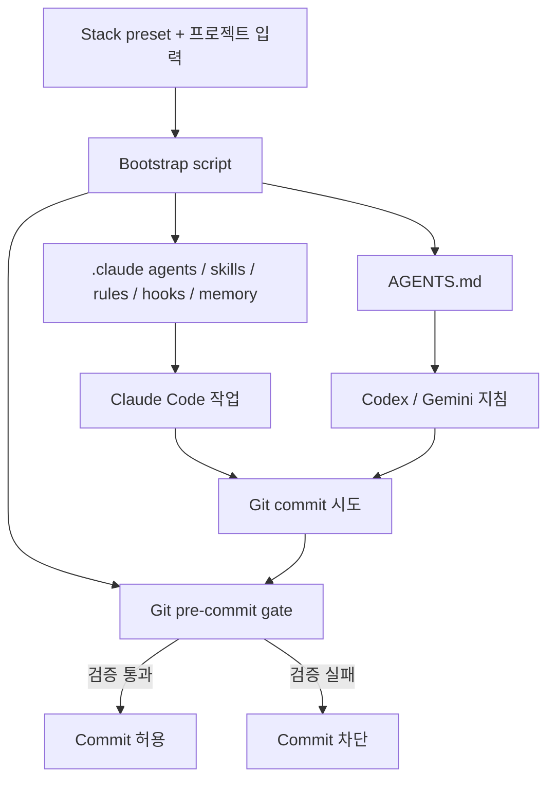

# agents-scaffold

> AI 코딩 에이전트의 프로젝트 규칙을 파일 기반 하네스로 배포하고 Git pre-commit 검증으로 강제하는 fork-and-fill 부트스트랩.

## 개요와 해결 문제
Claude Code 중심으로 에이전트, Skill, Hook, 경로별 규칙, 메모리, 스택별 프리셋을 저장소에 생성한다. Codex/Gemini에는 AGENTS.md를 통한 공통 지침을 제공한다. 반복 설명해야 하는 규칙, 개발자마다 다른 설정, 비밀정보 및 오류 코드 커밋을 줄이는 것이 목적이다.

## 핵심 기능
- .claude/ 아래 agents, skills, hooks, path-scoped rules, memory 생성
- AGENTS.md 공통 프로젝트 지침
- P0/P1/P2 규칙과 Git pre-commit 품질 게이트
- 스택 프리셋 구성(README 기준 12개)
- /fix-issue, /sdlc-cycle(역할 분리 3개 에이전트), /review, /status 등
- 세션별 Git worktree 격리, skill-evolve/agent-evolve 피드백 반영
- Bats 회귀 테스트, 문서 링크 검사

## 아키텍처

README에 근거한 개념적 흐름이며 내부 모든 호출 순서를 검증한 실행 추적은 아니다.

## 장점
- 단순 프롬프트 권고보다 강한 로컬 커밋 차단
- 별도 런타임/레지스트리 없이 일반 파일을 저장소에서 직접 관리
- 경로별 규칙 로드로 불필요한 컨텍스트 주입 감소 가능
- 팀별 하네스 표준화와 병렬 세션 격리에 유용

## 단점과 한계
- Git hook은 --no-verify 등으로 우회 가능하므로 서버 측 CI 필수 검사와 병행해야 함
- Claude Code 중심이며 Codex/Gemini 기능 동등성은 확인되지 않음
- 자체 진화 기능은 규칙 품질 악화 방지를 위한 코드 리뷰 필요
- 토큰 절감률, 실제 품질 향상, 대규모 조직 운영 성과는 확인되지 않음
- Windows는 Git Bash 및 설치 환경 의존성 확인 필요
- 외부 curl|bash 실행 전 스크립트 검토 권장

## 활용 사례 및 비교
| 접근 | 규칙 제공 | 실행 강제 |
|---|---|---|
| AGENTS.md 단독 | 프로젝트 지침 | 기본적으로 없음 |
| Claude 설정 파일 단독 | 지침/훅 구성 가능 | 구성에 따라 다름 |
| agents-scaffold | 지침+역할+프리셋+메모리 | 로컬 pre-commit 게이트 |

## Quick Start
공식 README 예시:
```bash
git clone https://github.com/leeyudok/agents-scaffold.git
agents-scaffold/bin/agents-scaffold.sh /path/to/new-repo --forge github --stack nextjs,bun --name my-app
```
운영 저장소 적용 전 격리된 테스트 저장소에서 생성 파일과 훅을 확인한다.

## 활용 아이디어
1. 공통 하네스 템플릿을 신규 프로젝트 부트스트랩에 사용
2. Claude Code와 Codex에서 AGENTS.md 공통 정책의 실제 적용 범위를 비교
3. Git Hook + TeamCity CI를 이중 품질 게이트로 구성
4. 병렬 worktree와 자체 진화 기능을 별도 PoC로 검증

## 결론
**PoC 가치 있음.** 프로젝트별 AI 코딩 규칙을 실행 가능한 품질 게이트와 묶는 방식은 유용하다. 기존 저장소에 일괄 적용하기보다 단일 샘플 저장소에서 Windows 호환성, 커밋 차단, 우회, CI 연동, 토큰 사용량을 검증하는 것이 적절하다.

## 참고 자료
- https://github.com/LeeYudok/agents-scaffold
- https://github.com/LeeYudok/agents-scaffold/blob/main/README.ko.md
- https://github.com/LeeYudok/agents-scaffold/blob/main/docs/INTERNALS.en.md
- https://github.com/LeeYudok/agents-scaffold/blob/main/docs/OFFLINE_INSTALL.en.md

조사일: 2026-10-24. 공개 README 중심 확인. 세부 소스 코드 실행 및 벤치마크는 미검증.
