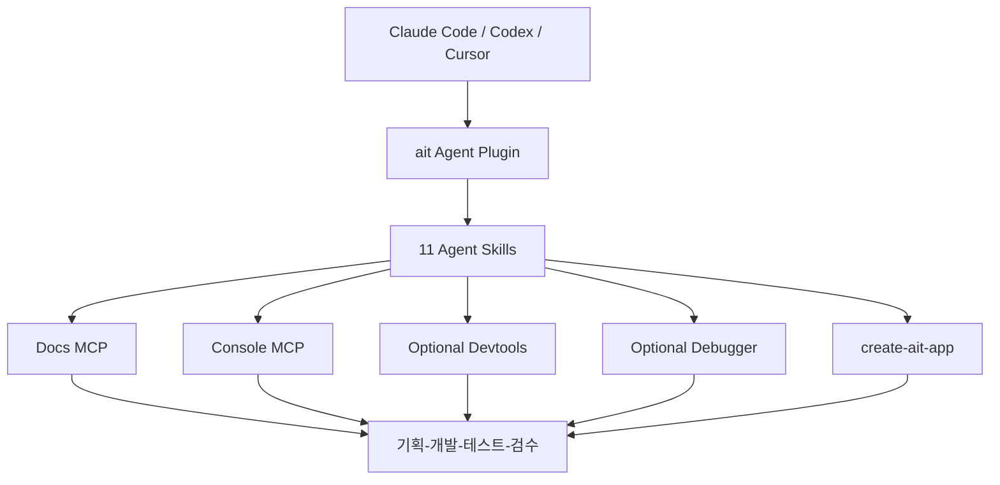

# Apps in Toss Harness

> 앱인토스 미니앱의 기획부터 개발·디버깅·실기기 검증·검수 준비까지 연결하는 토스 공식 AI Agent Harness.

## 프로젝트 개요
토스의 공식 monorepo로 Claude Code, Codex, Cursor의 앱인토스 개발을 지원한다. Node.js 24 이상과 pnpm을 사용하며, Agent Plugin·Docs MCP·Console MCP·선택적 Devtools 및 Debugger를 조합한다.

## 해결하려는 문제
코드 생성과 플랫폼 문서 확인, SDK 권한 설정, 실기기 테스트, 콘솔 업로드 및 검수 준비가 서로 분리된 문제를 해결한다.

## 핵심 기능
- 11종 Agent Skill을 통한 개발 단계별 안내
- `/ait:plan`: 요구사항 및 권한 기획
- `/ait:new`: 미니앱 스캐폴딩
- `/ait:design`: 화면 생성 및 디자인 가이드
- `/ait:server`: 서버 연동
- `/ait:test-on-device`: 실기기 확인
- `/ait:debug`: 문제 분석
- `/ait:launch`: 검수 체크리스트 및 승인 기반 요청
- Docs MCP: 개발 문서 및 SDK 검색
- Console MCP: 앱 등록, 번들 업로드, 상태 확인

## 아키텍처

저장소는 `packages/agent-plugin`, `packages/debugger`, `packages/debug-console`, `shared/internal-protocol`, `scripts` 중심이다. devtools 소스는 별도 관리된다. pnpm 기반 빌드, Biome 린트, TypeScript 타입 검사, Vitest 테스트를 정의한다.

## 장점
- 공식 문서와 콘솔을 에이전트 작업 흐름에 통합
- 브라우저 Mock SDK와 실기기 검증을 단계별 연결
- 필요 시에만 무거운 개발·디버깅 도구 활성화
- 출시 전 검수 및 사용자 승인 게이트 제공

## 단점 및 한계
- 앱인토스 전용으로 범용 개발 재사용성 제한
- Node 24 이상, 플랫폼 인증과 외부 MCP 의존
- Claude Code 중심 실기기 attach 디버깅; Codex·Cursor는 기능 차이 존재
- 비대화형 MCP 승인 및 콘솔 인증 관리 필요
- 완전 무인 최종 출시는 지원하지 않음
- 토큰 절감, Windows/Enterprise 지원 및 장기 안정성의 독립 정량 검증은 확인되지 않음

## 활용 사례
1. 신규 앱인토스 미니앱 기획·생성·개발·검수
2. 기존 웹 기반 앱의 앱인토스 적용 PoC
3. Claude Code 중심 실기기 디버깅과 Codex 보조 개발
4. 자체 Harness 설계 시 Skill/MCP/디버깅 도구의 선택적 결합 참고

## 기존 도구와 비교
Claude Code 또는 Codex 단독 사용보다 앱인토스 특화 문서, SDK, 콘솔, 검수 절차를 하나의 흐름으로 제공한다. 범용 Harness와의 정량 벤치마크는 확인되지 않았다.

## 활용 아이디어
- **바로 적용 가능:** 앱인토스 신규 프로젝트에 ait 플러그인 도입
- **PoC 가치 있음:** Claude Code와 Codex 병행 개발 및 실기기 검증
- **아이디어 참고:** 기본 Docs/Console MCP + 선택적 Debugger, 단계별 Skill, 승인 기반 출시 게이트
- **현재 도입 가치 낮음:** UE5 등 비앱인토스 개발의 범용 Harness 대체

## 결론
앱인토스 미니앱 개발에는 높은 가치가 있지만 범용 Harness보다는 플랫폼 특화 실행 계층으로 도입해야 한다.

## 참고 자료
- https://github.com/toss/apps-in-toss-harness
- https://github.com/toss/apps-in-toss-harness/blob/main/README.md
- https://github.com/toss/apps-in-toss-harness/blob/main/CLAUDE.md
- https://github.com/toss/apps-in-toss-harness/blob/main/package.json
