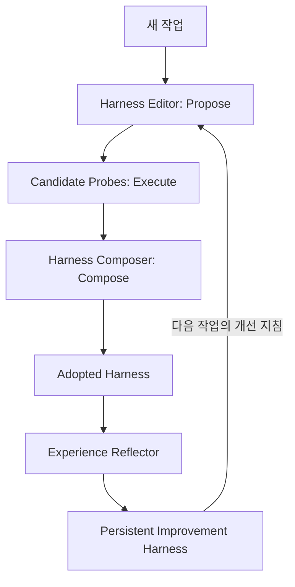

# Harness²

> AI Agent의 실행 환경을 작업별로 실험·개선하고, 개선 근거를 다음 작업에 재사용하는 이중 재귀형 Harness 최적화 프레임워크.

## 프로젝트 개요
Google Research가 공개한 연구용 오픈소스 프레임워크. 모델 가중치를 고정하고 모델 주변 Harness를 최적화한다. Apache 2.0 라이선스이며 공식 지원 Google 제품은 아니다.

- Repository: https://github.com/google-research/harness2
- Paper: https://arxiv.org/abs/2610.14224

## 해결하려는 문제
고정된 시스템 프롬프트·스킬·도구 지침은 처음 보는 작업에 최적이 아닐 수 있다. 사람이 Harness를 수동 조정하는 대신 실행 증거를 바탕으로 개선하고, 작업 간 경험을 축적한다.

## 핵심 기능
- Task-level recursion: Propose → Probe → Compose. 후보 Harness를 동일 작업에 적용하고 행동 차이를 비교해 개선한다. 정답 레이블 없이 개선안을 구성한다.
- Harnessing-level recursion: 채택된 Harness와 근거가 있는 교훈을 persistent improvement harness에 반영한다.
- 편집 가능한 8개 구성 요소: system prompt, guardrails, memory, tool guidance, subagents, skills, scripts, plugins.
- Parallel / Sequential recursion, 실행 결과 저장·재개, 벤치마크 평가·보고.
- OpenCode 기본 실행기, Codex 실행기(--substrate cx) 지원.

## 아키텍처



병렬 모드는 K개의 general 및 K개의 domain-specific 후보를 시험하고, 순차 모드는 K번의 개선을 이어서 수행한다. 작업별 실행 Harness와 개선용 Harness가 분리된다는 점이 핵심이다.

## 실험 결과
공개 README 기준 최대 개선 폭: WorkBuddy-Bench +11.5점, JobBench +4.5점, LAB partial pass rate +11.8%p. GLM-5 및 Gemini 3.5 Flash의 여러 모델-Harness 조합에서 보고됐다. 서로 다른 지표의 최대치이므로 평균 개선율로 해석하면 안 된다. 독립 재현은 확인되지 않음.

## 설치 및 Quick Start
기본 요구 환경: Linux, Python 3.12, uv.

```bash
uv venv --python 3.12 .venv
source .venv/bin/activate
uv pip install -e '.[render]'
harness2-demo --output runs/demo --k 2
```

로컬 데모는 모델 인증 없이 실행할 수 있다. 모델 기반 벤치마크는 Node.js 20+, Google Cloud CLI, 벤치마크별 추가 의존성 및 모델 인증이 필요하다.

```bash
harness2-setup lab
harness2-check --bench lab
harness2 --bench lab --k 1 --mode parallel --only-domains antitrust-competition --max-tasks 1
harness2-judge --bench lab --k 1 --mode parallel
harness2-report --bench lab --k 1 --mode parallel
```

## 장점
- 모델 파인튜닝 없이 실행 환경을 개선.
- 후보별 실행 근거 및 개선 교훈을 보존.
- Codex 및 OpenCode 실행기 지원.
- 재귀 예산과 탐색 방식을 조절할 수 있음.

## 단점 및 한계
- Probe 반복으로 토큰·API 비용과 실행 시간이 증가.
- 정답 레이블 없는 행동 비교가 항상 품질 개선을 보장하지 않음.
- 기본 안내상 executor 네트워크 접근이 제한되지 않으며 Codex sandbox가 비활성화됨. 격리된 평가 환경 및 네트워크 통제 필수.
- 평가 기준과 정답에 대한 네트워크 접근을 막지 않으면 벤치마크 오염 위험.
- Windows 네이티브, Claude Code 직접 연동, Perforce/TeamCity 통합은 확인되지 않음.
- 초기 공개 연구 프로젝트로 장기 운영 성숙도 자료 부족.

## 활용 사례
Codex 코딩 작업의 스킬·도구 지침 최적화, 오프라인 Harness 비교 실험, 작업 유형별 개선 경험 누적.

## 기존 방식과 비교
정적 Harness는 사람이 수정하고 테스트한다. Harness²는 여러 실행 후보를 자동 비교하고 개선 근거를 다음 작업으로 전달한다. 모델 파인튜닝과는 다른 계층의 최적화다.

## 활용 아이디어
- **PoC 가치 높음:** Codex의 고정 코딩 작업 10~20개를 대상으로 성공률, 토큰, 지연, 도구 호출 수, 회귀율 비교.
- **PoC 가치 있음:** 격리된 환경에서 Perforce/TeamCity 작업용 Tool Guidance 실험.
- **아이디어 참고:** Claude Code Skills에 Propose–Probe–Compose 방식 도입.
- **현재 도입 보류:** 운영 Harness에 검증 없이 자동 수정 반영.

## 결론
Harness²는 Harness를 고정된 설정이 아니라 지속 개선 가능한 실행 시스템으로 취급한다. 현재는 격리된 Codex PoC에 적합하며 토큰 절감은 별도 실험으로 확인해야 한다.

## 참고 자료
- https://github.com/google-research/harness2
- https://github.com/google-research/harness2/blob/main/README.md
- https://github.com/google-research/harness2/blob/main/docs/SETUP.md
- https://github.com/google-research/harness2/blob/main/docs/EXPERIMENTS.md
- https://arxiv.org/abs/2610.14224
