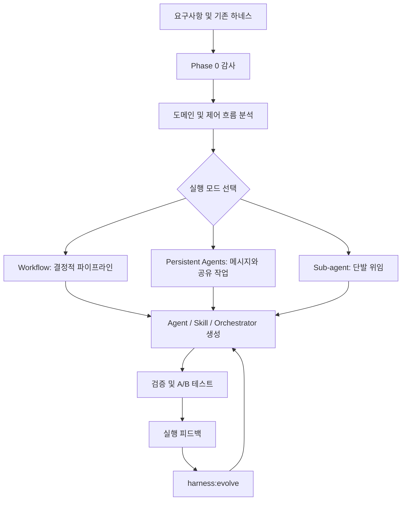

# Harness v2 (revfactory)

> 프로젝트의 업무 흐름을 분석해 Claude Code Agent, Skill, Orchestrator를 설계·검증·개선하는 메타 하네스.

## 프로젝트 개요
revfactory의 Harness v2.1.0은 Claude Code 플러그인으로, 프로젝트 요구사항을 전문 Agent 팀과 실행 Skill로 전환한다. Apache 2.0 라이선스이며, 기존 구성을 감사하고 확장하거나 v1에서 마이그레이션할 수도 있다.

## 해결하려는 문제
매 프로젝트마다 Agent 역할, 실행 순서, 컨텍스트 전달, 검증 및 운영 규칙을 수작업으로 구성해야 하는 부담을 줄인다. 팀 인원수보다 작업의 제어 흐름을 기준으로 실행 방식을 고르는 것이 핵심 아이디어다.

## 핵심 기능
- 기존 .claude/agents, .claude/skills, CLAUDE.md 감사 및 중복 검사
- Pipeline, Fan-out/Fan-in, Expert Pool, Producer-Reviewer, Supervisor, Hierarchical Delegation 패턴
- Progressive Disclosure 기반 Skill 생성 및 최소 CLAUDE.md 포인터
- 실행 모드별 오류 처리, 데이터 전달, 재개 설계
- 호출 조건 평가, Dry Run, With-Skill/Baseline A/B 테스트
- /harness:evolve를 통한 피드백 기반 개선
- v1 TeamCreate/TeamDelete 및 실험 플래그 마이그레이션

## 아키텍처


실행 모드는 Workflow 스크립트(pipeline/parallel/schema/budget), 지속형 Agent(이름·SendMessage·공유 작업), 일회성 Sub-agent 위임의 세 가지다. 필요하면 단계별로 혼합한다. 산출물은 .claude/agents/*.md, .claude/skills/*/SKILL.md, CLAUDE.md의 최소 호출 조건 및 변경 이력이다.

## 설치 및 사용
Claude Code에서 다음을 실행한다.

```text
/plugin marketplace add revfactory/harness
/plugin install harness@harness-marketplace
```

사용 예: '하네스 구성해줘', '하네스 회고해줘'.

## 장점
- 신규 구축, 기존 구성 확장, 유지보수 및 v1 마이그레이션 지원
- 역할과 작업 절차를 분리하고 중복 Agent 생성을 방지
- 결정적 처리와 장기 협업을 분리해 제어 흐름을 명시
- 모델별 난이도 기반 선택 정책으로 무분별한 최고급 모델 고정을 방지
- 테스트와 개선 루프를 기본 절차에 포함

## 단점 및 한계
- 생성된 하네스의 성능 우위 및 토큰 절감은 프로젝트별 검증이 필요
- 병렬 Agent와 교차 검증이 오히려 비용·지연·복잡도를 늘릴 수 있음
- Claude Code 런타임 및 기능 제공 상태에 종속
- Windows, Enterprise, Perforce/TeamCity 연동의 실측 호환성은 확인되지 않음
- 생성 Skill 및 스크립트의 권한·보안 리뷰 필요
- README의 v1 저자 측정 15개 과제 평균 품질 49.5→79.3은 v2 독립 검증 결과가 아님

## 활용 사례
1. 신규 저장소에 분석/구현/QA Agent 팀과 Skill 구축
2. 기존 하네스의 중복 역할과 오래된 API 감사
3. 정적 대량 검증을 Workflow로, 반복 설계 리뷰를 지속형 Agent로 분리
4. 실행 실패와 사용자 피드백을 harness:evolve에 반영

## 기존 도구와 비교
- 수동 CLAUDE.md/Skill 구성은 통제력이 높지만 초기 설계와 유지보수 비용이 큼.
- 고정 Agent 템플릿은 빠르게 시작하지만 프로젝트별 제어 흐름 설계가 제한적.
- Harness v2는 분석→설계→검증→진화라는 하네스 생성 과정 자체에 초점을 둠.

## 활용 아이디어
- **바로 적용 가능:** 역할/Skill 책임 분리, 중복 감사, 검증 체크리스트.
- **PoC 가치 있음:** 수동 하네스·Harness v2 생성 하네스·단일 Agent를 동일 작업에서 성공률/토큰/비용/소요 시간/재작업으로 비교.
- **아이디어 참고:** Perforce/TeamCity 작업 흐름에 적합한 실행 모드 선택과 회고 자동화.
- **현재 도입 가치 낮음:** 승인과 검증 없이 생성 설정을 운영 환경에 자동 교체.

## 결론
Harness v2는 하네스 실행기보다는 하네스 설계와 개선을 자동화하는 메타 계층으로 유용하다. 제한된 코드베이스에서 PoC 후 확장 권장.

## 참고 자료
- https://github.com/revfactory/harness
- https://github.com/revfactory/harness/blob/main/README.md
- https://github.com/revfactory/harness/blob/main/skills/harness/SKILL.md
