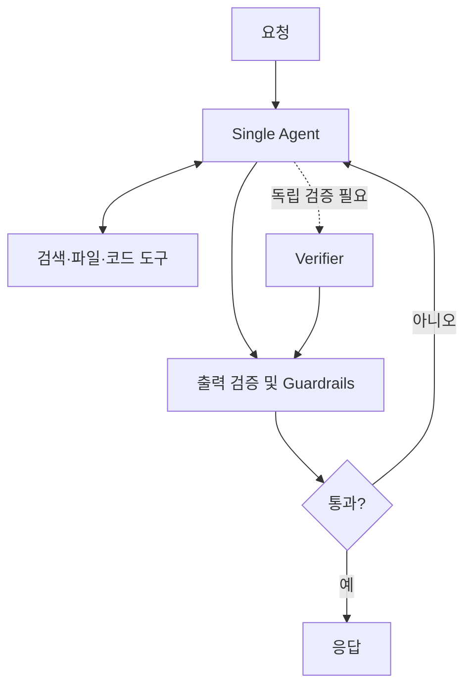

# Single Agent Loop와 서브에이전트 축소 설계

## 요약
2026-10-25 제공된 ASAP 인스타그램 카드뉴스 캡처 6장(전체 7장 중 표지 및 2~6장)을 분석한 기록. 카드뉴스는 Anthropic의 설계 조언을 인용해 복잡한 다중 에이전트 파이프라인 대신 명확한 시스템 프롬프트, 소수 도구, 출력 가드레일로 구성한 단일 에이전트 루프를 먼저 검토하라고 설명한다. **원본 Anthropic 문서의 정확한 URL 및 원문은 미확인**이므로 공식 권고와 수치의 독립 검증은 보류한다.

## 이미지에서 확인한 주장
1. 의도 분류기, 고정 5단계 추론, 사용자 세그먼트 분기, 추천 분기 등 다층 구조를 하나의 루프와 4~5개 도구로 단순화한다.
2. 서브에이전트 축소 방식: (a) 공유 맥락이 큰 에이전트 통합, (b) 서브에이전트를 결과 반환 도구처럼 호출, (c) 반복 프롬프트를 Skill/Tool로 전환.
3. 역할별 분할(구현→테스트 작성→리뷰)은 핸드오프마다 컨텍스트가 유실될 수 있다. 구현과 테스트 작성은 같은 에이전트에 맡기고 독립 실행 검증은 Verifier로 분리하는 패턴을 제시한다.
4. 서브에이전트 적합 조건: 컨텍스트 격리, 병렬 처리, 별도 도구 선택 및 프롬프트 지시가 필요할 때.
5. 카드뉴스의 고객 사례 주장: 실행 약 2배 개선, Claude Code 시스템 프롬프트 80% 이상 감소, Opus 4.5부터 단일 프롬프트 처리 역량 증가. **측정 조건·실험 설계·원문 미검증**이며 보편적 효과가 아니다.

## 설계 비교

| 기준 | 다단계 멀티에이전트 | 단일 Agent Loop |
|---|---|---|
| 컨텍스트 | 역할 간 전달·요약 필요 | 대화 내 공유 가능 |
| 병렬 처리 | 독립 작업에 유리 | 기본적으로 순차적 |
| 운영 복잡성 | 라우팅·복구·관찰성 추가 | 상대적으로 단순 |
| 검증 | 독립 검증자 배치 용이 | 외부 검증 단계 별도 필요 |
| 적합성 | 독립 탐색·격리·권한 분리 | 긴밀하게 연결된 실행 작업 |

## 제안 구조 (원본 구현도가 아닌 적용 예시)

## 실무 적용
- 기존 워크플로우의 서브에이전트별 입력/출력, 공유 컨텍스트, 권한, 병렬 실행 여부를 먼저 표로 작성한다.
- 동일 코드·결정 배경을 공유하는 구현/테스트 작성 단계는 통합 PoC를 수행한다.
- 반복적인 지침은 Skill로, 단순 API 호출은 Tool로 옮긴다.
- 품질 검증·권한 격리·병렬 탐색은 필요할 때만 별도 Agent로 남긴다.
- 변경 전후 동일 태스크 세트에서 성공률, 지연 시간, 토큰 비용, 오류 복구율을 측정한다.

## 출처 및 한계
- 1차 제공 자료: 사용자 업로드 인스타그램 스크린샷 6장, ASAP(@ai.asap.kr), 조사일 2026-10-25.
- 카드뉴스 내 출처 표기: 'Claude 공식 아티클' (정확한 문서명 및 URL 미제공).
- 스크린샷은 7장 중 1~6장에 해당하며 마지막 7장은 제공되지 않았다.
- 공식 문서 직접 대조 전까지 수치와 인용의 진위를 확정하지 않는다.
