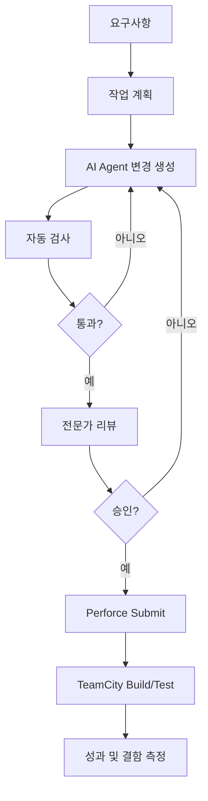

# 아정당 AX Builder 조직 전환 사례

> AI 도입의 성패는 코드 생성량보다 책임, 검증 게이트, 조직 운영 방식에 달려 있다.

## 프로젝트 개요
국내외 기업의 AI 중심 업무·개발 조직 전환 사례를 종합한 조사 자료다. 단일 도구 소개보다 조직 설계 및 실제 운영 방식 비교에 초점을 둔다.

## 해결하려는 문제
AI 코딩으로 구현 속도가 높아져도 품질 책임, 전문가 역할, 권한 경계와 고객 가치 측정이 불분명하면 실질 생산성이 높아지지 않는다.

## 핵심 기능 및 발견
- 생성과 승인·배포 권한을 구분한다.
- AI 자율성이 증가할수록 자동화된 품질 게이트를 강화한다.
- 제너럴리스트 확대와 전문성 유지를 병행한다.
- AI 도구를 기존 업무 트리거에 통합한다.
- 코드량보다 리드타임·결함률·고객 성과를 측정한다.

## 아키텍처
다음은 원문에 등장하는 특정 회사의 구현도가 아닌 실무 적용 제안이다.

## 장점
- 도구 보급보다 운영 모델을 강조한다.
- 성공뿐 아니라 실패 및 운영 방식 수정에서 교훈을 얻을 수 있다.
- Agent Harness의 권한 분리 및 품질 게이트 설계에 유용하다.

## 단점 및 한계
- 종합 사례 자료는 2차 분석이므로 개별 수치와 인과관계는 원문 대조가 필요하다.
- 조직 규모·산업·규제 차이로 일반화에 한계가 있다.
- Windows, Unreal Engine, Perforce 환경에서 직접 검증된 결과는 확인되지 않았다.
- 통일된 비용·토큰·ROI 벤치마크는 확인되지 않았다.

## 활용 사례
Perforce·TeamCity 기반 AI Coding Harness에서 AI 변경 생성과 실제 Submit 권한을 분리하고, CI 실패 시 자동 차단하며, 위험 변경에 전문가 승인을 요구한다.

## 기존 방식과 비교
| 항목 | 단순 AI 도구 보급 | 게이트 중심 AX |
|---|---|---|
| 실행 | 개인별 도구 사용 | 업무 흐름에 AI 통합 |
| 검증 | 사후 수동 점검 | 자동 검사 및 리뷰 |
| 권한 | 포괄적 접근 | 생성·승인·배포 분리 |
| 성과 | 코드 생성량 | 품질 및 실제 결과 |

## 활용 아이디어
- **바로 적용 가능:** Agent Submit 권한 분리 및 CI 검증 강제.
- **PoC 가치 있음:** 위험도별 리뷰 게이트 및 자동 복구.
- **아이디어 참고:** 비개발자의 저위험 내부 자동화 참여.
- **도입 신중:** 검증 체계 없는 직군 전면 통합.

## 결론
AI 도입은 직군을 없애는 것이 아니라 자율성의 범위, 검증 책임, 성과 지표를 다시 설계하는 과정이다.

## 참고 자료
- https://ajd-builder-cases.netlify.app/
