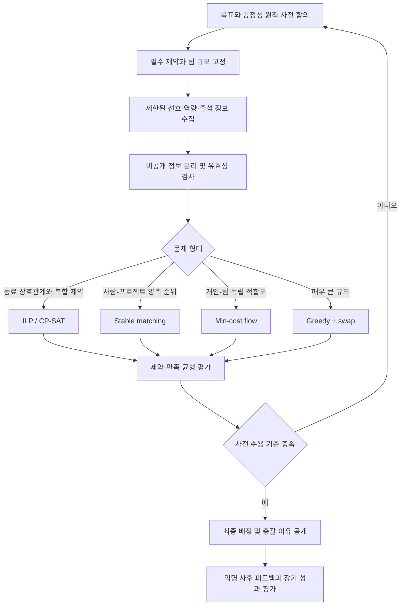

# 최대 다수의 만족을 위한 공정한 팀 편성

> 2026-11-23 심층 리서치에 기반한 위키용 재구성 보고서. 조직의 프로젝트 팀, 교육팀, 행사팀, 동호회·스포츠팀에 적용할 수 있도록 공정성의 철학부터 실제 최적화 모델까지 연결한다. 학술적 원리와 실무 설계 제안은 구분해 기술한다.

## 핵심 결론

팀 편성은 인원을 균등하게 나누는 단순 조합이 아니라 **개인의 선호와 집단의 목표가 충돌하는 집단 의사결정 문제**다. “가장 많은 사람이 만족하는 편성”이라는 목표조차 (a) 만족하는 사람의 수, (b) 전체 만족 점수의 합, (c) 가장 불만족한 사람의 보호, (d) 팀 성능의 균형 중 무엇을 우선하는지에 따라 서로 다른 해를 낳는다. 따라서 **알고리즘보다 공정성의 우선순위를 먼저 합의**해야 한다.

실무 기본안은 **명시적 필수 제약 → 불만족 인원 최소화 → 최소 개인 만족도 최대화 → 전체 만족도 최대화 → 팀 간 실력 편차 최소화**의 사전식(lexicographic) 최적화다. 단, 스포츠 경기에서는 승부 균형이 핵심이므로 팀 간 실력 편차를 필수 제약 또는 더 높은 우선순위로 올려야 한다. 이는 보편적 수학 정리가 아니라 목표에 따른 정책 제안이다.

대칭적인 사람↔사람 선호와 팀 내 관계가 중요하다면 **hedonic games(쾌락적/선호 기반 연합 게임)** 와 **coalition formation(연합형성)** 가 이론적으로 가장 직접적이다. 실제 구현에서는 팀 크기, 실력, 역할, 함께 배치 불가, 선호를 함께 표현할 수 있는 **정수계획(ILP/MILP) 또는 OR-Tools CP-SAT**가 범용적이다. 사람↔프로젝트의 양면 선호에는 안정적 매칭, 사람↔팀의 독립적인 적합도에만 집중할 때는 최소비용 흐름이 효율적이다.

## 1. '공정한 팀'의 서로 다른 정의

| 원칙 | 편성 문제로 번역 | 장점 | 한계 |
|---|---|---|---|
| 공리주의적 총효용 | 전체 만족도 합을 최대화 | 전체 효율이 높음 | 소수에게 극단적인 불만이 집중될 수 있음 |
| 만족자 수 최대화 | 개인 만족도 ≥ 기준인 사람 수를 최대화 | “최대한 많은 인원”에 가장 직접적 | 임계값 바로 위/아래의 차이를 과도하게 반영 |
| Rawls에서 영감을 얻은 약자 우선 | 가장 불리한 구성원의 상태 개선 | 최악의 결과에 민감 | Rawls의 원래 차등원칙을 팀 편성에 그대로 적용한 것은 아님 |
| Max-min | 개인 만족도의 최소값을 최대화 | 심한 불만을 방지 | 최저점이 같은 해들을 구별하지 못함 |
| Leximin | 만족도를 낮은 순서대로 정렬해 사전식 최대화 | 최저점, 두 번째 최저점 순서로 보호 | 계산 및 해석 복잡 |
| Nash social welfare | 양(+)의 효용 증가분 곱을 최대화 | 효율·분배의 절충 | 효용의 기준점과 척도 선택이 중요 |
| Pareto 효율 | 타인을 악화시키지 않고 누군가를 더 좋게 할 수 없는 상태 | 명백히 개선 가능한 배정 제거 | 어떤 파레토 효율적 배정이 더 공정한지는 말해주지 못함 |
| Envy-freeness | 남의 배정을 자기 것보다 탐내지 않음 | 직관적인 사후 검사 지표 | 팀은 사람이 재화인 단순 배분과 달라 직접 제약으로 적용 곤란 |
| 안정성 | 개인 또는 집단이 팀 이탈·재편으로 모두 이득 보는 상황 억제 | 배정의 수용성·지속성 고려 | 안정적 편성이 존재하지 않을 수 있음 |

**사회선택이론의 함의:** 개인 선호를 집단 선택으로 모으는 데에는 원리적 충돌이 있다. Arrow의 불가능성 정리와 Gibbard–Satterthwaite 정리는 각각 특정한 가정 아래 선호 집계의 완전한 공정성·전략방지에 한계를 보인다. 이 정리들을 팀 편성에 문자 그대로 적용해서 “모든 팀 편성은 조작 가능하다”라고 단정하면 안 된다. 하지만 **만족 기준의 투명한 사전 합의와 조작 유인 관리가 필요**하다는 경고로는 유용하다.

## 2. 선호를 수학적으로 표현하기

구성원 집합 N={1,…,n}, 팀 집합 T={1,…,k}, 배정을 P라 한다. i가 j와 같은 팀일 때의 *방향성 있는* 선호를 w[i,j]로 두자. i는 j를 선호하지만 j는 i를 선호하지 않을 수 있으므로 w[i,j]와 w[j,i]는 일반적으로 다르다.

가산형(additively separable) 예시:

```text
utility(i, P) = sum over j != i of
                w[i,j] * indicator(team(i) == team(j))
```

양수는 함께하고 싶은 관계, 음수는 회피, 0은 중립이다. 실제 만족도는 사람 간 선호뿐 아니라 자신의 역할, 관심 주제, 시간대 및 팀 능력 균형을 포함할 수 있다.

```text
u_i = α * peer_preference_i
    + β * role_fit_i
    + γ * project_fit_i
    + δ * schedule_fit_i
    - λ * avoid_violation_i
```

중요: (1) 각 항의 척도를 정규화하고, (2) β·γ 등의 가중치를 **배정 전에** 정하며, (3) 직장·스포츠·교육의 정책 우선순위를 구별해야 한다. 선호의 합은 실제 인간 만족도의 완벽한 측정치가 아니라 **의사결정 모델**이다. 특히 팀원 간 시너지·갈등이 단순 가산형을 벗어날 수 있다.

## 3. 배정 전 정해야 할 강한 제약과 부드러운 선호

- **Hard constraints(반드시 지킬 조건):** 1인 1팀; 팀별 최소·최대 인원; 안전상·조직상 불가한 조합; 필수 역할/기술; 참석 가능 시간. 불가피하게 충돌하면 “가능한 배정이 없다(infeasible)”고 보고하고 제약 자체를 재검토한다.
- **Soft constraints(선호/벌점):** 같이하고 싶은 팀원, 약한 회피, 역할 적합성, 팀 평균 숙련도 차이, 최근 반복된 같은 팀 배치, 신규 관계 형성.
- **실력 균형:** 팀 총점이나 평균점의 **최대-최소 차이**를 제한하거나, 각 팀의 예상 기량이 전체 목표치에서 벗어난 절대편차 합을 최소화한다. 스포츠에서는 이 지표가 단순 개인 만족도보다 중요할 수 있다.
- **반복 편성의 공정성:** 한 번의 만족뿐 아니라 지난 여러 차례의 팀 배정, 강팀 경험, 희망 팀원 충족 빈도를 함께 측정한다. 단발성 파레토 효율성은 장기 형평성을 보장하지 않는다.

## 4. 대표 이론: 어떤 문제에 적합한가

### 4.1 Hedonic games / coalition formation

개인의 선호는 **자신이 속한 그룹의 구성**에 따라 달라진다. 연합 S에 대한 효용을 u_i(S)라 할 때 가산형으로는 u_i(S)=sum_{j∈S, j≠i} w[i,j]를 사용할 수 있다.

- **Core stability:** 어떤 그룹도 기존 팀을 떠나 새 연합을 만들 때 그룹 구성원 모두가 엄격하게 이득을 보지 못함.
- **Individual stability:** 누군가 다른 팀으로 옮겨 이득을 보는 동시에 받아들이는 팀의 기존 구성원도 피해가 없는 이동이 없음.
- **Nash stability:** 다른 팀으로 일방적으로 옮겨 본인의 효용을 높일 수 없음(받는 팀의 동의를 요구하지 않는 형태).

이 세 정의는 서로 다른 안정성 개념이며 모든 선호 구조에서 안정해의 존재가 보장되지는 않는다. 실제 팀 정원이 고정되어 있으면 한 사람만 이동할 수 없으므로 **1:1 교환(swap)**, 여러 명의 순환 교환 등 적법한 편성 변경을 따로 정의해야 한다.

핵심 문헌: Banerjee, Konishi & Sönmez (2001); Bogomolnaia & Jackson (2002); Yekta, Bergman & Day (2022/23).

### 4.2 Stable matching

Gale–Shapley deferred acceptance는 두 측(예: 사람↔프로젝트, 학생↔기관)이 서로의 순위를 매기는 구조에 특히 적합하다. 서로 현재 배정보다 선호하는 미매칭 쌍(blocking pair)이 없는 안정적 해를 구한다. 한쪽 제안자가 유리한 안정적 해를 구한다.

그러나 동료가 서로 동등한 자격으로 3~6인 팀을 이루는 **다자 그룹 형성**을 Gale–Shapley의 1:1 매칭으로 그대로 풀 수는 없다. 팀 슬롯별 독립 선호로 모델링할 수 있을 때에만 적합하다.

### 4.3 Fair division / Nash welfare

정량화된 개인 효용 u_i와 명시적 기준점 d_i를 두고 이득 g_i=u_i-d_i>0인 경우, Nash welfare는 Π_i g_i 또는 Σ_i log(g_i)를 최대화한다. 낮은 이득을 가진 사람의 상대적 개선을 중시한다. 다만 점수의 원점을 임의로 이동시키면 선택 결과가 바뀔 수 있다. 만족도 척도와 기준점에 대한 합의 없이 임의 상수를 더하는 방식은 결과 설명에 부적절하다.

Envy-free, EF1, EFX는 불가분 재화 배분 연구에서 발전한 개념이다. 동료 팀 편성에서는 팀이 동시에 타인의 효용을 결정하므로 그대로 가져오기보다 **다른 팀에 들어갔을 때의 반사실적 만족 차이(envy gap)** 를 사후 진단하는 편이 낫다.

## 5. 실용 알고리즘 비교

| 기법 | 좋은 용도 | 주의점 |
|---|---|---|
| **ILP/MILP** | 조합 제약 + 복수 목적 + 팀원 간 관계 | 일반 문제는 계산 난도가 큼 |
| **CP-SAT** | Boolean 배정, 금지 조합, 팀원 수, 기술 요건, 단계별 최적화 | 목표와 제약을 정수로 표현해야 함 |
| Min-cost max-flow | 사람→팀의 독립적 적합도와 인원 정원 | 팀원 쌍 시너지의 직접 표현이 어려움 |
| Balanced graph partition | 친밀도·협업관계 그래프를 비슷한 팀 크기로 나누기 | 실력·역할·희망사항을 따로 보정해야 함 |
| Greedy + local swap/search | 빨리 초기안을 만들고 교환으로 개선 | 전역 최적성 보장 없음 |
| Stable matching | 사람↔프로젝트/역할의 양측 선호 | 동료끼리 다자 팀을 꾸리는 문제와 다름 |

### 5.1 ILP/CP-SAT 기본 모델

이진변수 x[i,t]=1 ⇔ i가 팀 t에 속함.

```text
for each person i:
    sum_t x[i,t] == 1

for each team t:
    lower[t] <= sum_i x[i,t] <= upper[t]

for each forbidden pair (i,j), each team t:
    x[i,t] + x[j,t] <= 1

for each required skill s, each team t:
    sum_i skill[i,s] * x[i,t] >= requirement[t,s]
```

한 팀에 있는 쌍을 y[i,j,t]=x[i,t] AND x[j,t]로 선형화한다.

```text
y <= x[i,t]
y <= x[j,t]
y >= x[i,t] + x[j,t] - 1
u[i] = sum_{j != i, t} w[i,j] * y[i,j,t]
```

개인별 불만 기준 τ[i]와 불만 플래그 d[i]∈{0,1}를 두면

```text
u[i] >= τ[i] - M * d[i]
minimize sum_i d[i]
```

여기서 M은 모델에서 가능한 최저 효용 범위를 덮는 **타당하고 가능한 작은 상한**이어야 한다. 과도하게 큰 M은 수치적·계산상 문제를 만들 수 있다.

### 5.2 사전식 다목적 최적화

권장하는 구현 패턴:

```text
STEP 0: 모든 hard constraint를 충족하는 배정 존재 여부 검사
STEP 1: 불만족한 개인 수 D를 최소화하여 최적값 D* 확정
STEP 2: D == D* 고정, 최저 개인 만족도 z를 최대화하여 z* 확정
STEP 3: D == D*, z == z* 고정, 전체 만족도 sum(u_i) 최대화
STEP 4: 앞의 최적값을 유지하며 팀 간 능력 편차 최소화
STEP 5: 동점이라면 재현 가능한 난수 seed로 결정
STEP 6: 최종 제약 충족 및 개인·팀별 지표 재계산
```

이 절차는 순위가 높은 목표의 개선을 후순위 목표와 임의의 가중치로 맞바꾸지 않는다. 다른 조직 목적에는 우선순위를 변경할 수 있으며, **팀 기량 균형을 첫 단계의 허용 편차 제약**으로 넣는 방법이 특히 유용하다.

### 5.3 규모별 현실적 전략

- **10~30명:** 가능한 배정의 수는 커도 CP-SAT/ILP로 다뤄볼 만하다. 다만 실행시간은 제약과 선호 구조에 따라 달라진다.
- **수십~수백 명:** CP-SAT/ILP에 시간 제한을 주고 feasible/best bound/optimality gap을 기록한다. 무조건 정확한 최적해가 나온다고 보장하지 않는다.
- **대규모/응답 즉시:** 제한조건을 지킨 greedy 초기안 → 랜덤 재시작 → 1:1 swap/다자 이동 → 필요하면 CP-SAT 후처리.

## 6. '최다 만족'과 '최저 만족 보호'가 충돌하는 예

6명 A~F를 3명씩 두 팀으로 편성한다고 하자. 아래 수치는 **이론 설명용 임의 예시**이며 실제 설문 데이터가 아니다.

| 평가자 | A | B | C | D | E | F |
|---|---:|---:|---:|---:|---:|---:|
| A | — | 1 | 2 | 3 | -3 | 0 |
| B | 3 | — | 2 | 3 | 3 | -3 |
| C | -2 | -3 | — | 2 | 3 | 0 |
| D | -2 | 1 | 1 | — | 2 | -3 |
| E | -1 | 3 | 1 | 0 | — | 2 |
| F | 3 | -2 | -3 | -1 | -3 | — |

- 편성 X = {A,C,F}, {B,D,E}; 개인 점수 (2,6,-2,3,3,0), 합계 **12**, 최소 **-2**, 0점 미만 **1명**.
- 편성 Y = {A,B,F}, {C,D,E}; 개인 점수 (1,0,5,3,1,1), 합계 **11**, 최소 **0**, 0점 미만 **0명**.

**합계 최대화**만 보면 X, **불만족자 수 최소화 또는 최저점 우선**이면 Y가 낫다. 따라서 “최대한 많은 사람이 만족”을 엄격히 구현하려면 만족 기준 τ를 정하고 *그 이상인 인원 수를 먼저 최대화*하는 것이 목표에 맞다. 다만 실제 스포츠 팀에서는 양팀 승부력 균형을 동시에 고려해야 한다.

## 7. 설문 설계와 전략적 응답 관리

사람들에게 모든 동료를 1~10점으로 평가하게 하는 것은 부담이 크고 사람마다 점수 기준이 달라 불공정해질 수 있다. 다음과 같은 **제한된 선택지 + 역할 정보**가 더 운영하기 쉽다.

1. 이번 팀에서 함께하고 싶은 사람 **최대 3명**을 순위대로 선택(미기재 허용).
2. 함께 편성되면 현실적으로 어려운 사람 **최대 2명**을 비공개로 선택(민감 정보이므로 선택사항, 필요시 별도 중재).
3. 선호 역할·포지션, 할 수 있는 역할, 숙련도 수준을 선택.
4. 출석·시간 제약 및 꼭 지켜야 할 배치 조건을 제출.
5. 새 사람과 함께하는 것에 대한 선호를 선택(항상 친한 사람끼리 고정되는 현상 완화).
6. 최근 몇 회의 배정이 만족스러웠는지 사후 익명 피드백 제출.

점수 변환 예: 1순위 +5, 2순위 +3, 3순위 +2. **이 수치는 설계 예시**이며 학술적으로 유일하게 옳은 값이 아니다.

일반적인 선호 집계에서 모두의 전략적 허위 응답을 원천 차단하기는 어렵다. 그러나 선택 인원 제한, 각 사용자의 총 투표 가중치 제한, 비공개 응답, 사전 공개된 규칙, 사후 만족도 측정, 극단 점수 방지로 조작 유인을 완화할 수 있다. 안전상의 회피 요청을 일반 선호 투표와 같은 방식으로 가볍게 취급해서는 안 된다.

## 8. 데이터 보호와 절차 공정성

사람↔사람 회피 응답은 관계에 위해를 줄 수 있는 민감 정보다.

- 원시 선호·회피표는 운영진 전체에 보여주지 말고 최소권한의 별도 저장소에 암호화해 보관한다.
- 배정 엔진에는 필요한 불가 조합 제약만 제공하고, 공개 출력은 팀 구성과 총괄 지표로 제한한다.
- 불가능한 제약이 있더라도 “누가 누구를 거절했다”는 식으로 공개하지 않는다.
- 사전 고지된 보관기간 종료 후 원시 응답을 삭제하고, 남길 필요가 있다면 익명화된 통계만 남긴다.
- 차등프라이버시는 공개 통계의 보호에 유용할 수 있지만 **개인별 배정 자체의 프라이버시를 자동 보장하는 마법 같은 해결책은 아니다**.
- 모델의 가중치·금지 조건의 범주·이의 신청 절차를 사전에 설명하는 **절차적 공정성**이 핵심이다.

## 9. 스포츠·동호회에서의 권장 모델

재미와 승부의 공정성이 모두 필요한 주간 축구·풋살 편성에는 다음과 같은 조합을 제안한다.

| 우선순위 | 지표 | 실무 구현 |
|---|---|---|
| 필수 | 인원 수와 참가 가능 상태 | 팀당 동일 인원, 참석 확정 인원만 배정 |
| 필수 | 명시적인 분리 요청 | 동일 팀 배치 불가 |
| 높음 | 팀 실력 균형 | 팀별 선수 능력 합 차이 제한 |
| 높음 | 개인 불만 최소화 | 선호 위반 수 및 불만 인원 최소화 |
| 중간 | 전체 구성원 만족 | 희망 동료 충족과 개인 만족도 합 |
| 중간 | 장기 형평성 | 지난 4~8회 배정 반복도, 팀 강도 편차 |
| 보조 | 무작위성·다양성 | 동점 시 seeded random, 새로운 조합 가산점 |

예를 들어 **3팀×5명**, 능력 점수는 선수별 1~5, 특정 세 명이 서로 같은 팀이 되지 않아야 한다면 각 팀에 최대 1명만 들어가도록 hard constraint를 작성한다. 팀 실력 합 차이는 상한을 두고, 이후 선호 충족을 최적화한다. 실력 점수 자체가 주관적이면 개인 평가 노출을 피하고 최근 경기 데이터나 여러 운영진의 집계 점수를 활용한다.

**공정한 배정과 강한 팀 만들기는 다른 목적**이다. 우승 가능성이 높은 팀을 한 개 만드는 것이 아니라 서로 경기할 여러 팀을 구성한다면, “최고 팀 성능”보다 **팀 간 예상 성능 격차 최소화**가 적합하다. 반복 편성에서 개인의 평균 경험까지 관리하면 한 번의 불만을 장기적으로 상쇄할 수 있다. 단, 단순 반복 배정을 이유로 안전·강한 회피 제약을 해제해서는 안 된다.

## 10. 운영 플로우와 검증



최소 검증 항목은 (a) 중복/누락 인원 0명, (b) 팀별 인원 조건 충족, (c) 금지 조합 위반 0건, (d) 팀 능력 차이 허용 범위 이내, (e) 불만 인원 수와 최소/평균 만족도, (f) 솔버 상태 FEASIBLE/OPTIMAL·시간 제한, (g) 이전 배정 대비 개선 정도다.

## 11. 장기 개선·A/B 검증 아이디어

무작위 배정, 실력균형 우선, 선호최대화, 계층적 공정 배정을 **같은 실제 참가자 데이터**에 적용해 오프라인으로 비교한다. 출력값으로 팀 실력 차, 불만 예상 인원, 최저 만족도, 연속 재배정 빈도, 반복 조합률을 확인한다. 현장에서는 사후 1~5점 만족, 편성에 대한 수용성, 경기 접전도 및 재참석률 등 동의된 지표를 추적한다.

단순히 만족 점수가 높은 팀이 실제 더 즐겁거나 성과가 좋다는 인과관계를 바로 주장해서는 안 된다. 참가자 결석, 경기력 변동, 기존 친분, 설문 응답 편향 등을 함께 고려한다.

## 12. 핵심 문헌·도구 (원문 링크)

1. Stanford Encyclopedia of Philosophy, [Social Choice Theory](https://plato.stanford.edu/entries/social-choice/) — 선호 집계와 불가능성 정리 개관.
2. Stanford Encyclopedia of Philosophy, [Rawls의 Difference Principle 설명](https://plato.stanford.edu/archives/fall2024/entries/original-position/difference-principle.html) — 최약자 우선 원칙의 원래 맥락.
3. Nash, J. F. (1950), [The Bargaining Problem](https://ideas.repec.org/a/ecm/emetrp/v18y1950i2p155-162.html) — Nash bargaining.
4. Gale & Shapley (1962), [College Admissions and the Stability of Marriage](https://doi.org/10.1080/00029890.1962.11989827) — 안정적 매칭.
5. Varian (1974), [Equity, Envy, and Efficiency](https://www.sciencedirect.com/science/article/abs/pii/0022053174900751) — 공정분배·효율.
6. Banerjee, Konishi & Sönmez (2001), [Core in a Simple Coalition Formation Game](https://ideas.repec.org/a/spr/sochwe/v18y2001i1p135-153.html) — 연합 형성.
7. Bogomolnaia & Jackson (2002), [The Stability of Hedonic Coalition Structures](https://eprints.gla.ac.uk/86597/) — 동료 그룹 편성 안정성.
8. Lappas, Liu & Terzi (2009), [Finding a Team of Experts in Social Networks](https://d3ccyth396mz21.cloudfront.net/publications/finding-a-team-of-experts-in-social-networks) — 능력과 협업 네트워크 기반 팀 구성.
9. Caragiannis et al. (2019), [The Unreasonable Fairness of Maximum Nash Welfare](https://eprints.gla.ac.uk/198815/) — Nash welfare와 불가분 자원 공정분배.
10. Yekta, Bergman & Day, [Balancing Stability and Efficiency in Team Formation as a Generalized Roommate Problem](https://onlinelibrary.wiley.com/doi/full/10.1002/nav.22084) — 팀 편성의 안정성·효율 동시 최적화.
11. Cutshall, Gavirneni & Schultz (2007), [Indiana University’s Kelley School of Business Uses Integer Programming to Form Equitable, Cohesive Student Teams](https://pubsonline.informs.org/doi/abs/10.1287/inte.1060.0248) — 실제 정수계획 편성 사례.
12. Google OR-Tools, [CP-SAT Solver](https://developers.google.com/optimization/cp/cp_solver) / [Minimum Cost Flow](https://developers.google.com/optimization/flow/mincostflow) — 구현 문서.
13. Kernighan & Lin (1970), [An Efficient Heuristic Procedure for Partitioning Graphs](https://onlinelibrary.wiley.com/doi/10.1002/j.1538-7305.1970.tb01770.x) — 그래프 분할·교환 기반 개선.
14. 국내, [팀워크 능력 배양을 위한 팀 구성법](https://koreascience.kr/article/JAKO201711656706849.pdf) — 학생 팀 편성과 협력에 관한 국내 자료.
15. 국내, [알고리즘 추천 시스템의 공정성 확보를 위한 시론적 연구](https://www.kci.go.kr/kciportal/ci/sereArticleSearch/ciSereArtiView.kci?sereArticleSearchBean.artiId=ART002765448) — 알고리즘 공정성의 사회적 수용성.
16. [Integer programming approaches to the multiple team formation problem](https://www.sciencedirect.com/science/article/pii/S0305054821001325) — 여러 팀 동시 구성의 최적화 모델.

---

**한 줄 원칙:** 모두가 원하는 팀을 보장하려 하기보다, 무엇을 절대 희생할 수 없는지 미리 결정하고, 불만이 한 사람에게 집중되지 않도록 제약과 효율을 함께 최적화하며, 그 절차를 설명 가능하게 만든다.
