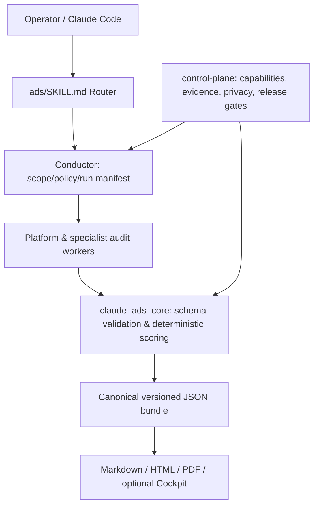

# Claude Ads

> 12개 광고 플랫폼의 데이터를 근거 중심으로 감사하고 캠페인 계획·소재·개선 초안을 작성하는 Claude Code 기반 Agent Skill.

## 프로젝트 개요
MIT 오픈소스 광고 운영 Skill. 광고 대행사, 컨설턴트, 사내 마케팅팀을 대상으로 한다. Claude Code가 공식 검증 호스트이며 Codex/Gemini/Cursor 등은 실험적 설치 대상이다. 조사 기준: 2026-10-22, 원본 README 및 핵심 Skill/코드 확인.

## 해결하려는 문제
플랫폼마다 분산된 광고 데이터, 측정 오류, 수작업 성과 진단, 출처 없는 최적화 판단을 통합된 근거 기반 감사 워크플로우로 정리한다.

## 핵심 기능
- `/ads setup`: 비즈니스 목표·전환·계정·권한 설정
- `/ads audit [all|platform|scope]`: 플랫폼별 감사
- `/ads plan`, `/ads budget`: 전략 및 예산 기획
- `/ads create`: 카피·콘셉트·브리프; `/ads generate`는 별도 설정된 제공자로 이미지 생성
- `/ads monitor`, `/ads optimize --draft`: 모니터링 및 개선 초안
- `/ads experiment`, `/ads report`: 실험 설계·결과 및 보고서
- 지원: Google, Meta, YouTube, LinkedIn, TikTok, Microsoft, Apple, Amazon, Reddit, Pinterest, Snapchat, X.

## 아키텍처

`ads/`는 엔트리포인트, `skills/`는 기능별 지침, `agents/`는 플랫폼·전문 Worker, `claude_ads_core/`는 검증/스코어링/어댑터, `control-plane/`은 안전·근거·릴리스 정책을 담당한다. 독립 작업만 분산하며 필수 Worker 실패는 partial run으로 표시한다. 결과는 pass/fail/unknown/not_applicable로 구분한다.

## 장점
- 증거 기반 결과와 데이터 누락을 명시하여 근거 없는 결론을 억제.
- 단일 명령 체계로 다중 광고 플랫폼 분석.
- 승인 없는 계정 변경 금지, 변경 전후 diff/권한/멱등성/롤백 요구.
- JSON 정규 결과와 다중 보고 형식, 플랫폼별 Skill 모듈화.

## 단점 및 한계
- 개발 후보 상태: 12개 계정 건강도 점수 프로필 비활성화, 완성형 점수 제공 불가.
- 플랫폼별 실시간 읽기/쓰기 능력은 capability manifest에서 별도 검증해야 함.
- 데이터 export·스크린샷 또는 승인된 어댑터 입력 필요; 자동 계정 연결 보장 불가.
- Claude Code 외 호스트는 실험적. Python 3.11/3.12, 네이티브 종속성 및 OS별 테스트 제약.
- LLM 토큰/실행 비용, 민감한 광고 계정 정보 취급, 최신 광고 정책 확인 부담.
- 광고주 지출 캠페인 관리용으로 AdMob/AdSense 게시자 수익 최적화 전용 도구가 아님.

## 활용 사례
- Google Ads 계정 CSV를 이용한 비용·전환 추적 진단.
- 여러 채널 광고 성과의 근거 중심 월간 보고서.
- 앱 설치 캠페인 소재 가설 및 A/B 테스트 설계.
- 캠페인 변경안을 사람의 승인 전까지 draft로 유지.

## 기존 도구와 비교
Google Ads/Meta Ads Manager는 각 플랫폼의 실제 계정 관리 UI/API이고 Claude Ads는 여러 플랫폼의 데이터 분석 및 권고를 통합하는 상위 Skill 계층이다. 직접적인 대체재가 아닌 보완재다.

## 활용 아이디어
- **바로 적용 가능:** 익명화한 CSV로 `/ads audit` 및 `/ads report` 평가.
- **PoC 가치 있음:** 앱 설치 유도 캠페인의 카피 생성, 실험 설계, 예산 제안.
- **아이디어 참고:** Conductor-Worker 분업, canonical JSON, evidence coverage, mutation gate를 다른 Agent Harness에 도입.
- **현재 도입 가치 낮음:** 무인 광고비 변경과 AdMob 수익 최적화에 직접 사용.

## Quick Start
Claude Code 플러그인:
```text
/plugin marketplace add agricidaniel/claude-ads
/plugin install claude-ads@ai-marketing-hub-claude-ads
/claude-ads:ads setup
```
설치 후 계정 export 등 증거 자료를 제공한다. API 키를 프롬프트에 붙여넣지 않는다.

## 결론
분석·보고·소재 기획에는 유용한 PoC 대상이다. 릴리스 게이트와 실계정 변경 기능이 검증되기 전에는 광고 자동 집행 시스템으로 취급하지 않는다.

## 참고 자료
- [GitHub README](https://github.com/AgriciDaniel/claude-ads/blob/main/README.md)
- [Skill contract](https://github.com/AgriciDaniel/claude-ads/blob/main/ads/SKILL.md)
- [Release requirements](https://github.com/AgriciDaniel/claude-ads/blob/main/control-plane/RELEASE_REQUIREMENTS.md)
- [Scoring implementation](https://github.com/AgriciDaniel/claude-ads/blob/main/claude_ads_core/scoring.py)
