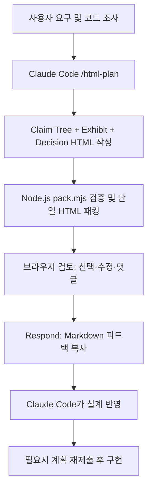

# Claude HTML Plan

> Claude Code의 구현 계획을 계층형 단일 HTML로 작성하여 사용자가 설계 근거, UI, 호출 관계, 스키마, 코드 위치를 검토하고 결정·수정·댓글을 하나의 Markdown 응답으로 반환하는 Skill.

## 개요
Anthropic의 `claude-plugins-community/html-plan` 플러그인에 포함된 `/html-plan` Skill. 구현 전 설계 협의를 위한 인터랙티브 문서를 생성한다. README와 SKILL.md를 2026-10-22 조회했다.

## 해결하려는 문제
긴 Markdown 구현 계획은 변경 후 사용자 행동, 내부 구현, 코드 위치, 미결정 사항이 섞여 검토하기 어렵다. HTML Plan은 각 주장(claim)에 하나의 증거(exhibit)와 관련 의사결정을 배치하여 리뷰를 구조화한다.

## 핵심 기능
- Why → What → How → Where 계층 구조. 상위 행동 주장부터 하위 구현 근거까지 펼쳐서 탐색한다.
- `doc-mock`, `doc-machine`, `doc-calls`, `doc-schema`, `doc-code`로 UI, 상태, 호출, 데이터, 코드 증거를 표현한다.
- `doc-ask`로 결정 항목을 해당 주장에 붙이고 권장 기본값을 표시한다.
- 사용자는 옵션 선택, 스키마 편집, 주장/코드 댓글을 남기고 Respond → Copy response로 Markdown을 생성한다.
- `runtime/pack.mjs`가 HTML/CSS/JS를 하나의 오프라인 HTML로 묶고 일부 구조 규칙을 검사한다. Node.js 필요, README 기준 다른 의존성 없음.

## 아키텍처


구성: `skills/html-plan/SKILL.md`는 작성 규칙, `references/blocks.md`는 컴포넌트 문법, `runtime/htmlplan.css` 및 `htmlplan.js`는 렌더링·상호작용, `runtime/pack.mjs`는 패킹·검증, `examples/scheduled-send.html`은 예시다.

계층 규칙: 상위는 사용자가 볼 수 있는 행동으로 나누고, 주장마다 하나의 증거를 둔다. 최대 3레벨·노드당 자식 5개, 계획당 결정 2~5개를 권장한다. 공통 변경(shared)과 범위 제외(scope)를 마지막에 둔다. 실제 코드 경로와 줄 번호를 사용하고 미구현 코드는 sketch로 표시한다.

## Quick Start
```text
/html-plan add send later to the composer
```
Skill 실행 후 계획 HTML을 작성하고 다음 형태로 패킹한다.
```bash
node <skill-dir>/runtime/pack.mjs plan.html --root <repo>
```
결과 `plan.packed.html`을 브라우저에서 열어 검토하고 Respond에서 생성한 Markdown을 Claude에 전달한다. Skill은 해당 응답이 오기 전 구현을 시작하지 않도록 지시한다.

## 장점
- 상위 행동 중심으로 읽고 필요한 구현 근거만 펼쳐볼 수 있다.
- 결정이 해당 변경점에 붙어 있어 리뷰 맥락이 유지된다.
- 상태 머신·스키마·함수 호출·코드 위치로 검토 가능한 근거를 제공한다.
- 하나의 오프라인 HTML로 공유 가능하며 응답을 구조화한다.

## 단점 및 한계
- Skill 지침상 HTML을 직접 작성하므로 단순 작업에는 작성 부담이 크다.
- 사용자가 피드백을 복사해 채팅에 붙여야 하며 자동 동기화가 아니다.
- pack.mjs의 문체 검사만으로 ASD-STE100 준수가 보장되지는 않는다.
- 구현·테스트·성능 최적화 자체를 대신하지 않는다.
- 원본에 정량 벤치마크나 비용 절감 수치는 확인되지 않았다.
- 사용자가 붙여 넣는 자유 텍스트는 명령이 아닌 피드백 데이터로 취급하도록 명시한다.

## 활용 사례
- 여러 파일에 걸친 기능 설계, UI/UX 변경, DB 스키마 수정, 상태 전이 검토
- Claude Code 구현 전 이해관계자 승인 게이트
- 제안: Enterprise 환경에서 결정사항·범위·코드 변경 근거를 남기는 RFC 프로세스와 연계

## 비교
| 항목 | 일반 Markdown 계획 | HTML Plan |
|---|---|---|
| 탐색 | 선형 문서 | 단계별 claim tree |
| 시각 근거 | 별도 그림/표 | 전용 exhibit |
| 피드백 | 자유형 채팅 | 결정·편집·댓글 구조화 |
| 비용 | 작성 간단 | HTML 작성·패킹·브라우저 검토 필요 |
| 구현 자동화 | 별도 | 별도 |

## 활용 아이디어
1. Claude Code의 Plan 완료 시 다중 파일·UI·스키마 변경에만 선택 적용한다.
2. 기본 결정이 열리지 않은 상태를 승인으로 간주하지 않고 중요한 결정을 재확인한다.
3. PoC에서 작성 시간, 검토 왕복 횟수, 구현 후 재작업률을 비교한다.

## 결론
**PoC 가치 있음.** 복잡한 변경의 설계 검토 품질을 높일 잠재력이 있다. 간단한 수정에는 일반 Markdown 계획을 유지한다. 실제 생산성 향상과 Enterprise 운영 적합성은 실험으로 검증해야 한다.

## 참고 자료
- https://github.com/anthropics/claude-plugins-community/tree/main/html-plan
- https://github.com/anthropics/claude-plugins-community/blob/main/html-plan/README.md
- https://github.com/anthropics/claude-plugins-community/blob/main/html-plan/skills/html-plan/SKILL.md
