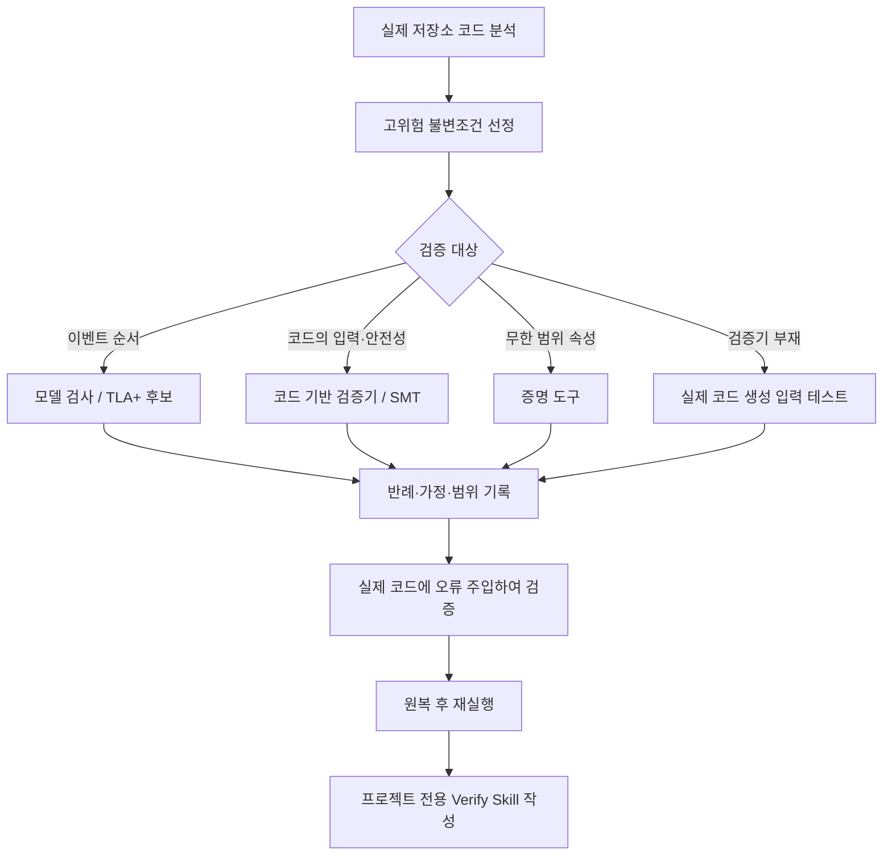

# Cursor Create Formal Verification Skill

## 한줄 요약
코드에서 테스트가 놓치기 쉬운 고위험 불변조건을 골라 적합한 형식 검증 도구로 확인하고, 검증을 반복할 수 있는 프로젝트 로컬 Skill을 생성하는 Cursor 플러그인 Skill.

## 개요
Cursor 공식 `cursor/plugins` 저장소의 `pstack/skills/create-formal-verification-skill/SKILL.md`에 정의된 Skill이다. 호출 예시는 `/create-formal-verification-skill`, “model-check this race”, “prove this invariant”이다. 원본 frontmatter의 `disable-model-invocation: true`는 자동 모델 호출을 비활성화한다.

## 해결하려는 문제
단위 테스트는 작성된 사례만 검사하므로 동시성 실행 순서, 재시도, 상태 머신, 파서, unsafe 코드의 특정 실패를 놓칠 수 있다. 이 Skill은 실제 코드에서 실패 영향이 큰 속성을 선택하고 모델·경계·가정을 명시해 검증한다.

## 핵심 기능
1. 코드베이스를 읽고 영향이 크면서 테스트가 닿기 어려운 불변조건 선정
2. 문제 유형에 맞춰 모델 검사기, SMT 기반 검증기, 증명 보조기 등을 선택
3. 실행 순서 검증에는 언어와 무관하게 작은 설계 모델의 TLA+를 기본 후보로 고려
4. 코드 자체의 오버플로·메모리 안전성·자료구조 불변조건은 실제 코드 기반 검증을 우선
5. 적절한 검증기가 없다면 생성 입력으로 실제 코드를 테스트하고, 손으로 만든 함수 모델을 코드 검증인 것처럼 제시하지 않음
6. 모델의 각 단계와 실제 코드의 원자적 동작을 대응시키고 검증 범위와 한계를 기록
7. 의도적으로 실제 코드를 깨뜨리는 scratch 변경으로 검증 실패를 확인한 뒤 원복
8. 커버하는 파일·함수, 마지막 동기화 commit, 실행 명령, 버전, 재검증 방법을 프로젝트 로컬 Skill에 남김

## 아키텍처 및 실행 흐름

원본 Skill의 지침을 요약한 실행 흐름이며 특정 프로젝트에서 실제로 검증을 수행한 결과는 아니다.

## 장점
- 테스트가 놓치는 실행 순서·상태 조합을 정해진 모델 범위에서 탐색
- 실제 코드와 모델 간 대응을 명시해 검증 결과의 추적 가능성 강화
- 반드시 깨진 변경을 탐지하게 하여 형식적인 통과 검사를 방지
- 단일 명령, 도구 버전, 동기화 커밋으로 반복 검증과 인수인계 용이
- 기존 코드에 결함이 발견되면 속성을 약화시키지 않고 반례를 보고

## 단점과 한계
- 모델의 추상화·원자성 가정이 실제 구현과 다르면 통과해도 실제 버그가 남을 수 있음
- 유한 경계 검증은 모든 크기의 안전성을 증명하지 않음
- 도구 설치·학습·검증 유지보수 비용이 발생
- 코드 변경 시 검증 모델과 Skill의 동기화가 필요
- 이 문서는 Skill 정의 분석이며 실제 대상 코드에서 실행한 벤치마크나 성능 수치는 확인되지 않음

## 활용 사례
- Agent 오케스트레이션의 중복 작업 실행, 재시도 및 상태 전이
- TeamCity 빌드 큐·Perforce 워크스페이스 잠금과 병렬 실행의 안전성
- DB 트랜잭션의 중복 생성·경쟁 조건
- 작업 취소·실패 복구 시 자원 정리와 상태 일관성

## 기존 방식 비교
| 구분 | 일반 테스트 | 이 Skill이 지향하는 검증 |
| --- | --- | --- |
| 입력/순서 | 작성된 테스트 사례 | 명시된 모델·경계 안의 가능한 경우 |
| 실패 설명 | assertion 및 로그 | 반례 실행 순서와 불변조건 |
| 유지보수 | 테스트 코드 | 검증 산출물 + 프로젝트 Skill + 동기화 커밋 |
| 주의점 | 커버리지 사각지대 | 모델 충실도·가정·경계의 한계 |

## 활용 아이디어
첫 PoC는 작업 상태가 `queued → running → succeeded/failed`로 이동하는 Agent 재시도 로직을 대상으로 한다. 같은 작업 ID가 동시에 두 번 성공 처리되지 않는다는 불변조건을 정의하고, 실제 구현의 원자적 경계와 대응시켜 검증한다. 검증이 잘못된 코드 변경을 탐지하는지 확인한 뒤 CI의 선택적 검증 단계로 연결한다. 이는 적용 제안이며 원본 프로젝트가 제공하는 즉시 실행 가능한 통합 기능은 아니다.

## 결론
**PoC 가치 있음.** 동시성·상태 머신·재시도 등 결함 비용이 큰 코드에 우선 적용한다. 일반 UI와 단순 CRUD 전체에 일괄 도입하는 것은 비용 대비 효용을 별도로 판단한다.

## 참고 자료
- [원본 Skill](https://github.com/cursor/plugins/blob/main/pstack/skills/create-formal-verification-skill/SKILL.md)
- [Cursor plugins 저장소](https://github.com/cursor/plugins)
