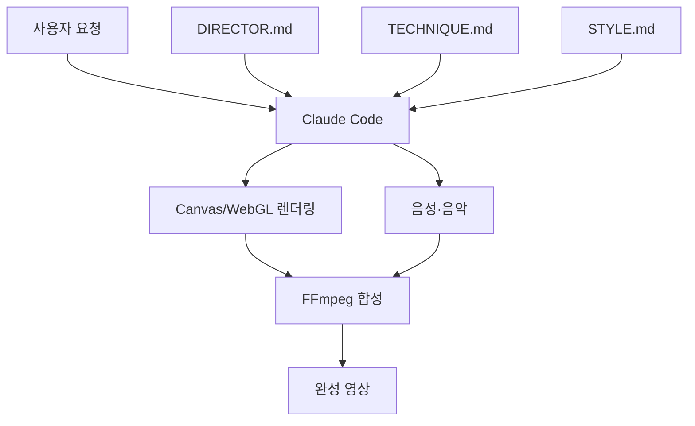

# Lemo-Opuscar

## 한줄 요약
Claude Code가 스타일 지침을 따라 Canvas/WebGL 렌더링 코드를 작성해 모션그래픽 영상을 만드는 프로젝트.

## 개요와 해결 문제
영상 생성 모델 대신 코드를 생성하여 텍스트, 도형, 타이밍과 디자인을 세밀하게 제어한다. 프로젝트 소개 기준 59종 스타일을 제공하며 Claude Opus 5.5 중심으로 설계되었다.

## 핵심 기능
- 스타일별 제작 지침과 예시 영상
- Canvas/WebGL 프레임 렌더링
- FFmpeg 인코딩 및 음성·음악 합성
- 사용자 정의 스타일 재사용
- 기본 출력 1920×1080, 24fps (프로젝트 안내 기준)

## 아키텍처

개념적 실행 흐름이며 내부 함수 단위 호출 순서는 추가 확인이 필요하다.

## 장점
- 타이포그래피와 데이터 시각화의 정밀한 코드 제어
- 스타일과 생성 코드를 재사용할 수 있음
- 기술 설명 영상과 앱 홍보에 적합

## 단점과 한계
- 제작자 안내 기준 영상당 약 30~60분이 걸릴 수 있으며 토큰 비용이 큼
- Opus 5.5 외 모델에서 재현성 불확실
- 실사 장면 제작에는 부적합할 수 있음
- Windows 및 Enterprise 환경의 호환성과 실제 비용·실패율은 미검증
- 오디오 및 외부 자산 라이선스 별도 확인 필요

## 활용 사례
AI Wiki 조사 결과를 30~60초 기술 설명 영상으로 자동 변환하거나 앱 홍보용 모션그래픽을 제작할 수 있다.

## 비교
| 방식 | 강점 | 한계 |
|---|---|---|
| Lemo-Opuscar | 정밀한 코드 기반 제어 | 토큰·렌더링 시간 |
| 생성형 영상 모델 | 자유로운 장면 생성 | 텍스트·도형 정밀 제어 어려움 |
| 수작업 모션그래픽 | 높은 편집 통제 | 제작 인력 필요 |

## 활용 아이디어 및 결론
동일한 30초 스크립트를 세 가지 스타일로 생성해 토큰·제작시간·품질·오류율을 측정한다. **판정: PoC 가치 있음.**

## 참고 자료
- https://github.com/lemomo-ai/lemo-opuscar
- https://lemomo-ai.github.io/lemo-opuscar/
