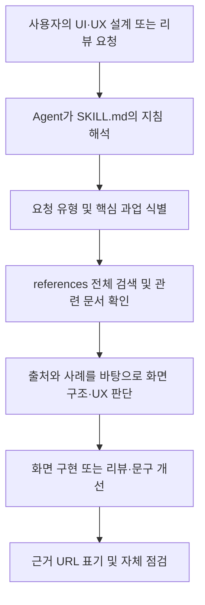

# Toss Design Skill v2

> **요약:** [Ilbie/Toss-Design-Skill](https://github.com/Ilbie/Toss-Design-Skill)은 toss.tech의 공개 디자인 아티클에서 UX 설계 판단 기준을 뽑아 AI 코딩 에이전트에 제공하는 **비공식 Agent Skill**이다. 토스의 화면·브랜드를 복제하는 컴포넌트 라이브러리가 아니라, 출처 기반으로 화면 구조·문구·퍼널·접근성·제품 판단을 돕는 지식 및 지침 모음이다.

- 조사 날짜: 2026-11-23
- 원본 저장소: https://github.com/Ilbie/Toss-Design-Skill
- 확인 버전: `SKILL.md`의 v2 (2026-11-21), 최근 확인 커밋 `af3d3dd54eab795b300967d98d64a2a94deeec86`
- 공개 저장소 현황(조사 당시): Stars 113, Forks 13
- 상태: 공식 Toss 배포물 아님. Toss(비바리퍼블리카)와 제휴·승인 관계 없음.

## 해결하려는 문제

AI로 화면을 만들 때 스타일만 모방하거나 예쁜 컴포넌트를 조합하면, 사용자의 과업·정보의 우선순위·에러 복구·접근성 등 실질적 UX 품질을 놓치기 쉽다. 이 스킬은 공개 디자인 사례에서 추출한 판단 기준과 원문 URL을 연결해, 에이전트가 설계 선택의 이유를 설명하도록 유도한다.

## 저장소 구성과 작동 방식

- `SKILL.md`: Skill 메타데이터, 핵심 원칙, UI 제작 단계, 상황별 참조 파일 라우팅, 출처 표기 및 금지 사항.
- `references/`: 디자인 원칙, 문제 해결, 제품 의사결정, UX Writing, 퍼널, 시각 스타일, 접근성, 리서치, 실험, 협업, B2B/내부 도구 등의 주제별 문서 21개와 `sources.md` 출처 목록.
- `images/`: README에서 사용한 버전 비교 이미지.
- `README.md`: 설치 방법·용도·비공식성·라이선스 범위.



**작동 방식의 한계:** 위 흐름은 `SKILL.md`에서 안내하는 문서 기반 작업 절차이며, 별도의 실행 엔진이나 외부 API, 자동 품질 평가가 확인된 것은 아니다. 실제 Skill 탐색·적용 여부는 사용 에이전트의 Skill 지원 및 설정에 달려 있다.

## 핵심 설계 원칙

1. **한 화면에 하나:** 하나의 화면에서 메시지와 핵심 행동을 명확히 한다.
2. **가치 먼저, 비용 나중:** 가입·입력·동의 전에 사용자가 얻는 가치를 제시한다.
3. **단계를 줄이는 것을 우선:** 불편한 절차를 개선하기 전에 해당 절차를 없앨 수 있는지 확인한다.
4. **사용자가 이해하는 오류:** 에러가 발생한 이유와 복구 방법을 사용자 언어로 설명한다.
5. **가설을 검증:** 제작자의 직관보다 프로토타입·사용성 조사·실험을 활용한다.
6. **접근성과 윤리:** 시니어·스크린리더 사용자 등 다양한 사용자를 고려하고 다크패턴을 점검한다.

개별 원칙과 사례의 출처는 원본 `SKILL.md` 및 연결된 `references/` 파일을 통해 검증해야 한다.

## 설치 및 사용

```bash
npx skills add Ilbie/Toss-Design-Skill
```

README는 Claude Code, Codex, OpenCode를 사용 맥락으로 제시한다. 설치 명령은 `skills` CLI를 실행하므로 네트워크 접근 및 패키지 실행 정책을 먼저 확인한다.

예시 작업:
- "사내 업무 요청 등록 화면의 필드를 줄이고 핵심 과업에 맞춰 구조를 검토해 줘."
- "결제 실패 안내 문구에 원인·해결 방법이 포함됐는지 점검해 줘."
- "기존 관리자 화면의 접근성, 클릭 단계, 다크패턴을 평가하고 근거 URL을 제시해 줘."

## 비교와 적용 판단

| 항목 | Toss Design Skill | 일반적인 UI 컴포넌트 라이브러리 |
| --- | --- | --- |
| 주된 산출 가치 | 설계 판단 기준·사례·출처 | 재사용 UI 구현체 |
| 중심 콘텐츠 | Markdown 지침 및 참고 자료 | 코드 컴포넌트·스타일·테마 |
| UX 문구·제품 결정 | 핵심 사용 영역 | 별도 지침 필요 |
| 즉시 사용 가능한 컴포넌트 코드 | 확인되지 않음 | 일반적으로 제공 |
| 유의점 | 원문 출처·상표·맥락 구분 | 코드 라이선스 및 프레임워크 호환성 |

### 강점
- 화면 생성 이전에 과업·정보 구조·사용 흐름을 설계하도록 유도한다.
- UX 라이팅과 접근성까지 포괄해 한국어 업무 서비스의 리뷰 체크리스트로 활용하기 좋다.
- 판단에 관련 글 제목과 URL을 붙이도록 요구하므로 결과 검토와 지식 추적에 유리하다.
- `internal-tools-b2b.md`를 포함해 관리자·사내 시스템 UX에 연결할 여지가 있다.

### 한계·주의
- README의 v1.3/v2 결과 비교는 제작자가 제시한 예시이지 독립된 실험·벤치마크가 아니다.
- 공개 아티클에서 도출한 지침은 실제 Toss 내부 디자인 시스템 전체를 의미하지 않는다.
- `references/` 문서가 크며, `SKILL.md`는 UI 제작 시 광범위하게 검색·정독하도록 지시한다. 따라서 Agent 환경에서 토큰 소비·실행 시간이 늘 수 있다.
- 프로젝트의 MIT 표기는 저장소 작성자의 문서 범위에 적용되고, toss.tech 원문·이미지·상표까지 재라이선스하지 않는다. 상업적 재배포·문구 장문 인용은 별도 권리 검토가 필요하다.
- 원본 지침상 결과물에 Toss 명칭·로고·서비스명·전용 서체 등 브랜드 자산을 넣지 않는다.

## 실무 적용 제안

사내 업무 효율 개선 시 **화면을 예쁘게 만드는 보조 지침**보다 **업무 흐름 마찰을 제거하는 리뷰 지침**으로 쓰는 편이 효과를 측정하기 쉽다.

1. 작업 전 기존 사용자의 핵심 과업, 완료율, 필수 입력, 오류·재시도 단계를 기록한다.
2. 이 Skill로 입력 필드·단계·CTA·오류 문구·접근성을 검토하고 수정안을 생성한다.
3. 실제 사용자에게 과업 성공률, 완료 시간, 클릭·입력 횟수, 오류 재시도를 비교한다.
4. 근거 있는 규칙과 프로젝트에 맞게 임의 판단한 항목을 구분해 문서화한다.

**검증 필요:** 실제 에이전트별 Skill 자동 로딩 정확도, UX 개선의 재현성, 비용·토큰 사용량, 원문 출처 링크의 지속성은 이번 조사에서 실측하지 않았다.

## 참고 자료

- [GitHub 저장소](https://github.com/Ilbie/Toss-Design-Skill)
- [README](https://github.com/Ilbie/Toss-Design-Skill/blob/main/README.md)
- [SKILL.md](https://github.com/Ilbie/Toss-Design-Skill/blob/main/SKILL.md)
- [참고 문서 목록](https://github.com/Ilbie/Toss-Design-Skill/tree/main/references)
- [원문 출처 목록](https://github.com/Ilbie/Toss-Design-Skill/blob/main/references/sources.md)
- [LICENSE](https://github.com/Ilbie/Toss-Design-Skill/blob/main/LICENSE)
