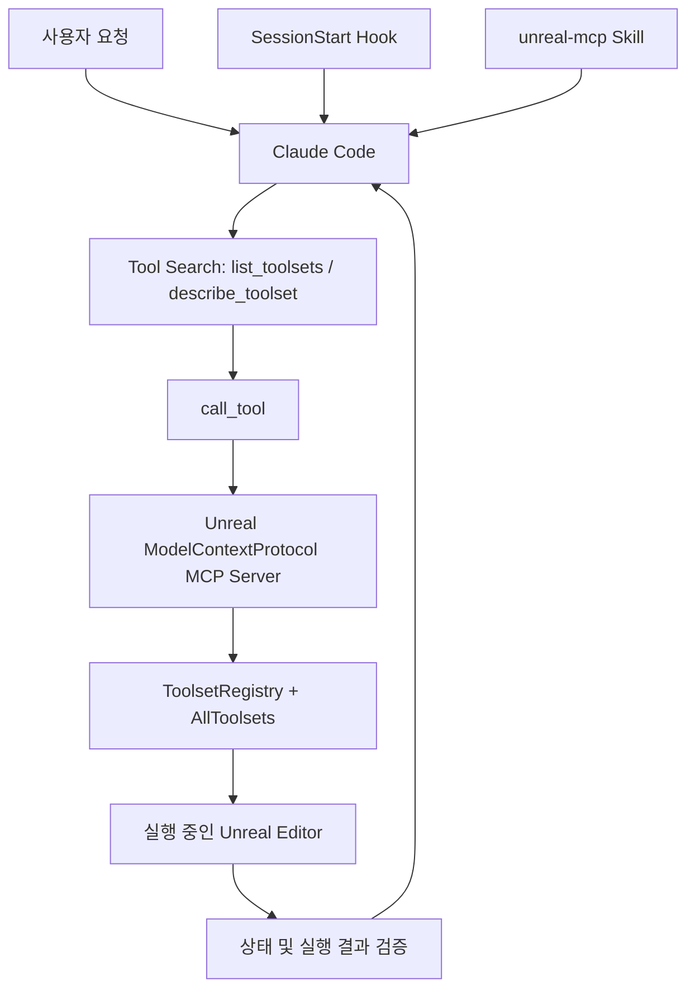

# Unreal Engine Skills for Claude Code

> Epic Games가 제공하는 Claude Code 플러그인으로, Unreal MCP 서버와 ToolsetRegistry를 이용해 실행 중인 Unreal Editor를 직접 조회·수정·검증한다.

## 프로젝트 개요

EpicGames 공식 공개 저장소. 확인된 plugin.json 버전 3.1.1, MIT 라이선스. Claude Code 측의 Skill 및 SessionStart Hook을 제공한다. 실제 Editor 기능은 Unreal Engine의 별도 ModelContextProtocol 및 AllToolsets 플러그인에 의존한다. 플러그인 설치만으로 Editor 도구가 활성화되지는 않는다.

## 해결하려는 문제

기존 코딩 에이전트는 UE C++ 파일은 수정할 수 있어도 Blueprint, Level, Material, Sequencer 등 Editor 내부 상태를 직접 다루기 어렵다. 이 플러그인은 MCP로 실제 Editor 객체를 조회하고 조작하는 경로를 제공한다.

## 핵심 기능

- Actor 생성·이동·조회·삭제, Blueprint 그래프 편집 및 컴파일
- 에셋 검색·저장·이동·복제, Material 및 Niagara 작업
- Control Rig, Sequencer, State Tree, Behavior Tree, GAS, UMG
- C++ Automation Test 및 Editor 로그·스크린샷 조회, Live Coding
- SessionStart Hook을 통한 Unreal 문맥 주입
- Unreal Agent Skill 조회 및 프로젝트별 Skill 재사용

## 아키텍처

MCP 서버는 기본적으로 세 메타 도구만 노출한다. 필요한 Toolset 스키마를 동적으로 조회하여 컨텍스트 사용을 줄이고 프롬프트 캐시를 유지하는 방식이다. 실제 절감량은 미측정. 기본 주소는 localhost:8000/mcp이며 Editor에서 `ModelContextProtocol.StartServer` 실행 또는 자동 시작 설정이 필요하다. 클라이언트 설정은 `ModelContextProtocol.GenerateClientConfig ClaudeCode`로 생성한다. 선택적 proxy는 Editor 재시작 중 MCP 연결 유지에 활용되나 연결 상태만으로 실제 Editor 접근을 보장하지 않는다.

## 장점

- 코드 외 Unreal Editor 작업까지 자연어 자동화 가능
- 필요한 도구만 탐색하는 Tool Search로 컨텍스트 효율 개선 가능
- 읽기·수정·컴파일·결과 확인의 반복 루프 구성 가능
- 공식 Unreal 도구 기반이며 팀별 Skill 확장 가능

## 단점 및 한계

- 실행 중인 Editor, ModelContextProtocol, AllToolsets에 의존
- 강력한 쓰기 권한으로 에셋 삭제·이동 등 위험. 작업 전 저장·버전관리 체크포인트 필수
- 같은 에셋에 대한 동시 Agent 작업은 충돌 위험
- C++·Shader 컴파일 중 호출 실패·대기 가능, PIE 상태 영향
- Windows SessionStart Hook에는 Git Bash 또는 WSL 필요. PowerShell 전용 Hook은 확인되지 않음
- Perforce 체크아웃·Shelve, TeamCity 연동은 이 저장소의 자체 기능으로 확인되지 않음
- 엔진 버전별 호환 범위, 성능 및 토큰 절감 정량 벤치마크는 추가 검증 필요

## 활용 사례

1. 읽기 전용으로 Level Actor 및 Blueprint 구조 수집
2. 격리된 Sandbox에서 Blueprint 노드 수정→컴파일→로그 확인
3. 자동화 테스트 실행 후 실패 항목 구조화
4. Editor 에셋 상태를 리뷰 보조 자료로 수집

## 기존 도구와 비교

일반 Claude Code의 파일 편집과 달리 실시간 Editor 객체를 다룬다. 독립 MCP 서버 제품이라기보다 Unreal Engine MCP 기능을 Claude Code에 연결하는 Skill/Hook 패키지다.

## 활용 아이디어

- **바로 적용 가능:** 읽기 전용 Editor 조회, 테스트 결과 수집
- **PoC 가치 있음:** Blueprint 수정·컴파일·검증 루프
- **추가 개발:** p4-harness에 Perforce checkout→변경→검증→shelve→리뷰 승인 게이트 연결
- **현재 도입 가치 낮음:** 복구 지점 없이 대량 에셋 변경 또는 다중 Agent 병렬 쓰기

권장 검증: 동일 UE 프로젝트에서 수동 작업 대비 완료시간·실패율·토큰 사용량·에셋 복구 가능성을 측정하고, Perforce의 exclusive checkout 및 TeamCity 검증을 별도 게이트로 구성한다.

## 결론

UE5 작업환경의 에이전트 활용 범위를 코드에서 Editor 전체로 확장하는 유력한 공식 기반이다. 다만 팀 운영에서는 MCP 호출 권한, Perforce 변경 관리, 재현성 및 테스트 게이트가 별도로 필요하므로 읽기 전용부터 단계적으로 도입한다.

## 참고 자료

- https://github.com/EpicGames/unreal-engine-skills-for-claude-code-plugin
- https://github.com/EpicGames/unreal-engine-skills-for-claude-code-plugin/blob/main/README.md
- https://github.com/EpicGames/unreal-engine-skills-for-claude-code-plugin/blob/main/skills/unreal-mcp/SKILL.md
- https://github.com/EpicGames/unreal-engine-skills-for-claude-code-plugin/blob/main/skills/unreal-skill/SKILL.md
- https://github.com/EpicGames/unreal-engine-skills-for-claude-code-plugin/blob/main/.claude-plugin/plugin.json
