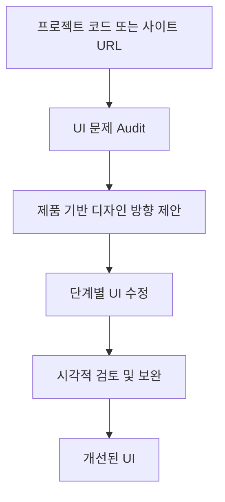

# Unslop — AI 생성 UI 디자인 개선 Skill

## 핵심 요약
Unslop은 Claude Code 및 Codex에서 AI가 생성한 획일적인 웹 UI를 진단하고 제품 정체성에 맞게 개선하는 Agent Skill이다. 소스 코드가 있는 React/Next.js/Vue/Svelte/Tailwind/HTML/CSS 프로젝트뿐 아니라 URL로 접근하는 라이브 사이트도 대상으로 안내한다.

## 해결 문제와 핵심 기능
- **Audit:** 보라색 그라데이션, Glow, 이모지 라벨, 과장된 카피, 불균형한 간격 등 전형적인 AI UI 패턴을 식별한다.
- **Direction:** 제품의 성격에 기반해 디자인 방향과 시그니처 디테일을 제안한다.
- **Passes:** 간격 → 색상 → 아이콘 → 카피 → 타이포그래피 → 레이아웃 → 디테일 → 비주얼 → 모션 순으로 검토한다.
- **Visuals:** 필요시 외부 이미지 생성 서비스와 연결한다. 유료 생성 전에 프롬프트를 보여주고 확인받는다고 README에 설명한다.
- **Story video:** Playwright와 ffmpeg를 사용해 10초 미만 정사각형 변환 영상을 만들 수 있다.

## 작업 흐름


이 흐름은 프로젝트 README의 설명을 정리한 것으로, 자동화된 품질 보증을 뜻하지 않는다.

## 설치
Claude Code 전역:
```bash
git clone https://github.com/heydamir/unslop
mkdir -p ~/.claude/skills
cp -r unslop/skills/unslop ~/.claude/skills/
```
프로젝트 범위는 `.claude/skills/`에 복사한다.

Codex:
```text
$skill-installer install https://github.com/heydamir/unslop/tree/main/skills/unslop
```
또는 `~/.agents/skills/` 및 프로젝트의 `.agents/skills/`에 복사한다.

라이브 사이트 스냅샷:
```bash
npm install -D playwright
npx playwright install chromium
```
스토리 영상에는 ffmpeg가 추가로 필요하다.

## 사용 예
```text
/unslop this dashboard
/unslop the hero of https://example.com
/unslop my landing page and make the story video
```
Codex에서는 `$unslop`으로 실행한다.

## 실무 평가
**적합:** 바이브 코딩으로 만든 관리자 화면, SaaS 랜딩페이지, 내부 업무 도구의 시각적 품질 개선. 기존 기술 스택을 유지하면서 점진적으로 적용할 수 있다.

**장점:** 문제를 먼저 지적하고 디자인 방향을 제안하므로 무조건적인 재설계를 줄일 수 있다. 코드 수정뿐 아니라 카피와 시각적 위계도 다룬다.

**제약:** 개선 품질은 에이전트 판단과 입력 UI에 좌우된다. 접근성, 반응형, 기능 회귀, 성능은 별도 검증이 필요하다. 라이브 사이트 캡처 및 외부 이미지 생성 시 개인정보·라이선스·API 비용을 점검해야 한다. Windows에서는 Unix 기반 복사 명령 대신 해당 셸 명령으로 변환해야 할 수 있다.

## 라이선스
CC BY 4.0. 상업적 이용 및 수정이 가능하지만 저작자 표시와 원본 링크 등 라이선스 조건을 준수해야 한다.

## 출처 및 확인
- 원본 저장소: https://github.com/heydamir/unslop
- Skill 경로: https://github.com/heydamir/unslop/tree/main/skills/unslop
- 조사일: 2026-11-02
- 확인 범위: GitHub README, 공개 저장소 구조, 설치·사용·라이선스 안내. 실제 프로젝트에 적용한 품질 테스트는 수행하지 않음.
