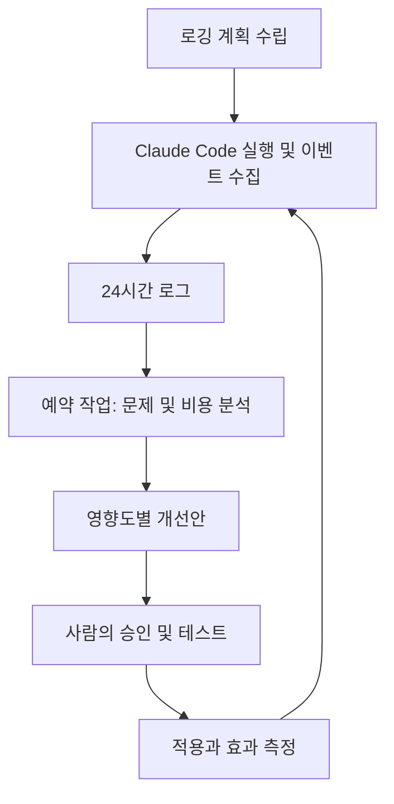

# Claude Code를 매일 개선하는 Two-Prompt 운영법

## 핵심 요약
2026-10-29 공유된 소셜 게시물 스크린샷에 따르면 Kun Chen이 소개한 방법은 (1) 사용자 경험·내부 실행·가시적 결과를 재구성할 수 있는 로깅 계획을 세우고 (2) 매일 최근 24시간 로그를 분석해 실패·사용자 마찰·비효율을 영향도 순으로 개선 제안하는 것이다. 원문 프롬프트 전문은 게시물에 포함되어 있지 않다. 이 문서의 프롬프트는 재구성 예시다.

## 작동 구조

## Prompt 1: 로깅 설계
> 현재 프로젝트를 분석하여 사용자 요청, 작업 단계, Tool 호출, 오류, 재시도, 최종 결과를 재구성할 수 있는 로깅 계획을 제안하세요. 이벤트별 timestamp, session_id, task_id, event_type, duration, status를 설계하고, 가능하면 Token·비용을 측정하세요. 기존 Hook과 Telemetry를 우선 활용하고 비밀정보·개인정보는 기록하지 마세요. 승인 없이 코드를 수정하지 마세요.

## Prompt 2: 일일 개선 분석
> 최근 24시간 로그에서 반복 오류, 불필요한 Tool 호출과 재시도, 사용자 마찰, Context/Token 낭비, 지연을 찾아 근거·발생 빈도·원인 가설·영향도·개선 비용·검증 방법을 제시하세요. 개선안을 우선순위별 Markdown 보고서로 작성하고 전일 결과와 비교하세요. 근거가 없는 주장은 가설로 표시하고 자동 수정하지 마세요.

## 운영 고려사항
- 로컬 로그가 필요한 경우 로컬 파일에 접근 가능한 Desktop Scheduled Task가 적합하다.
- 컴퓨터 종료 중 실행하려면 로그가 클라우드에서 접근 가능해야 한다. Cloud Scheduled Task가 로컬 파일을 자동으로 읽는다고 가정하지 않는다.
- 민감정보 마스킹, 접근 권한, 보존 기간, 로그 저장 비용을 설계한다.
- 자동 수정 대신 observe → propose → verify → promote → rollback 단계로 운영한다.
- 측정 지표: 성공률, 재시도율, 평균 실행 시간, Token 비용, 동일 오류 재발률.

## 확인된 내용과 한계
- 확인: 사용자가 제공한 게시물 이미지에 두 프롬프트 전략, 24시간 로그 분석, Desktop/Cloud 작업 구분, Telemetry 집계 제안이 기재되어 있다.
- 미확인: Kun Chen 원문 게시물의 전체 내용과 원본 프롬프트, 실제 개선 성능, Claude Code 버전별 Scheduled Task 지원 조건.
- 게시물의 좋아요 수는 성능 증거가 아니다.

## 출처
- 사용자 제공 Instagram 게시물 스크린샷 (2026-10-29 확인)
- 게시물에 기재된 원 출처: https://x.com/kunchenguid
- 게시물에 기재된 제품 사이트: https://code.claude.com
