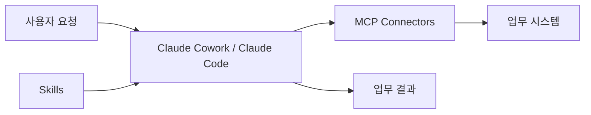

# Anthropic Knowledge Work Plugins

## 핵심 요약
Anthropic의 직무별 Claude 플러그인 오픈소스 모음이다. Claude Cowork용으로 제작됐으며 Claude Code와도 호환된다. 업무별 Skills, Commands, MCP Connectors 및 sub-agents를 묶어 조직에 맞춘 업무 수행 방식을 재사용한다.

## 주요 기능과 대상
공식 README는 11개 플러그인을 소개한다: productivity, sales, customer-support, product-management, marketing, legal, finance, data, enterprise-search, bio-research, cowork-plugin-management. 업무별로 문서 작성, 고객 대응, 분석, 검색, 재무 및 연구 작업을 지원한다.

## 구성
```text
plugin-name/
├── .claude-plugin/plugin.json
├── .mcp.json
├── commands/
└── skills/
```

- Manifest: 플러그인 메타데이터
- Skills: 자동 참조하는 도메인 지식과 업무 지침
- Commands: 사용자가 명시적으로 호출하는 슬래시 명령
- MCP Connectors: 외부 도구와 데이터 소스 연결
- Sub-agents: 플러그인에 따라 전문 작업 수행 구성 요소

### 개념적 실행 흐름
아래는 README의 구성 설명을 바탕으로 정리한 개념도이며 내부 런타임을 검증한 도식은 아니다.



## 설치
Claude Cowork는 https://claude.com/plugins 에서 설치한다. Claude Code는 다음 명령을 제공한다.

```bash
claude plugin marketplace add anthropics/knowledge-work-plugins
claude plugin install sales@knowledge-work-plugins
```

설치 후 관련 Skills가 자동으로 적용되며 명시적 명령도 사용할 수 있다(예: `/sales:call-prep`, `/data:write-query`).

## 장점
- 직무별 절차를 Markdown/JSON 파일로 버전 관리하고 공유할 수 있다.
- Skill의 업무 지침과 MCP의 외부 연결을 분리해 확장할 수 있다.
- 회사별 용어, 조직 구조, 프로세스, 도구 스택에 맞게 조정할 수 있다.

## 제약 및 검증 필요 사항
- 개별 플러그인의 실행 정확도·비용 절감·성능에 관한 정량적 근거는 README에 없다.
- 외부 커넥터의 권한·인증·민감정보 처리 및 프롬프트 인젝션 위험을 별도 검토해야 한다.
- Windows와 Enterprise 배포 환경에서의 실제 호환성 및 관리 정책은 PoC로 확인해야 한다.
- README의 파일 기반 구조 설명은 개별 커넥터가 별도 서버를 요구하지 않는다는 뜻은 아니다.

## 실무 적용 제안
1. productivity 또는 enterprise-search로 회의 준비·사내 정보 검색 업무를 시범 적용한다.
2. 반복 작업은 Skill, 명시적 트리거는 Command, 시스템 연동은 MCP로 분리한다.
3. 정확도, 실행 시간, 권한 오류, 재시도, 감사 로그, 사용 비용을 측정한다.
4. 커스터마이징한 지침은 코드 리뷰와 최소 권한 정책으로 관리한다.

## 분류 근거
개별 Skill보다 Anthropic의 독립적인 플러그인 프로젝트 자체를 설명하는 자료이므로 `ai/tools/`에 배치한다.

## 출처
- 공식 저장소: https://github.com/anthropics/knowledge-work-plugins
- 공식 README: https://github.com/anthropics/knowledge-work-plugins/blob/main/README.md
- 조사일: 2026-10-23
- 확인 범위: README의 제공 플러그인, 구성, 설치 안내. 개별 구현과 운영 성능은 미검증.
