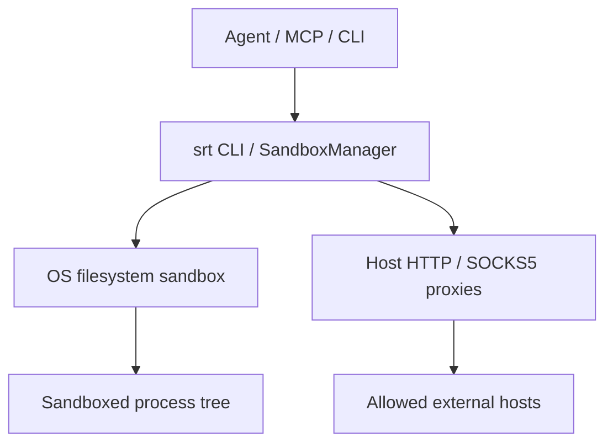

# Anthropic Sandbox Runtime (srt)

## 핵심 요약
Anthropic Sandbox Runtime은 AI 에이전트, MCP 서버 및 임의 프로세스를 OS 수준에서 격리하는 CLI/TypeScript 라이브러리다. 파일 읽기·쓰기와 네트워크 접근을 제한하며 컨테이너 운영을 필수로 요구하지 않는다. 프로젝트는 Beta Research Preview로 API 및 설정 변경 가능성이 있다.

## 해결 문제 및 기능
- 에이전트가 실행한 명령의 민감 파일 접근과 데이터 유출 위험 완화
- 파일시스템: denyRead/allowRead, allowWrite/denyWrite 정책
- 네트워크: 도메인 허용·거부 목록, HTTP 및 SOCKS5 프록시
- MCP 서버 명령 앞에 srt를 추가하여 격리 실행
- 위반 기록과 명령별 귀속, 실행 중 네트워크 정책 갱신 지원

## 구현 구조


플랫폼별 구현: macOS는 sandbox-exec/Seatbelt, Linux는 bubblewrap 및 네트워크 네임스페이스, Windows는 전용 로컬 사용자 계정·WFP 송신 필터·ACL을 사용한다.

## 사용법
```bash
npm install -g @anthropic-ai/sandbox-runtime
srt npm test
srt --settings /path/to/srt-settings.json npm install
```

MCP 설정 예:
```json
{"mcpServers":{"filesystem":{"command":"srt","args":["npx","-y","@modelcontextprotocol/server-filesystem"]}}}
```

정책 예:
```json
{
  "filesystem": {
    "denyRead": ["~/.ssh"],
    "allowWrite": ["."],
    "denyWrite": [".env"]
  },
  "network": {
    "allowedDomains": ["api.github.com"],
    "deniedDomains": []
  }
}
```

## 주의사항
- 기본 설정은 네트워크를 차단하고 쓰기 경로를 제한하지만, 읽기는 기본적으로 광범위하게 허용한다. 민감 경로를 별도 차단해야 한다.
- 네트워크 허용 도메인은 업무 필요 최소 범위로 관리한다.
- Windows는 토큰 변경이나 시스템 서비스가 대리 수행하는 통신 등 문서화된 우회 한계가 있어 별도 위협 모델과 검증이 필요하다.
- 연구 프리뷰이므로 고신뢰·Enterprise 환경에서는 릴리스 고정, 보안 테스트, 운영 모니터링을 권장한다.

## 활용 평가
Claude Code 및 자체 Coding Agent의 로컬 명령 실행, MCP 서버 최소 권한 실행에 적합하다. 완전한 VM 보안 경계나 악성 코드 분석용 격리 환경의 대체재로 가정해서는 안 된다.

## 출처 및 확인
- 원본 저장소: https://github.com/anthropics/sandbox-runtime
- README: https://github.com/anthropics/sandbox-runtime/blob/main/README.md
- 조사일: 2026-10-24
