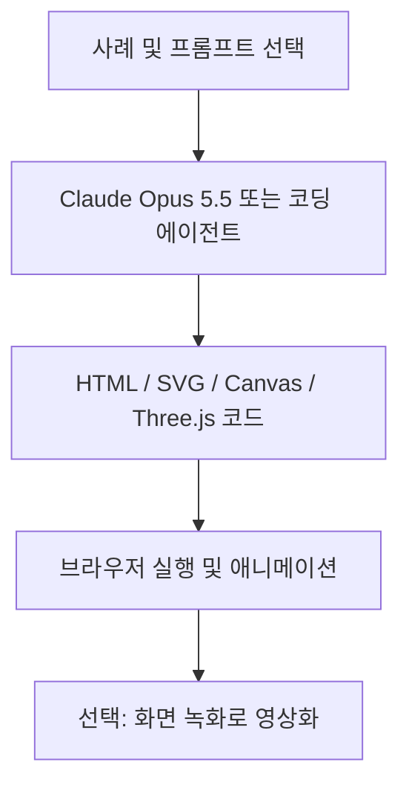

# Awesome Opus 5.5 Videos

## 한줄 요약
Claude Opus 5.5가 생성한 HTML·Canvas·SVG·Three.js 애니메이션 영상 사례와 프롬프트를 수집한 레퍼런스 저장소.

## 개요
- 원본: https://github.com/yihui-dev/awesome-opus5-5-videos
- 조회: 2026-10-22
- README 기준 프롬프트 703개, Skillry 라이브 재현 418개, 대표 사례 100개.
- README에 기록된 최근 업데이트: 2026-10-12.
- 프로젝트 성격: 영상 생성 모델이나 독립 실행 엔진이 아닌 프롬프트·사례 큐레이션.

## 해결 문제
코드 기반 모션그래픽을 AI로 제작할 때 참고할 프롬프트, 기술 스택, 결과물 및 원작자 게시물을 한곳에서 찾기 어렵다는 문제를 해결한다.

## 핵심 기능
- 모션그래픽 58개, 설명 영상 16개, 3D 장면 14개, 게임·인터랙티브 12개 대표 사례.
- prompts/에 프롬프트를 정리하고 data/videos.json에 목록 데이터 보관.
- 원본 게시물 링크 및 Skillry에서 재현 사례 비교.
- Canvas, SVG, GSAP, Three.js, GLSL, WebGL, CSS, Web Audio 등 기술 태그 제공.

## 아키텍처
저장소는 실행 하네스가 아니라 콘텐츠 인덱스다. 아래는 README가 안내하는 제작 흐름이며 저장소 자체의 런타임 아키텍처가 아니다.

## 장점
- 재현 가능한 코드 산출물을 얻어 수정·재사용하기 좋다.
- 원작자 게시물과 프롬프트를 함께 살펴볼 수 있다.
- 모션·3D·설명 콘텐츠의 다양한 스타일을 탐색할 수 있다.

## 단점 및 한계
- 일부 프롬프트는 전문이 아닌 부분 공개 또는 결과 설명만 포함한다.
- 실제 생성 결과는 모델 버전·환경·외부 에셋에 따라 달라질 수 있다.
- 수집 사례는 통제된 성능 벤치마크가 아니다.
- 저장소 MIT 라이선스와 개별 창작물·영상·프롬프트 권리는 별도로 확인해야 한다.
- 토큰 비용, 제작 시간, 품질 재현율에 대한 통제 실험은 확인되지 않음.

## 활용 사례
- 앱 온보딩·로딩·전환 모션 프로토타입.
- 제품 소개 영상·기술 설명 애니메이션.
- 블로그 시각 콘텐츠 및 UI 디자인 레퍼런스.
- Claude Code와 Codex의 동일 프롬프트 비교 실험.

## 비교
| 방식 | 특징 | 적합한 작업 |
| --- | --- | --- |
| 코드 기반 AI 모션 | 코드 수정·재사용·상호작용 가능 | UI 모션, 설명형 영상 |
| 생성형 비디오 모델 | 픽셀/영상 직접 생성 | 실사·시네마틱 영상 |
| 수동 모션 툴 | 타임라인 중심의 정밀 제어 | 브랜드 품질의 후반 편집 |

## 활용 아이디어
1. 서로 다른 유형의 프롬프트 5개를 선정한다.
2. Claude Code와 Codex에서 동일 제약으로 HTML을 생성한다.
3. 실행 성공률, 수정 횟수, 토큰·비용, 프레임 안정성, 시각적 품질을 기록한다.
4. 재현 가능한 패턴을 별도 UI Motion 제작 가이드로 정리한다.

## 결론
**PoC 가치 있음.** 즉시 활용할 디자인·프롬프트 레퍼런스로 유용하지만, 자동 제작 파이프라인의 품질과 비용은 별도 실험으로 검증해야 한다.

## 참고 자료
- https://github.com/yihui-dev/awesome-opus5-5-videos
- https://github.com/yihui-dev/awesome-opus5-5-videos/tree/main/prompts
- https://github.com/yihui-dev/awesome-opus5-5-videos/blob/main/data/videos.json
- https://skillry.dev/ai-videos/opus-5-5
