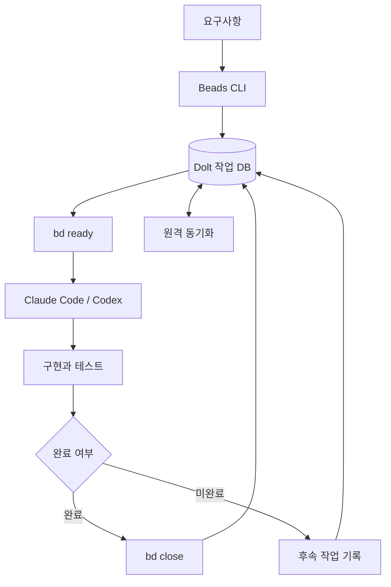

# Beads

> AI 코딩 에이전트가 세션을 넘어 작업 상태와 의존관계를 이어갈 수 있도록 지원하는 작업 추적 CLI.

## 프로젝트 개요
Beads는 AI 코딩 에이전트를 위한 구조화된 작업 추적 시스템이다. 작업 상태, 우선순위, 의존관계를 보존하고 CLI인 `bd`로 관리한다.

## 해결하려는 문제
대화 컨텍스트와 TODO 문서만으로 장기 작업을 관리하면 세션 재시작 시 진행 상황을 재구성해야 하고, 여러 에이전트가 동일한 작업을 수행하거나 선행 작업을 누락할 수 있다.

## 핵심 기능
- 작업 생성 및 상태 관리: `bd create`, `bd update`, `bd close`
- 실행 가능한 작업 조회: `bd ready`
- 의존관계 기반 작업 그래프
- 작업 점유 및 에이전트 간 인계
- Dolt 기반 영속 저장 및 원격 동기화

## 아키텍처

에이전트는 현재 수행 가능한 작업을 조회하고 점유해 구현한다. 작업 완료 시 상태를 변경하여 의존성이 해결된 후속 작업이 나타나도록 한다. 기본 Embedded Dolt 구성의 단일 writer 제약과 다중 프로세스 동시 쓰기 정책을 검토해야 한다.

## 장점
- 세션 종료 후 작업 상태 복원
- 작업 간 선행 조건 명시
- 복수 에이전트의 작업 분배와 인계 지원
- 전체 대화 재탐색 부담을 줄일 가능성

## 단점 및 한계
- 단순 TODO에 비해 초기 설정과 운영 부담
- DB 및 동기화 충돌 관리 필요
- GitHub Issues와 병행 시 이중 관리 가능
- 토큰 절감과 생산성 향상은 실측 필요
- Windows 및 Enterprise 보안 환경에서 별도 검증 필요

## 활용 사례
1. Claude Code와 Codex 간 개발 작업 인계
2. 예약 실행 후 미완료 작업 재개
3. 다중 에이전트가 의존성을 준수하며 개발
4. 테스트 실패에 따른 후속 작업 자동 등록

## 기존 도구와 비교
Markdown TODO는 간단하지만 구조화된 의존관계 관리가 약하다. GitHub Issues는 사람 중심의 협업과 추적에 강하고, Beads는 코딩 에이전트가 CLI에서 실행 가능한 작업을 선택하고 상태를 이어가는 데 초점을 둔다.

## 활용 아이디어
- 바로 적용 가능: 장기 개발 세션의 작업 상태 기록
- PoC 가치 있음: Claude Code/Codex 교대 작업, 세션 복구, 원격 동기화
- 아이디어 참고: Harness 작업 메모리 계층
- 도입 가치 낮음: 일회성 소규모 수정

### PoC 검증
20개 작업과 5개 이상 의존관계를 구성해 세션 재시작 후 복구율, 중복 수행, 충돌, 토큰 사용량 및 설정 시간을 측정한다.

## 결론
장기 실행 및 다중 에이전트 개발 환경에서 PoC 가치가 높다. 실제 도입 전 저장소 동기화와 동시 쓰기 정책을 검증한다.

## 참고 자료
- https://github.com/gastownhall/beads
