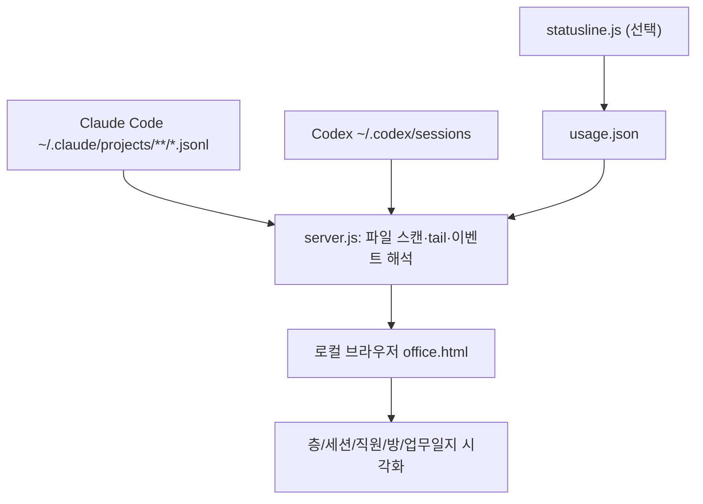

# Claude Office

> Claude Code와 Codex의 로컬 JSONL 세션 기록을 실시간으로 읽어 AI 코딩 작업을 미니어처 사무실로 시각화하는 Node.js 기반 로컬 대시보드.

## 프로젝트 개요
TOPLAIN SOFT의 MIT 라이선스 프로젝트. Node.js만으로 실행되며 기본 주소는 `http://localhost:4777`이다. 에이전트 실행기나 Harness가 아니라 관찰용 UI다.

## 해결하려는 문제
여러 Claude Code/Codex 세션이 동시에 작동할 때 어떤 프로젝트가 파일을 읽고, 수정하고, 명령을 실행하는지 터미널을 일일이 확인해야 하는 문제를 해결한다. 질문 대기와 도구 오류도 시각적으로 표시한다.

## 핵심 기능
- 프로젝트별 건물 층, 세션별 창문으로 멀티 세션 표시
- Read/Grep 등 자료실, Edit/Write 개발실, Bash 서버실, 웹/MCP 검색실, 계획 회의실로 도구 활동 매핑
- Claude Code의 하위 에이전트 생성·활동·종료 표시
- Codex 세션 자동 탐지 및 별도 캐릭터 표시
- 질문·오류 알림, 작업 타임라인, 5분 단위 출퇴근 기록과 하루 요약
- Claude 상태줄 선택 연동을 통한 사용량 표시(기존 settings.json 백업)
- 데모 모드(`node demo.js`), 화면 정보 가리기

## 아키텍처


소스 `server.js`의 설정값: 활성 파일 tail 간격 250ms, 신규 프로젝트/세션 스캔 간격 2000ms, 기본 포트 4777. 도구명을 방으로 매핑하고 JSONL의 tool_use, tool_result, assistant/user 이벤트 등을 해석한다. 기록 파일은 읽기 전용으로 취급하며 서버는 127.0.0.1에 바인딩하도록 설계되었다(README 설명). AI 모델을 추가 호출하지 않는다.

## 설치 및 Quick Start
Node.js 18 이상 및 Claude Code 설치 후 저장소를 내려받아:
```bash
node server.js
# 데모
node demo.js
# Codex 비활성화
NO_CODEX=1 node server.js
```
Windows PowerShell에서 환경변수 지정은 `$env:PORT=4778; node server.js` 형태다. `CLAUDE_PROJECTS_DIR`, `CODEX_SESSIONS_DIR`로 기록 경로를 지정할 수 있다.

## 장점
- 별도 패키지·AI 호출 없이 로컬 로그 활용, 추가 토큰 비용 없음
- Claude/Codex와 프로젝트별 병렬 세션의 활동을 직관적으로 확인
- 로컬 기반이며 Windows 실행 방법 제공
- 사용자 개입 및 오류 감지의 시각적 접근성 개선

## 단점 및 한계
- 세션 이벤트의 관찰 도구이며 작업 제어, 승인 자동화, 테스트 검증, 품질 보증 기능은 제공하지 않음
- 여러 PC를 통합하는 중앙 관제 기능은 기본 제공되지 않음
- JSONL 내부 포맷 변경에 영향받을 수 있음
- 로컬 기록의 프롬프트, 경로, 명령 등이 UI에 노출될 수 있으므로 화면 공유 및 접근 권한 관리 필요
- 2026-10-22 확인 당시 저장소는 초기 3 commits, GitHub Stars 13으로 장기 유지보수·실사용 검증 자료 부족
- 토큰 절감 효과는 없음(추가 토큰을 소비하지 않는 것과 구별)

## 활용 사례
동일 PC에서 Claude Code와 Codex 예약/장시간 작업을 병행할 때 진행 상황을 시각화한다. 작업 실패·사용자 응답 대기 파악 및 하루 활동 회고에 활용한다.

## 기존 도구와 비교
일반적인 터미널/JSONL 로그 직접 확인과 달리 프로젝트·세션·도구 유형을 공간적 캐릭터로 시각화한다. 다만 CI/CD 모니터링이나 중앙 로그 분석 시스템과 달리 실행 결과 검증·알림 연동·장기 집계의 대체재는 아니다.

## 활용 아이디어
- **바로 적용 가능:** 로컬 Claude/Codex 다중 세션 대시보드로 실행
- **PoC 가치 있음:** 예약 작업의 상태를 별도 검증 데이터와 결합하여 표시
- **아이디어 참고:** 개인 AI 운영 대시보드의 UX 패턴 및 JSONL 이벤트 매핑
- **현재 도입 가치 낮음:** 원격 여러 PC의 중앙 관리, 엔터프라이즈 감사·보안 요구 충족을 직접 기대하는 경우

## 결론
가벼운 로컬 관찰성 도구로 실용성이 있다. Harness나 자동 실행 플랫폼이 아닌 시각화 레이어로 분류한다. 실제 도입 전 Windows·Codex 최신 로그 호환성 및 개인정보 노출 여부를 PoC로 검증하는 것이 적절하다.

## 참고 자료
- [원본 저장소](https://github.com/toplainsoft/claude-office)
- [README](https://github.com/toplainsoft/claude-office/blob/main/README.md)
- [server.js](https://github.com/toplainsoft/claude-office/blob/main/server.js)
