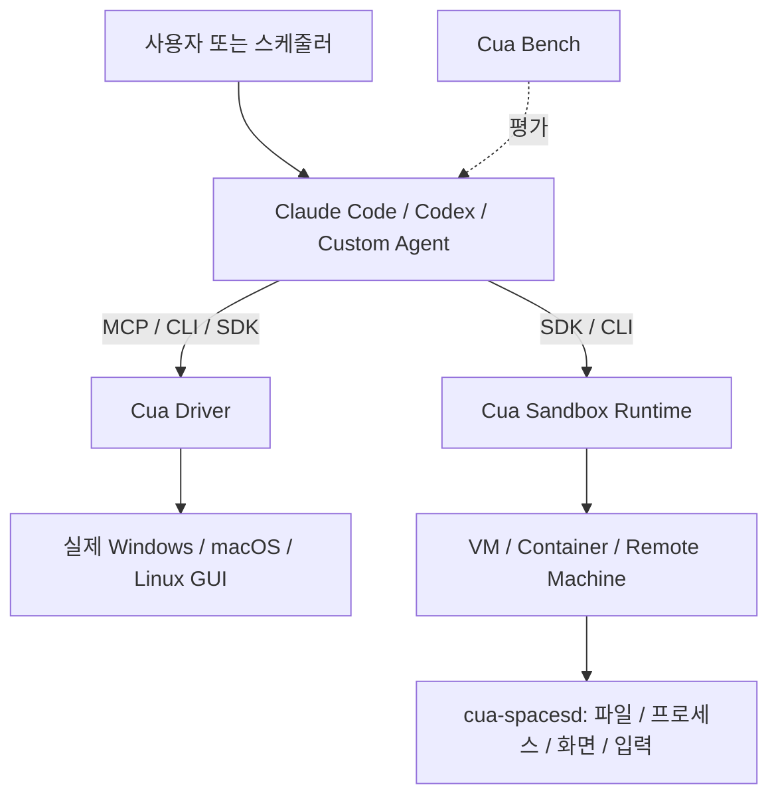

# Cua

> AI Agent가 실제 데스크톱 GUI를 조작하고 격리된 컴퓨터 환경을 운영하도록 지원하는 Computer-Use 인프라.

## 프로젝트 개요

Cua(trycua/cua)는 Cua Driver, Cua SDK/CLI, Cua Spaces, Lume, CUA-S1, Cua Bench를 제공한다. 기존 AI Coding Agent의 모델을 대체하기보다 GUI 실행과 격리 환경, 평가 기능을 제공한다.

## 해결하려는 문제

API/CLI로 접근할 수 없는 네이티브 GUI 작업은 자동화하기 어렵고, 실제 사용자 PC에서 직접 실행하면 입력 충돌 및 보안 위험이 있다. Cua는 GUI 드라이버와 격리된 샌드박스, 평가 체계를 제공한다.

## 핵심 기능

- **Cua Driver**: macOS, Windows, Linux 데스크톱 및 브라우저 제어. CLI, MCP, SDK 연결.
- **Cua SDK/CLI**: Python, TypeScript, Rust 기반 VM·컨테이너·원격 머신 관리. Swift/Kotlin 바인딩은 아직 출시되지 않음.
- **Cua Spaces**: 독립 데스크톱, 사람과 Agent의 협업, 승인 기반 세션 이동. macOS 앱 중심.
- **Lume**: Apple Silicon에서 macOS/Linux VM 관리.
- **CUA-S1**: 폼 처리 등의 제한된 GUI 의사결정을 위한 소형 모델 연구.
- **Cua Bench**: GUI Agent 과제 생성, 평가, 궤적 수집.

## 아키텍처

Cua는 자체 범용 계획 Agent를 필수로 요구하지 않는다. Agent의 추론/계획은 외부 모델 및 Harness가 담당할 수 있다.

## 장점

- API가 없는 데스크톱 앱의 자동화 가능성.
- MCP를 통한 기존 Claude Code/Codex 연동 경로.
- 실제 PC와 격리 환경 모두 활용 가능.
- 벤치마크와 재현 가능한 테스트 환경 구성에 유리.

## 단점 및 한계

- GUI 변경, 화면 해상도, 포커스, 접근성 API에 따른 실패 가능성.
- Windows에서 Cua Driver는 지원하지만 Lume의 Apple Silicon VM 기능은 사용할 수 없음.
- Cua Spaces 앱은 macOS 중심이며 Windows/Linux 지원 범위를 별도 검증해야 함.
- GUI 관찰·조작 루프는 API 직접 호출보다 느리고 모델 비용이 늘어날 수 있음. 정량 비용은 확인되지 않음.
- 원격 데스크톱 권한, 로그인 세션, 개인정보 및 명령 실행 범위를 통제해야 함.
- 라이선스가 단일 MIT가 아님: Spaces 및 Driver Bench는 FSL-1.1-MIT, 다수 SDK/Driver/Lume 구성은 MIT, 선택적 perception 확장은 별도 AGPL 조건 확인 필요.
- CUA-S1은 초기 연구 릴리스로 일반 목적 Agent의 대체재가 아님.

## 활용 사례

1. UE5 Editor 반복 GUI 테스트 및 결과 캡처(실제 호환성 PoC 필요).
2. Windows 기반 사내 GUI 업무 자동화.
3. Claude Code/Codex의 브라우저·네이티브 앱 검증 확장.
4. 별도 샌드박스에서 GUI 테스트를 실행하고 Bench로 결과 평가.

## 기존 도구와 비교

- Playwright: 브라우저 DOM 기반 테스트가 중심이므로 웹 테스트는 Playwright를 우선. 네이티브 GUI에는 Cua가 보완재.
- 일반 RPA: 정형화된 좌표·규칙 기반 작업은 RPA가 단순할 수 있으나, Cua는 Agent 판단과 통합하기 좋음.
- 직접 MCP 구현: 앱 전용 API가 있다면 직접 MCP/API 연결이 더 안정적일 수 있음.

## 활용 아이디어

- **바로 적용 가능**: Cua Driver를 테스트 PC에 설치하고 Calculator, 브라우저, LibreOffice 등의 단순 조작 확인.
- **PoC 가치 있음**: UE5 Editor에서 프로젝트 열기→설정 확인→스크린샷→결과 기록.
- **아이디어 참고**: Agent 전용 VM과 Cua Bench를 CI 평가 파이프라인에 연결.
- **현재 도입 가치 낮음**: API로 이미 안정적으로 수행하는 대량·반복 작업을 전부 GUI로 대체하는 방식.

## 결론

우선순위는 Cua Driver와 Claude Code/Codex의 Windows PoC다. 독립 실행 환경이 필요해지면 SDK/CLI와 Spaces를 검토한다. 생산성, 안정성, 토큰 비용은 실측 전까지 확정하지 않는다.

## 참고 자료

- https://github.com/trycua/cua
- https://cua.ai/
- https://github.com/trycua/cua/tree/main/libs
- https://github.com/trycua/cua/tree/main/docs
