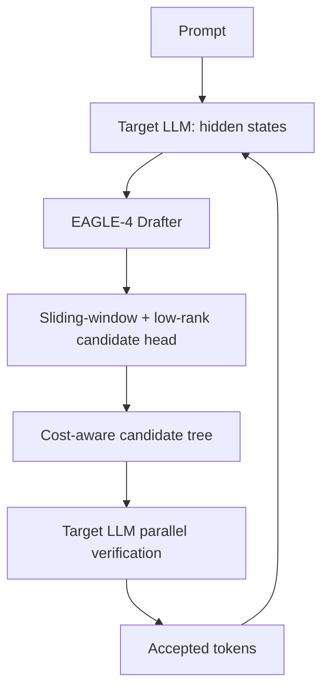

# EAGLE-4

> 하드웨어와 배치 크기에 따라 speculative decoding 후보 트리를 조정하는 LLM 추론 가속 Drafter 및 Serving Harness.

## 프로젝트 개요
EAGLE 계열의 4세대 추론 가속 구현. `eagle-harness` 패키지와 엔진별 플러그인을 통해 SGLang, vLLM, 실험적 TokenSpeed를 지원한다. 2026-10-22 조사 기준 초기 v0.1.0 릴리스.

## 해결하려는 문제
Autoregressive decoding은 토큰별 순차 실행으로 GPU 메모리 대역폭에 묶이기 쉽다. 기존 고정 speculative tree는 동시 요청 수와 GPU에 따라 비용 대비 효과가 달라진다. EAGLE-4는 실제 draft/verify 비용에 따라 후보 확장 규모를 조정한다.

## 핵심 기능
- Target LLM hidden states와 token embeddings를 활용한 경량 Drafter
- Sliding-window draft layer, low-rank candidate head, append-only draft cache
- 동시 요청·하드웨어·워크로드 비용에 따른 후보 트리 조정
- Target model 병렬 검증과 출력 분포 유지
- SGLang, vLLM 및 실험적 TokenSpeed 엔진 연동

## 아키텍처

패치된 엔진 wheel/image가 hook을 제공하고 eagle-harness가 플러그인으로 연결된다. 기본 upstream 엔진에는 해당 hook이 없다. SGLang은 serving 중 비용을 측정하고 vLLM은 별도 calibration을 사용한다.

## 성능
공식 저장소의 SPEED-Bench temperature 0, 동일 엔진 no-spec 대비:
| 환경 | 동시 요청 | 기본 tok/s | EAGLE-4 tok/s | 배속 |
|---|---:|---:|---:|---:|
| vLLM 4× B300 | 1 | 241.6 | 722.8 | 2.99× |
| vLLM 4× B300 | 8 | 1699.9 | 2883.9 | 1.70× |
| SGLang 4× B300 | 8 | 1479.4 | 2820.6 | 1.91× |
| SGLang 4× B300 | 64 | 3925.3 | 5281.3 | 1.35× |
| SGLang 1× MI355X | 8 | 552.7 | 1145.9 | 2.07× |

측정 조건에 종속된 제작사 수치이며 범용적인 3배 가속을 의미하지 않는다.

## 장점
- 모델 출력 분포 보존을 목표로 하는 가속
- 단일 Drafter가 다양한 배치 크기에 적응
- vLLM/SGLang과 연동하며 NVIDIA 및 일부 AMD GPU 지원

## 단점 및 한계
- 별도 패치 엔진 및 버전 고정으로 운영 복잡도 증가
- 공개 실측은 특정 모델·GPU·요청 설정 중심
- Text-only 요청, KV cache 및 pipeline parallelism 등 제약 확인 필요
- Windows 네이티브/일반 소비자 GPU 운영 검증 부족
- Source-Available이며 OSI 오픈소스가 아님. 경쟁 상용 제공 및 최근 12개월 합산 매출 US$20M 초과 시 별도 상용 계약 조건 확인 필요
- GPU당 처리량 상승이 곧 전체 비용 절감은 아님

## 활용 사례
자체 운영 LLM API 서버에서 동시성별 throughput, TPOT, p95 latency, GPU 시간당 비용을 비교하는 PoC.

## 기존 도구와 비교
vLLM/SGLang은 추론 엔진이며 EAGLE-4는 해당 엔진에 추가하는 speculative decoding 구현이다. Claude Code/Codex의 외부 API 모델 호출을 직접 가속하지 않는다.

## 활용 아이디어
- **PoC 가치 있음:** 자체 GPU 추론 환경에서 기본 decoding과 동일 모델·동일 하드웨어 A/B 벤치마크
- **아이디어 참고:** Agent orchestration의 호출 수 최적화와 serving 계층의 토큰 생성 가속을 분리
- **현재 도입 가치 낮음:** 외부 상용 API만 쓰는 일반 AI Coding Workflow

## 결론
자체 LLM Serving 인프라를 운영할 때 유망하지만, 초기 릴리스의 패치 의존성·지원 범위·라이선스 검토가 선행되어야 한다.

## 참고 자료
- https://github.com/eagle-hq/EAGLE-4
- https://github.com/eagle-hq/EAGLE-4/blob/main/docs/architecture.md
- https://github.com/eagle-hq/EAGLE-4/blob/main/docs/support-matrix.md
- https://github.com/eagle-hq/EAGLE-4/blob/main/docs/known-limits.md
- https://blog.fal.ai/eagle-4-technical-deepdive/
