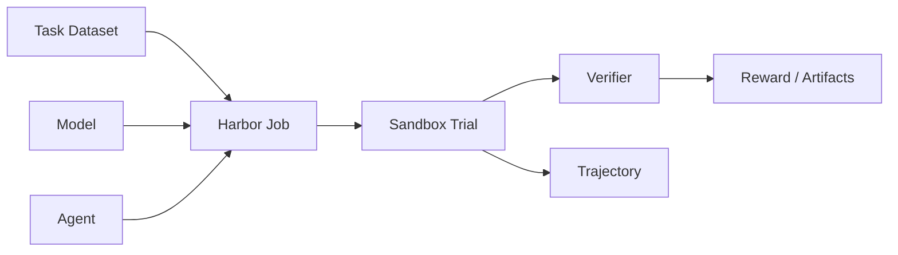

# Harbor - AI Agent 평가 및 최적화 프레임워크

## 핵심 요약
Harbor는 Agent, Model, Task, Sandbox를 독립적으로 조합하고 병렬 실행해 AI 에이전트 성능을 평가·최적화하는 오픈소스 프레임워크다. Terminal-Bench 2.0의 공식 평가 하네스로 소개된다. 공개 벤치마크뿐 아니라 조직의 실제 업무를 평가 과제로 구성해 에이전트 후보를 비교하는 데 활용할 수 있다.

## 해결하는 문제
벤치마크마다 다른 실행기와 채점 규약 때문에 에이전트별 성능을 공정하게 비교하기 어렵다. Harbor는 과제 폴더 형식, 에이전트 인터페이스, 샌드박스 인터페이스를 분리해 재사용성을 높인다.

## 핵심 구성과 실행 흐름
- **Task**: instruction.md, task.toml, environment/, solution/, tests/를 포함하는 독립 폴더.
- **Agent**: 과제를 수행하는 프로그램. 사용자 정의 Agent는 BaseAgent를 구현한다.
- **Sandbox**: Docker 등의 로컬 또는 클라우드 격리 환경. 확장은 BaseEnvironment를 구현한다.
- **Verifier**: 결과를 검사하고 /logs/verifier/reward.txt 또는 reward.json에 점수를 기록한다.
- **Trial**: 한 에이전트의 한 과제 시도. **Job**은 여러 Trial을 병렬로 실행한다.
- **Trajectory**: 행동 기록은 ATIF 형식으로 분석·비교할 수 있다.



## 시작 예시
```bash
uv tool install harbor
harbor run -t hello-world/hello-world -a codex -m <model-id>
harbor view ./jobs
```
실행 전 모델 공급자 API 키, Docker 등 런타임, 해당 Agent 설정을 준비해야 한다. 모델 ID와 플래그는 설치 버전의 공식 문서에서 재확인한다.

## 주요 기능
- 에이전트·모델·과제·실행 환경 조합 및 반복 병렬 평가
- 과제별 시도 횟수, 동시성, 재시도 설정
- 실행 결과 및 행동 기록 분석, 재채점
- 평가 과제의 강화학습용 rollout 데이터 활용
- 원격 샌드박스와 Hosted Job 연계

## 실무 적용 제안
1. 사내 반복 업무에서 재현 가능한 작업 5~10개를 선정한다.
2. 작업별 초기 상태, 기대 결과, 독립 채점 테스트를 정의한다.
3. 후보 Agent를 같은 모델·환경·자원 조건으로 여러 번 평가한다.
4. 성공률·실행시간·API 비용·실패 유형을 함께 비교한다.
5. 검증기 오류와 과제 편향을 검토한 뒤 도입 결정을 내린다.

## 제약 및 주의사항
- 채점 신뢰도는 검증기 품질에 좌우된다. Oracle 통과는 평가의 타당성까지 증명하지 않는다.
- Agent마다 설정·도구 접근·MCP 연결 지원이 달라 동일 조건 보장이 어렵다.
- 대규모 병렬 평가에는 모델 호출료와 원격 샌드박스 비용, rate limit이 따른다.
- 사내 소스·비밀정보를 외부 Sandbox/Hub로 전송할 경우 보안·반출 정책을 검토해야 한다.
- Windows 지원 여부와 실제 실행 가능 조합은 사용 버전별 검증이 필요하다.

## 확인 범위
2026-10-23에 2차 해설 원문을 확인했다. 위의 제품 세부 기능과 연동 수량은 해설에 기반하며, 공식 저장소 코드 및 최신 릴리스와의 독립 교차 검증은 별도로 필요하다.

## 참고 자료
- 해설: https://wikidocs.net/blog/@jaehong/33321/
- 공식 문서: https://docs.harborframework.com/
- 공식 GitHub 저장소: 원문에 연결된 '하버 깃허브 저장소' 참조
