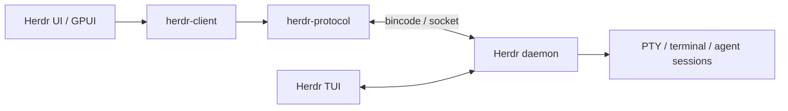

# Herdr UI

> Herdr 데몬의 터미널·에이전트 세션을 네이티브 창에서 시각화하고 관리하는 Rust/GPUI 클라이언트.

## 핵심 요약
- 공식 저장소: https://github.com/penso/herdr-gpui
- Herdr 본체와 독립된 프로젝트이며, 별도 설치된 Herdr 데몬이 필요하다.
- macOS, Linux, Windows를 지원하며 Apache-2.0 라이선스다.
- GUI와 TUI는 같은 데몬의 세션을 공유한다. GUI를 닫아도 데몬의 터미널과 에이전트는 계속 실행된다.

## 해결 문제와 기능
여러 코딩 에이전트를 병렬 실행할 때 터미널별 작업 상태와 변경 내용을 파악하기 어렵다. Herdr UI는 워크스페이스·Git Worktree·에이전트 상태를 사이드바에 표시하고, 이슈 기반 작업 배정, 체크포인트, 코드 Diff 리뷰와 라인별 에이전트 피드백, 브라우저 주석, 장치 개요, Teleport(호스트 간 작업 이전), 사용량 표시를 제공한다. 저장된 SSH 호스트와 로컬/원격 세션 관리도 제공하지만 Windows에서는 저장된 SSH 호스트 기능이 제한된다.

## 검증된 아키텍처

데몬이 세션과 프로세스를 소유하고 클라이언트가 화면 셀을 그린다. 브라우저 탭 등 일부 GUI 전용 상태는 예외적으로 GUI에 속한다.

## 설치
Herdr 본체를 먼저 설치한다: https://herdr.dev/
- macOS: `brew install penso/tap/herdr-gpui` (14.2 이상)
- Linux: `curl -fsSL https://herdrui.dev/install.sh | sh` (패키지 기준 glibc 2.39 이상)
- Windows: `irm https://herdrui.dev/install.ps1 | iex` (x86_64/ARM64)
보안이 중요한 환경에서는 원격 스크립트 직접 실행보다 공식 Releases 설치 파일을 검증하고 사용하는 편이 적절하다: https://github.com/penso/herdr-gpui/releases

## 장점과 한계
**장점:** 기존 TUI와 세션 공존, 시각적 에이전트 상태 추적, Git Worktree별 병렬 작업과 Diff 리뷰, Windows 네이티브 지원, 세션 분리형 실행.

**제약:** 데몬 별도 설치 필요, Windows 저장 SSH 호스트 미지원, 일부 기능은 GUI 전용, 조직 도입 시 로컬 소켓·SSH·GitHub 인증·에이전트 실행 권한·업데이트 체계 검증 필요. 성능 보고의 p95 수치는 개발 머신의 CPU 측정으로 실제 GPU 표시 지연을 의미하지 않는다.

## 활용 판단
여러 Claude Code/Codex 등 CLI 에이전트를 병렬 운용하는 개인·소규모 개발팀에 PoC 가치가 높다. 기존 Herdr를 실행 계층으로 사용한다면 UI는 관제·리뷰 계층으로 적합하다. Windows/Enterprise에서는 WSL 연결, endpoint protection, 설치 권한, 사내 Git/Proxy 및 원격 접근 정책을 검증한다. Herdr UI를 별도 중앙 서버형 팀 대시보드로 간주해서는 안 된다.

## Orca와 비교 — 공식 GitHub 기준 (2026-11-01)

비교 대상은 [stablyai/orca](https://github.com/stablyai/orca)이다. 기존 로컬 `D:\\work\\orca` 기록과 동일 프로젝트인지 확인되지 않았으므로 동일시하지 않는다. 공식 README 및 [Worktrees 문서](https://www.onorca.dev/docs/model/worktrees)를 기준으로 비교하며, 양측 실제 설치·벤치마크는 수행하지 않았다.

| 기준 | Herdr UI + Herdr | Orca (stablyai/orca) |
|---|---|---|
| 제품 포지션 | 지속 터미널 세션을 위한 네이티브 GUI | 에이전트 중심 통합 개발 환경 |
| 멀티 에이전트 | 여러 CLI 에이전트 상태 표시 | Codex·Claude Code·OpenCode·Pi 등 병렬 실행 |
| Worktree | 워크스페이스별 관리 | 작업별 격리, 병렬 실행, 비교·병합 |
| 터미널 | Herdr 데몬 PTY, TUI/GUI 공유 | Ghostty급 터미널 분할 및 재시작 후 스크롤백 |
| 코드 리뷰 | Diff와 라인별 피드백 | Diff, Annotate AI Diff, Git 변경 검토 |
| 브라우저 | 브라우저 주석 및 에이전트 전달 | Chromium Design Mode에서 요소·스타일·스크린샷 전달 |
| 모바일 | 공식 확인 범위에서 미확인 | 모바일 Companion, 상태 확인·후속 지시·완료 알림 |
| 원격 | SSH/Teleport 및 데몬 연결 | 원격 Runtime |
| 핵심 차별점 | 데몬이 실행 세션을 소유하는 분리형 구조 | 작업 생성→실행→리뷰→PR→정리까지 통합 |

### 판단
- **장시간 실행·세션 분리·기존 TUI 공존**이 최우선이면 Herdr UI의 구조가 매력적이다.
- **모바일 제어·완료 알림·Worktree 전체 수명주기·통합 GUI**가 중요하면 Orca가 더 직접적인 후보이다.
- 두 제품 모두 멀티 에이전트와 Diff/Worktree를 지원하므로 단순 기능 유무만으로 우열을 단정하지 않는다.
- Windows/Enterprise PoC에서는 설치/업데이트, 권한·인증, WSL, 프록시, 원격 실행, 장시간 세션 복구, Git 충돌과 작업 완료 알림의 신뢰성을 같은 시나리오로 비교한다.

### 출처
- Orca 공식 GitHub: https://github.com/stablyai/orca
- Orca Worktrees: https://www.onorca.dev/docs/model/worktrees
- Herdr UI 공식 GitHub: https://github.com/penso/herdr-gpui

## 관련 Wiki
- [Herdr 본체](./herdr.md) — 지속 세션·Agent Runtime의 구조와 운영

## 출처 및 확인 범위
조사일: 2026-11-01
- 공식 사이트: https://herdrui.dev/
- 공식 코드/README: https://github.com/penso/herdr-gpui
- 릴리스: https://github.com/penso/herdr-gpui/releases
- 원본 데몬: https://herdr.dev/

공식 사이트와 공개 GitHub README/저장소 구조를 확인했다. 직접 설치·실행 검증은 수행하지 않았다.
