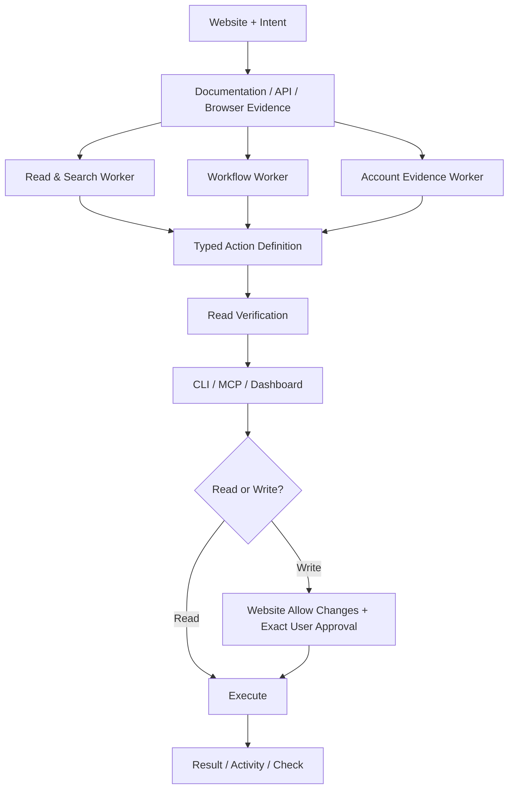

# Hycli

> 웹사이트의 문서·API·HTML·브라우저 증거를 분석해 검증 가능한 타입 기반 CLI 및 MCP 액션을 생성하는 로컬 우선 도구.

## 프로젝트 개요

Hybirdss/Hycli는 웹사이트를 AI Agent가 재사용 가능한 도구로 다룰 수 있도록 변환한다. Rust 기반 웹사이트 엔진과 로컬 대시보드, CLI, MCP 연결을 제공하며 Apache-2.0 라이선스다. 조사 기준일은 2026-10-19이다.

## 해결하려는 문제

브라우저 Agent는 동일 사이트를 반복 탐색하고 UI 변경에 영향을 받는다. 사이트별 직접 API/MCP 연동은 구현과 유지보수 비용이 크다. Hycli는 관찰 가능한 웹 인터페이스에서 액션 정의를 생성·검증하고 재사용하려 한다.

## 핵심 기능

- REST/OpenAPI, GraphQL, HTML, JavaScript 렌더링 GET, JSON/URL 인코딩 폼 기반 액션 준비
- 읽기·검색, 유용한 워크플로, 계정 증거를 담당하는 3개 AI Worker
- 입력·결과가 명시된 CLI/MCP 액션과 로컬 대시보드
- 검증된 읽기 시퀀스 재실행(`hycli check`), signed_out/site_changed/blocked/unreachable 판별
- 기본 읽기 전용, 사이트별 쓰기 활성화와 정확한 요청별 승인
- 로컬 credential vault, 브라우저 세션 연결 및 companion 지원
- Windows/macOS/Linux 빌드 및 패키징 경로

## 아키텍처



이 도식은 공식 README의 설명을 개념적으로 재구성한 것이다. 세 Worker의 내부 메시지 프로토콜이나 정확한 스케줄링 구현을 확정하는 도식은 아니다.

## 장점

1. 사이트별 수작업 MCP 구현 부담 감소 가능.
2. 동일한 액션을 CLI, MCP, Dashboard에서 재사용.
3. 계정 만료와 사이트 변경을 분리해 진단.
4. 쓰기 작업을 Agent가 자체 승인하지 못하도록 설계.
5. Windows를 포함한 데스크톱 환경을 고려.

## 단점 및 한계

- 임의 브라우저 클릭 시퀀스, multipart 업로드, 바이너리 다운로드는 현재 계약 밖.
- 사이트별 문서·엔드포인트·세션 접근 가능 여부에 크게 의존.
- 모델 호출 비용과 준비 시간은 사이트 복잡도에 따라 달라지며 독립적인 토큰 절감 벤치마크는 확인되지 않음.
- 브라우저 세션·credential vault·사내 사이트 연결은 별도 보안 검토 필요.
- Windows 설치 아티팩트 서명 및 macOS notarization 상태 확인 필요.
- v0.1.0의 검증된 다운로드는 Linux x64이며, 다른 플랫폼은 소스 빌드 또는 CI 산출물 확인이 필요하다는 README 설명에 유의.
- 대규모 Enterprise 운영 안정성 및 장기 유지보수 성숙도는 확인되지 않음.

## 활용 사례

- 문서·이슈·업무 포털의 읽기/검색을 MCP 액션으로 변환
- 반복 조회를 CLI로 스크립트화하고 CI에서 읽기 검증
- Claude Code/Codex의 사이트별 반복 탐색을 재사용 가능한 액션으로 대체

## 기존 도구와 비교

| 방식 | 강점 | 제약 |
|---|---|---|
| Playwright/브라우저 Agent | 화면 중심의 유연한 조작 | UI 변경·반복 탐색 비용 |
| 수작업 MCP/API | 높은 통제력과 명확한 계약 | 사이트별 개발 필요 |
| Hycli | 관찰 증거 기반 자동 액션 생성·검증 | 지원 인터페이스 및 인증 제약 |

## 활용 아이디어

**바로 적용 가능:** 공개 API/문서가 있는 읽기 전용 사이트에서 액션 생성과 `hycli check` 검증.

**PoC 가치 있음:** 사내 웹 관리 도구를 대상으로 보안 승인을 받은 격리 환경에서 Claude Code 연동. 브라우저 직접 조작 대비 30회 반복 실행 성공률·토큰·지연·복구 시간을 비교.

**아이디어 참고:** Harness에 사이트별 Action Registry와 인증/스키마 변경 감지 계층 도입.

**현재 도입 가치 낮음:** 승인 없는 대량 쓰기, 임의 GUI 클릭, 파일 업로드가 핵심인 업무.

## Quick Start

```bash
hycli prepare https://example.com --intent "Find saved references"
hycli describe
hycli check
hycli mcp
```

실제 실행 파일 설치 및 모델 연결이 선행되어야 한다. 위 URL은 예시이며 실행 검증 결과가 아니다.

## 결론

도구 자동 생성보다 **증거 기반 생성 → 읽기 검증 → 재사용 → 변경 감지**가 핵심 차별점이다. 로컬·Windows 기반 Agent 작업환경에서 읽기 전용 PoC를 우선 권장한다. 성능·토큰 절감과 Enterprise 안정성은 실측 전까지 미검증으로 둔다.

## 참고 자료

- https://github.com/Hybirdss/Hycli
- https://github.com/Hybirdss/Hycli/blob/main/README.md
- https://github.com/Hybirdss/Hycli/blob/main/CHANGELOG.md
- https://github.com/Hybirdss/Hycli/tree/main/docs
- https://github.com/Hybirdss/Hycli/tree/main/tests
