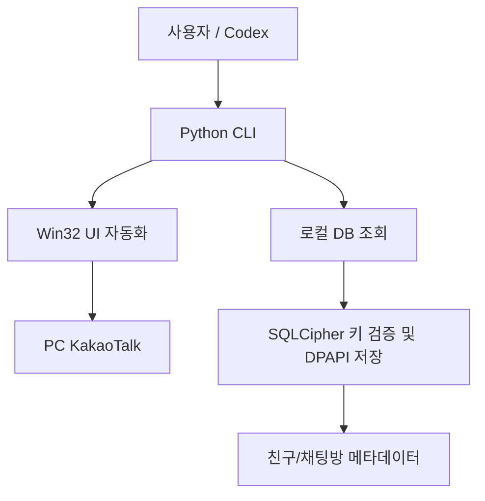

# kakaocli-win

## 핵심 요약
Windows 10/11의 PC 카카오톡을 Win32 API로 제어하는 비공식 Python CLI. 카카오 공식 API나 프로토콜을 사용하지 않으며, 열린 채팅방 UI 제어와 로컬 암호화 DB의 친구·채팅방 메타데이터 조회를 제공한다. Codex용 재사용 Skill 두 개도 포함한다.

## 요구 조건
- Windows 10/11, Python 3.10+, 설치 및 로그인된 PC 카카오톡.
- UI 읽기/전송 대상 채팅방은 독립 창으로 열려 있어야 한다.
- 카카오톡 업데이트 시 컨트롤 선택자 호환성이 깨질 수 있다.

## 기능 및 명령
| 명령 | 기능 | 주의 |
| --- | --- | --- |
| `doctor`, `start` | 환경 점검 및 실행 | 권한 수준 일치 필요 |
| `rooms`, `open` | 열린 독립 채팅방 목록 및 포커스 | 닫힌 방 자동 검색 불가 |
| `read` | 화면에 로드된 대화 읽기 | 클립보드 내용 변경 |
| `send`, `send-self` | 메시지 전송 | 기본 확인; `--dry-run` 지원 |
| `friends`, `chat-rooms` | 로컬 DB 메타데이터 검색 | 메시지 본문은 조회하지 않음 |
| `export-room-contacts` | 참여자 캐시 CSV 내보내기 | 개인정보 및 부분 목록 가능 |
| `recover-key`, `key-status` | 로컬 DB 키 복구 및 저장 상태 | 프로세스 메모리 접근 |
| `inspect`, `db-schema` | UI 및 DB 진단 | 진단 결과 민감정보 확인 |

## 구조

위 도식은 README에 근거한 개념적 구성도이며 코드 호출 관계를 완전히 재현한 것은 아니다.

## 안전성과 제약
- `recover-key`는 KakaoTalk.exe 메모리의 읽기 가능한 사설 영역에서 후보를 찾고 DB 첫 페이지의 SQLCipher 4 HMAC-SHA512로 검증한다고 설명한다.
- 검증 키는 사용자별 DPAPI 암호문으로 저장하며 임시 복호화 SQLite 파일은 조회 후 삭제하도록 설계되었다고 설명한다. 이는 저장소의 구현 주장으로, 별도 보안 감사 결과는 아니다.
- 자동 대량 전송 기능은 제공하지 않는다. `--exact`로 대상 채팅방을 정확히 지정하는 것이 좋다.
- 서비스 약관, 회사 보안 정책, 타인 개인정보 접근 권한을 확인해야 한다.
- 프로세스 메모리 및 연락처 데이터 취급은 Enterprise 관리 환경에서 특히 신중히 검토해야 한다.

## Codex Skills
- `skills/kakaotalk-windows-cli`: 설치, 진단, UI 자동화
- `skills/kakaotalk-db-key-recovery`: 권한 범위 내 DB 키 복구·검증

## 적용 판단
개인 Windows 자동화 PoC 및 사용자 승인형 메시지 발송에 적합하다. 운영 자동화에는 UI 변경 내성, 전송 결과 확인, 비밀정보 로깅 방지, 사용자 승인 절차가 필요하다. 조직 전체 배포나 무인 대량 전송에는 적합하다고 단정할 수 없다.

## 검증 범위
2026-10-24 공개 GitHub README 및 최상위 파일 구조를 확인했다. Windows 실제 실행, 보안 감사, 최신 카카오톡 버전 호환성 검증은 수행하지 않았다.

## 참고 자료
- 원본: https://github.com/Lee-SiHyeon/kakaocli-win
- SQLCipher 설계: https://www.zetetic.net/sqlcipher/design/
