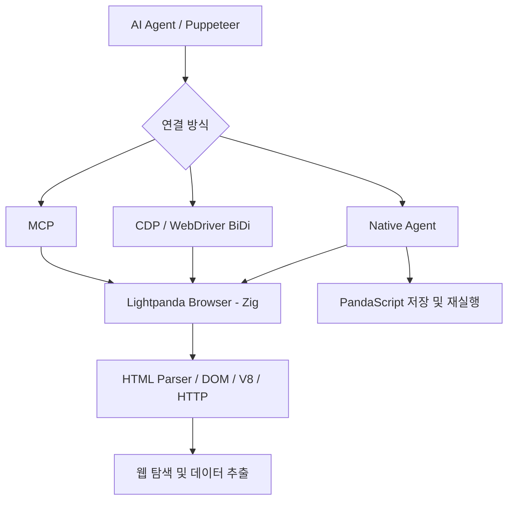

# Lightpanda Browser

## 핵심 요약
Lightpanda는 Chromium 포크가 아닌 Zig 기반 신규 Headless Browser로, AI Agent 및 웹 자동화에 최적화된 실행 환경을 지향한다. CDP, WebDriver BiDi, Native MCP, Native Agent 및 PandaScript를 지원한다.

## 해결하는 문제
Chromium 기반 자동화의 높은 메모리 사용량과 실행 오버헤드를 줄이고, AI 에이전트가 웹 탐색·추출·반복 실행을 수행할 수 있도록 한다.

## 핵심 기능
- HTML 파싱(html5ever), DOM 및 Web APIs, V8 JavaScript 실행, HTTP(libcurl)
- CDP/WebDriver BiDi 서버로 Puppeteer 등 클라이언트 연결
- `fetch --dump markdown`을 통한 페이지 텍스트 추출 및 `--dump structured_data` 메타데이터 추출
- Native MCP(stdio/HTTP)와 세션별 브라우징 컨텍스트 격리
- Native Agent가 자연어 작업을 수행하고 PandaScript로 저장·재실행
- 쿠키, 프록시, 네트워크 인터셉션, robots.txt 준수 옵션

## 구성 요소와 흐름

위 그림은 공식 README의 기능을 기반으로 한 개념적 구성도이며 내부 모듈 의존성의 정확한 구현도를 뜻하지 않는다.

## 성능 근거 및 한계
공식 README는 AWS EC2 m5.large에서 실제 웹페이지 933개를 요청한 벤치마크를 인용한다. 100페이지 기준 피크 메모리는 Lightpanda 123MB 대 Headless Chrome 2GB(약 16배 절감), 실행 시간은 5초 대 46초(약 9배 빠름)로 제시한다. 이는 제작사 측 특정 조건의 결과이며 모든 사이트, 동시성, 워크로드에서 재현된다는 의미는 아니다.

## 도입 및 실행
Linux/macOS용 nightly 바이너리와 공식 Docker 이미지를 제공한다. Windows 네이티브 바이너리는 없으며 WSL2를 사용한다.

```bash
docker run -d --name lightpanda -p 127.0.0.1:9222:9222 lightpanda/browser:latest
```

CDP 서버 예:
```bash
./lightpanda serve --obey-robots --host 127.0.0.1 --port 9222
```

MCP stdio 설정:
```json
{"mcpServers":{"lightpanda":{"command":"/path/to/lightpanda","args":["mcp"]}}}
```

## 실무 평가
- **적합:** 다량의 문서 수집, Markdown 변환, Agent 기반 정보 추출, 반복 작업의 스크립트화.
- **검증 필요:** 복잡한 SPA, SSO/기업 인증, 브라우저 호환성, CDP 기능 범위, 사이트별 JavaScript 동작.
- **제약:** AGPL-3.0 라이선스 의무 검토, Windows에서 WSL2/Docker 필요, 기본 텔레메트리 설정 검토(`LIGHTPANDA_DISABLE_TELEMETRY=true`로 비활성화 가능).
- **권장 PoC:** 동일 URL 세트에 대해 Chrome/Lightpanda의 추출 정확도, 오류율, 메모리, 처리시간을 비교하고, 실패 페이지는 Chromium으로 fallback한다.

## 확인 사실과 미확인 사항
- 확인: README의 기능 목록, 설치·실행 예제, 공식 벤치마크 수치, 라이선스.
- 미확인: 실제 사용자 환경의 속도 개선, 전체 웹 호환성, 사내 SSO 적합성, 기업 배포의 법률적 라이선스 판단.
- 이 문서는 공식 저장소 README 중심의 조사이며 소스코드 실행 테스트를 수행하지 않았다.

## 참고 자료
- [공식 GitHub 저장소](https://github.com/lightpanda-io/browser)
- [공식 사이트](https://lightpanda.io)
- [릴리스](https://github.com/lightpanda-io/browser/releases)
- 조사일: 2026-11-01
