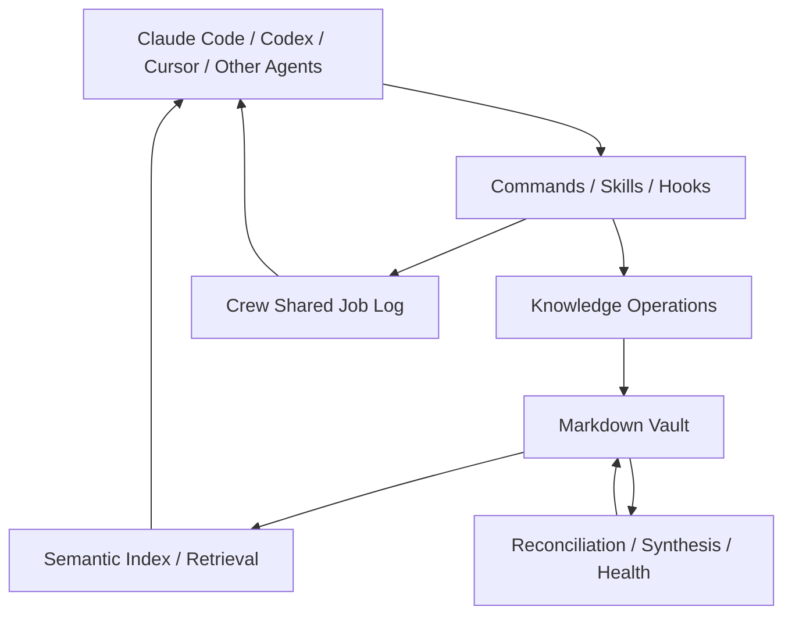

# Obsidian Second Brain

## 한줄 요약
Claude Code, Codex 등 AI Agent가 Markdown Vault를 지속적 기억으로 활용하고, 기존 지식을 갱신하며, Crew 작업 기록을 공유하도록 하는 오픈소스 도구.

## 개요
Eugeniu Ghelbur의 MIT 라이선스 프로젝트. 2026-10-28 기준 README는 Claude Code 49개 명령(다른 일부 배포판 48개), 2026년 10월 v0.18의 Crew 기능을 설명한다. 수치는 README에 표시된 기준이며 실측 검증은 하지 않았다.

## 해결하려는 문제
- AI 세션 간 작업 배경과 의사결정이 소실되는 문제
- 서로 다른 Agent가 이전 작업 결과를 알지 못하는 문제
- 단순 append-only Wiki의 중복·모순·노후화
- 기존 지식이 있는데도 같은 내용을 재조사하는 비용

## 핵심 기능
- `/obsidian-save`, `/obsidian-ingest`: 대화·URL·파일에서 지식을 추출하고 관련 기존 노트를 갱신
- `/obsidian-find`, `/obsidian-reindex`, `/obsidian-retrieval-eval`: 검색, 의미 색인, recall@k·MRR 기반 평가
- `/obsidian-reconcile`, `/obsidian-health`, `/obsidian-synthesize`: 모순·신선도·연결성 점검 및 통합
- `/obsidian-world`: 세션 컨텍스트 복원
- Crew: Claude Code·Codex·Cursor·Grok Bot의 공용 작업 로그 및 승인 기반 교훈 유지; 별도 Obsidian 없이 일반 폴더에서도 동작
- 정기 에이전트: 아침 요약, 야간 통합, 주간 리뷰, Vault 건강 점검

## 아키텍처
README 기반 개념도이며 코드 호출 순서의 완전한 검증은 아니다.

지식 저장소는 Front Matter, 출처, 시간 정보, 관계를 갖는 Markdown 중심이다. Crew는 백그라운드 실행 루프가 아니며, 제안된 교훈은 사람이 `keep`을 수행해야 규칙이 된다.

## 장점
- 특정 Agent 제품과 분리된 읽기 쉬운 지식 저장 형식
- 단순 신규 문서 추가보다 기존 사실 갱신을 우선
- 작업 로그와 지식 노트를 구분해 멀티 에이전트 인수인계에 활용 가능
- 검색 품질 평가 명령을 제공
- Obsidian 앱이 없어도 Crew 사용 가능

## 단점·한계
- 자동 모순 해결이나 기존 문서 재작성은 오판 시 지식 오염 위험이 있다.
- 다중 Agent의 동시 수정 시 충돌 처리 정책이 별도로 필요하다.
- 명령 수가 많아 학습·유지보수 복잡도가 증가한다.
- 토큰 절감률, 성능 및 Windows/Enterprise 환경의 실제 호환성은 이번 조사에서 실측되지 않았다.
- Crew는 작업 공유 계층이지 병렬 실행·오류 복구를 포괄하는 완전한 Harness가 아니다.
- 외부 연구·X·YouTube 연동은 서비스 의존성 및 개인정보·보안 정책 검토가 필요하다.

## 활용 사례
1. Claude Code와 Codex가 동일 프로젝트에서 작업한 결과와 교훈 공유
2. AI 기술 조사 자료를 기존 Wiki 문서에 통합하고 출처·날짜 유지
3. 과거 설계 결정과 현재 결정 간 모순 확인
4. 문서 증가 시 의미 검색과 회귀 평가 운영

## 기존 방식 비교
| 항목 | 단순 Markdown Wiki | Obsidian Second Brain |
|---|---|---|
| 지식 축적 | 문서 생성·수동 수정 | 기존 문서 재작성·연결 |
| 모순 처리 | 수동 검토 | 자동 탐지·해결 명령 제공 |
| Agent 연속성 | 지침·문서 직접 주입 | 컨텍스트 복원·Crew 로그 |
| 정기 관리 | 별도 자동화 필요 | 정기 Agent 패턴 제공 |
| 운영 위험 | 비교적 단순 | 자동 갱신 검증 필요 |

## 활용 아이디어
기존 `jaywapp/wiki`의 `ai/Orchestration.md` 분류 정책을 유지하면서 다음을 별도 PoC로 검증한다.

1. 신규 소스 입력 → 동일 프로젝트 및 유사 문서 검색 → 날짜·출처 비교 → 변경 제안
2. 자동 overwrite 대신 diff와 근거 확인을 거쳐 GitHub develop에 게시
3. Claude Code/Codex가 공유할 job log를 Wiki 문서와 별도 경로로 운용
4. 검색 질문 세트를 만들어 recall@k, MRR, 토큰 사용량, 잘못된 문서 수정 비율 측정
5. 기존 GitHub Document Publishing Skill의 develop read-back 검증을 유지

## 결론
**PoC 가치 있음.** Obsidian Vault 전체를 이관하기보다 기존 GitHub Wiki에 증분 지식 갱신, 시점 정보, Agent 작업 로그, 검색 평가를 선택적으로 도입하는 편이 적절하다. 자동 모순 해결은 사람의 검토를 우선한다.

## 참고 자료
- 원본 저장소: https://github.com/eugeniughelbur/obsidian-second-brain
- README: https://github.com/eugeniughelbur/obsidian-second-brain/blob/main/README.md
- 아키텍처: https://github.com/eugeniughelbur/obsidian-second-brain/blob/main/architecture.md
- 변경 이력: https://github.com/eugeniughelbur/obsidian-second-brain/blob/main/CHANGELOG.md
- Wiki 분류 정책: https://github.com/jaywapp/wiki/blob/develop/ai/Orchestration.md
