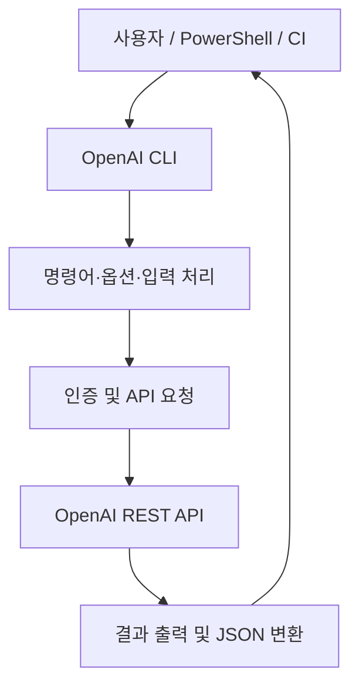

# OpenAI CLI

## 한줄 요약
OpenAI REST API를 터미널 및 CI에서 호출·관리하기 위한 Go 기반 공식 CLI. Codex CLI와 달리 자율 코딩 에이전트가 아니라 API 작업 인터페이스다.

## 개요
- 원본: https://github.com/openai/openai-cli
- 라이선스: Apache-2.0
- 구현: Go; `cmd/openai`, `internal`, `generated`, `tests/cli` 구조 확인
- 조사일: 2026-10-22

## 해결 문제
API별 HTTP 요청·인증·파일 입출력·응답 파싱을 직접 작성하는 반복 작업을 명령줄 인터페이스로 단순화한다.

## 핵심 기능
- `openai responses create`를 통한 Responses API 호출
- 모델 조회, 파일 업로드·조회·다운로드
- 이미지 생성·편집·저장 및 로컬 미리보기
- Admin API의 조직 사용량 조회
- `--format json|jsonl`, `--transform`으로 자동화 친화적인 출력
- API 키·관리자 키·조직/프로젝트 선택, 프록시, 커스텀 헤더, mTLS 지원
- Bash/zsh/fish completion 및 PowerShell 기본 Tab completion

## 아키텍처

위 흐름은 README의 명령 사용·인증·출력 동작에 근거한 개념적 구조다. 내부 패키지 간 정확한 호출 그래프는 별도 소스 검증이 필요하다.

## Quick Start
Homebrew:
```bash
brew install openai/tools/openai
```
Go 1.26 이상:
```bash
go install 'github.com/openai/openai-cli/cmd/openai@latest'
```
API 키는 비밀 관리 시스템 또는 환경변수 `OPENAI_API_KEY`로 설정한다.
```bash
openai responses create --input "Say this is a test" --model gpt-5.5
openai models list --format json
openai files upload "sample.txt" --purpose user_data
```
명령의 모델 ID 및 실제 API 접근 가능 여부는 계정·시점별 확인 필요.

## 장점
- 공식 OpenAI API 인터페이스, 스크립트 및 CI에 통합하기 쉬움
- JSON/JSONL과 오류 형식 제어 지원
- 로컬 파일 처리 및 이미지 워크플로우 제공
- Apache-2.0 라이선스

## 단점과 한계
- API 호출 비용 및 별도 인증 필요; ChatGPT 구독만으로 API 과금이 대체되는 것은 아님
- Agent의 자율 계획·상태 관리·복구·멀티 에이전트 조정 기능을 제공하는 Harness가 아님
- API 키 노출, 민감한 입력 및 `--debug` 로그 취급 주의
- Windows 네이티브 설치 패키지 제공 여부와 CI 성능 수치는 이번 조사에서 확인되지 않음
- API 장애 시 재시도·백오프·관측성은 사용자가 구성해야 함

## 활용 사례
- TeamCity 빌드 후 테스트 로그 요약을 Responses API로 처리
- PowerShell 스크립트에서 모델·파일 API 자동화
- 조직 API 사용량을 수집해 비용 대시보드로 전달
- 배치 이미지 생성 및 파일 다운로드

## 비교
| 구분 | OpenAI CLI | Codex CLI | 직접 HTTP/SDK |
|---|---|---|---|
| 주목적 | OpenAI API 호출·관리 | 코딩 에이전트 | API를 애플리케이션에 통합 |
| 자율 코드 수정 | 주기능 아님 | 핵심 용도 | 직접 구현 |
| 스크립트 사용 | 편리 | 에이전트 실행 중심 | 유연하지만 구현 부담 |
| 복잡한 업무 조정 | 외부 Orchestrator 필요 | 에이전트 기능 범위 내 | 직접 구현 |

## 활용 아이디어
1. TeamCity 별도 후처리 Step에서 빌드 실패 로그를 입력해 요약한다.
2. API 사용량을 일별 수집해 비용 이상치를 검출한다.
3. Windows PowerShell에서 API 기반 반복 업무를 표준화한다.
4. PoC에서는 호출 실패, 비밀정보 마스킹, 출력 스키마 및 비용 상한을 검증한다.

## 결론
**바로 적용 가능.** OpenAI API 자동화의 표준 CLI로 유용하다. 복잡한 Agent Harness 대체재가 아니라 Harness에서 호출할 수 있는 도구 계층으로 평가한다.

## 참고 자료
- https://github.com/openai/openai-cli
- https://github.com/openai/openai-cli/blob/main/README.md
- https://github.com/openai/openai-cli/tree/main/cmd/openai
- https://github.com/openai/openai-cli/tree/main/internal
- https://github.com/openai/openai-cli/tree/main/tests/cli
