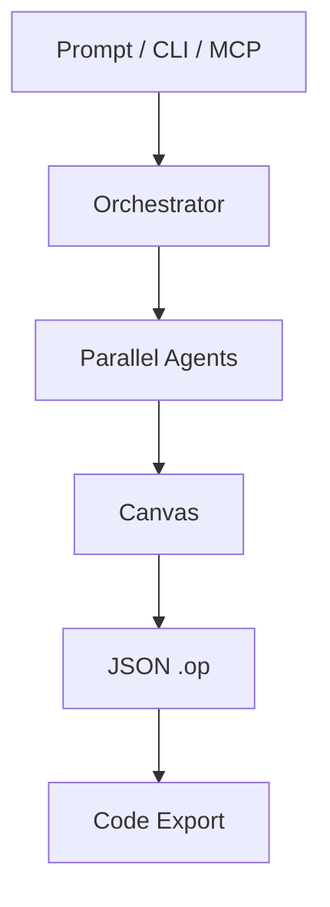

# OpenPencil

OpenPencil은 MIT 라이선스의 AI-native 벡터 디자인 도구로, 자연어에서 캔버스 UI를 생성하고 여러 Agent가 페이지의 서로 다른 영역을 병렬로 작업하도록 설계됐다.

## 핵심 기능

- Prompt-to-Canvas: 자연어로 UI 생성 및 요소 수정.
- Concurrent Agent Teams: Orchestrator가 공간별 작업을 분할하여 병렬 생성.
- MCP Server: Claude Code, Codex, OpenCode 등에서 `.op` 파일 조작.
- Design-as-Code: JSON 기반 `.op` 파일을 Git diff로 추적하고 디자인 변수를 CSS로 내보냄.
- CLI: `op design`, `op insert`, `op start --headless`.
- Export: React, Vue, Svelte, Flutter, SwiftUI, Jetpack Compose, React Native 등.

## 아키텍처 개념

공식 README 설명을 재구성한 개념도이며 내부 실행 흐름을 독립 검증한 것은 아니다.

## 기술 및 운영

Rust 기반 workspace 및 웹/데스크톱 배포 구조를 제공한다. Windows, macOS, Linux와 웹 호스트를 지원한다. Windows 일부 포터블 배포는 Visual C++ Redistributable이 필요하다. 웹 자격 증명은 기본적으로 브라우저 localStorage에 저장되므로 XSS와 오리진 제한에 유의해야 한다.

## 평가 및 PoC

장점은 버전 관리 가능한 디자인 산출물과 외부 Agent 연동이다. 생성 품질, 코드 Export 완성도, 협업 충돌 처리, 기업 환경 보안 적합성은 별도 실험이 필요하다. 동일 랜딩 페이지를 프롬프트로 생성하고 MCP 수정, `.op` diff, React Export 결과를 비교하는 PoC를 권장한다.

## 출처

- https://github.com/ZSeven-W/openpencil
- https://github.com/ZSeven-W/openpencil/releases
- 조사일: 2026-10-25

README 및 저장소 구조 확인에 기반하며 실제 실행 테스트는 수행하지 않았다.
