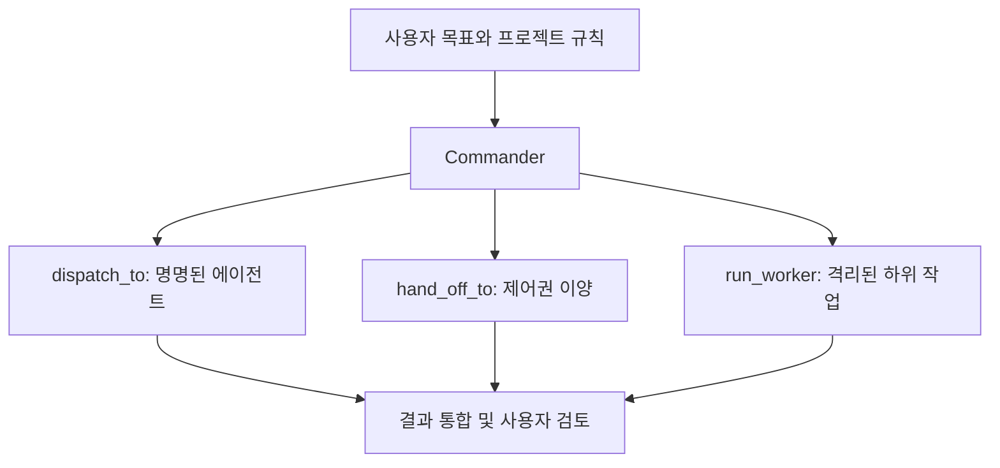

# Orkas — 16개 전문 에이전트의 데스크톱 업무 자동화

## 핵심 요약
Orkas는 MIT 라이선스의 local-first 데스크톱 멀티에이전트 앱이다. Commander가 사용자 목표를 작업으로 나누고 16개 내장 전문 에이전트 및 Claude Code, Codex, OpenCode, OpenClaw, Hermes-Agent 같은 외부 CLI 에이전트에 위임한다. 단일 챗봇보다는 지속적인 프로젝트 운영과 반복 자동화에 적합하다.

## 주요 기능
- **Commander:** 목표 계획, To-do 생성, 전문 에이전트 위임, 결과 통합.
- **16개 전문가:** 리서치(DeepResearcher, SeoGeoAgent, StockAnalyser), 콘텐츠(ContentWriter, PptMaker, ImageStudio, VideoStudio, VoiceStudio), 개발(UIDesigner, ProductDeveloper), 사무(OfficeWorker), 이커머스(ECommerceResearcher, ECommerceWriter, ECommerceReviewer, ECommerceAnalyzer, ECommerceOperator).
- **프로젝트:** 목표, 규칙, 메모리, 파일, To-do 및 Auto-advance 유지.
- **자동화:** 시간별·일별·주별·월별 예약. v1.9 이후 12시간 이내 누락된 최근 실행을 기기 재가동 시 보충.
- **문서 라이브러리:** 로컬 문서 추출, SQLite 벡터 인덱스, 출처 기반 검색.
- **모델:** 내장 Orkas 모델, 개인 API 키, 로컬 OpenAI 호환 엔드포인트.
- **커넥터:** Gmail, Calendar, Sheets, Drive, Notion, Slack, Shopify 등.

## 실행·Context 구조

공식 README에 따르면 `dispatch_to`는 명명된 에이전트의 결과를 받아 후속 작업을 수행하고, `hand_off_to`는 제어권을 넘기며, `run_worker`는 대화 이력을 받지 않는 익명 격리 작업이다. Context는 모델 입력 예산, 최근 이력 창, 장기 작업 체크포인트 및 파일·명령 실행 기록으로 관리된다. 세션 잠금, 동시 실행 제한, 반복 호출 검사, watchdog을 통해 무한 실행 위험을 줄인다.

## 배포 및 비용
| 항목 | 패키지 앱 | 소스 빌드 |
|---|---|---|
| 플랫폼 | macOS 12+, Windows 10+ | macOS, Windows, Linux glibc 2.34+ |
| 계정 | 로그인 필요 | 계정 불필요 |
| 모델 | 내장 모델 또는 개인 키 | 개인 키 또는 로컬 엔드포인트 |
| 클라우드 동기화·공유·웹 게시 | 제공(기능별 요금제 제약) | 미지원 |

패키지 앱의 내장 모델은 초기 500크레딧이 제공되며 이후 별도 비용이 발생할 수 있다. 외부 API 요금은 별도다. Orkas는 로컬에서 실행되지만 클라우드 모델 사용 시 데이터가 모델 공급자로 전송된다. 자동화는 PC가 켜져 있고 Orkas가 실행 중이어야 한다.

## 실무 활용 및 평가
**추천 PoC:** 정기 기술 조사 → 출처 확인 → Markdown 보고서 → GitHub 게시 전 검토를 프로젝트 To-do로 연결. 전문 에이전트 분업의 효용과 품질을 측정한다.

**장점:** 기존 CLI 에이전트 재사용, 프로젝트 지속성, 모델 선택 유연성, 로컬 문서 검색, 예약 실행.

**주의:** 여러 에이전트의 호출 비용과 복잡도, 파일/명령 실행 권한, 커넥터 외부 전송, 클라우드 동기화 범위, 자동화 중단/복구 정책을 별도로 검증해야 한다. 소스 빌드와 패키지 앱의 기능이 다르다. README에 기술된 기능은 프로젝트 측 설명이며 실제 환경별 안정성·성능은 별도 검증이 필요하다.

## 설치
Node.js 22.12+ 필요. Windows에서는 저장소 clone 후 `run.cmd`, macOS/Linux에서는 `./run.sh` 실행. 초기 설치 시 모델과 도구 의존성을 다운로드할 수 있다.

## 출처
- 공식 GitHub 및 README: https://github.com/Orkas-AI/Orkas
- gitlog 소개(2026-10-31): https://gitlog.kr/i/t15a7

조사일: 2026-11-01. 공식 README 중심 확인. 실제 설치·벤치마크는 수행하지 않음.
