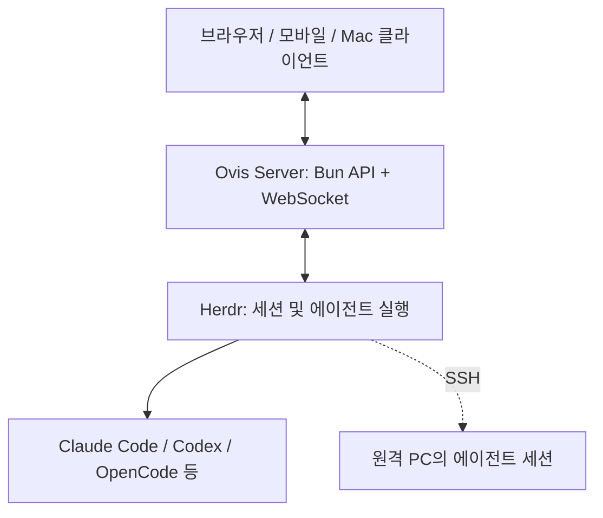

# Ovis — AI 코딩 에이전트 통합 원격 관리 UI

## 핵심 요약
Ovis(구 Herdr Web UI)는 Herdr에서 실행하는 Claude Code, Codex, OpenCode 등 코딩 에이전트 세션을 브라우저, 모바일, Mac 앱에서 채팅과 실시간 터미널로 관리하는 무료 MIT 오픈소스 클라이언트다. AI 모델 실행기 자체가 아니라 Herdr의 UI 계층이다.

## 주요 기능
- 여러 워크스페이스, 탭, 분할 화면과 SSH 연결된 원격 PC 세션 통합
- 에이전트의 승인·질문을 카드 형태로 제시하고 응답 전 유효성 재확인
- 실시간 터미널 및 모바일용 키 바
- 질문 및 작업 완료 웹 푸시 알림
- Windows/macOS/Linux 설치, 모바일 PWA 및 iOS/Android 베타
- 계정 없는 자체 호스팅

## 구성과 실행 흐름

위 도식은 README와 디렉터리 구조에 근거한 개념적 요약이며, 세부 프로토콜 구현을 검증한 도식은 아니다.

저장소에는 `server/`, `src/`, `app/`, `relay/`, `push-relay/`, `crates/pty-sidecar/`, `integrations/` 등이 있다. React, Bun, xterm.js 등을 사용한다. 개발 모드에서는 `bun run server`(7317), `bun run dev`(5173)를 실행한다.

## 설치
- Windows: 공식 사이트의 Ovis.exe
- macOS: Ovis.dmg
- Linux: `curl -fsSL https://ovis.sh/install.sh | sh`
- 휴대전화: iOS TestFlight/Android Google Play 베타 또는 PWA
- Tailscale, VPN, SSH 터널 등으로 실행 PC에 연결한다.

## 장점과 제약
**장점:** 여러 에이전트 세션을 통합하고 휴대전화에서 승인 및 상태 확인이 가능하다. MIT 라이선스와 자체 호스팅으로 확장 및 통제에 유리하다.

**제약:** Herdr 설치가 필요하며 호스트 PC가 켜져 있어야 한다. 원격 접근 네트워크 구성 및 보안 통제가 필요하다. Ovis 자체 계정이나 호스팅 릴레이는 없지만 익명 사용량 통계가 기본 활성화되어 있으며 `OVIS_TELEMETRY=0`으로 끌 수 있다. 모바일 앱은 조사 시점 베타로 안내된다.

## 실무 적용 판단
여러 Claude Code/Codex 작업을 병렬 수행하면서 모바일에서 대기 중인 승인 요청에 대응하는 환경에 적합하다. 기업 Windows 환경에서는 실행 파일 설치 권한, VPN/Tailscale 허용, 방화벽, 접근 인증 및 푸시 알림 데이터 정책을 PoC에서 확인해야 한다. 단순 단일 터미널 사용에는 Herdr 자체 TUI만으로 충분할 수 있다.

## 확인 및 미확인
- 확인: README에 명시된 지원 플랫폼, 기능, 설치, 제약, 라이선스, 개발 명령.
- 미확인: 실사용 성능, 대규모 세션 안정성, Enterprise 인증 적합성, 실제 보안 감사 결과. 별도 테스트 필요.

## 출처
- [GitHub 원본](https://github.com/devswha/ovis)
- [한국어 README](https://github.com/devswha/ovis/blob/main/README.ko.md)
- [설치 문서](https://github.com/devswha/ovis/blob/main/INSTALL.md)
- [보안 정책](https://github.com/devswha/ovis/blob/main/SECURITY.md)
- [공식 사이트](https://ovis.sh)

조사일: 2026-11-01
