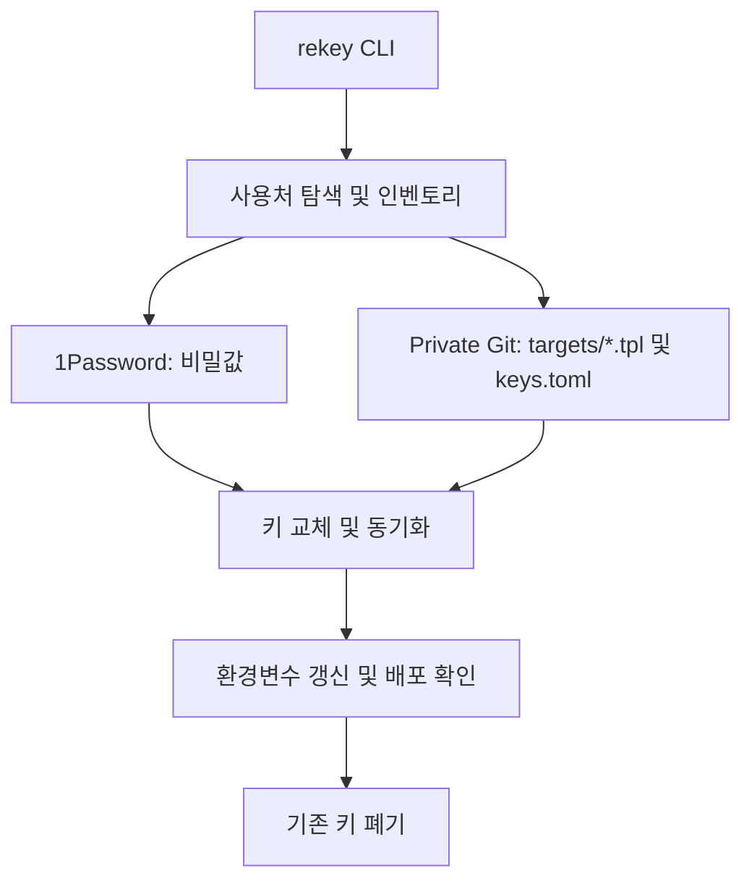

# rekey

> API Key 사용처를 탐색하고 1Password와 Git 템플릿을 기반으로 재발급·동기화·폐기를 관리하는 Python CLI.

## 프로젝트 개요
golbin/rekey는 여러 환경에 복제된 API Key를 교체하는 작업을 통합하는 MIT 라이선스 CLI다. Python 3.11 이상을 요구하고 표준 라이브러리를 사용한다.

## 해결하려는 문제
키가 .env, Vercel, Railway, Supabase, GCP, GitHub 등에 분산되면 누락된 사용처와 오래된 키가 발생하기 쉽다. rekey는 키 값과 사용 위치를 분리하여 관리한다.

## 핵심 기능
- `rekey init`: 로컬 .env와 지원 서비스의 환경 설정을 조사하고 동일 키를 묶어 사용처 목록 구성
- `rekey rotate 'openai.*'`: 키 재발급과 사용처 업데이트, 배포 상태 확인 흐름
- `rekey revoke 'openai.*'`: 구 키 폐기
- 자동 발급 API가 없는 공급자는 브라우저에서 수동 발급하도록 안내
- 시스템 언어에 따른 다국어 메시지 지원

## 아키텍처

주요 코드: `rekey_lib/cli.py`, `core.py`, `init.py`, `providers.py`, `targets.py`, `store.py`, `tpl.py`. 실제 각 공급자별 자동화 범위는 별도 검증이 필요하다.

## 장점
- 다수 프로젝트의 키 사용처 누락을 줄일 수 있음
- 비밀값을 Git 템플릿과 분리하고 1Password에 저장
- CLI 기반으로 자동화 파이프라인에 결합 가능
- 단일 언어 Python 및 MIT 라이선스

## 단점 및 한계
- 1Password 의존성과 CLI 인증·권한 관리 필요
- 공급자마다 자동 발급·폐기 지원 수준이 다름
- 재배포 실패 시 서비스 장애 및 롤백 정책 검증 필요
- Windows, Enterprise 감사·승인, 동시 실행 안전성은 확인되지 않음
- 초기 프로젝트로 보이며 운영 규모와 실사용 안정성 자료 부족

## 활용 사례
- Vercel과 Supabase에 분산된 여러 앱의 API Key 교체
- API Key 유출 대응 및 퇴사자 접근권한 정리
- Claude Code/Codex에서 승인 후 CLI 실행하는 운영 스킬의 백엔드

## 기존 도구와 비교
1Password 단독 사용이 비밀값 보관에 초점을 맞춘다면 rekey는 사용처 목록과 교체 흐름을 결합한다. Vault 및 클라우드 Secret Manager와의 기능·보안 동등성은 입증되지 않았다.

## 활용 아이디어
- **바로 적용 가능:** 키 사용처 인벤토리 및 템플릿 운영 원칙 참고
- **PoC 가치 있음:** 비운영 Vercel/Supabase 프로젝트에서 탐색→교체→배포 확인→폐기 검증
- **아이디어 참고:** AI Agent가 승인 절차를 거쳐 키 회전 작업을 실행하는 스킬
- **운영 도입 보류:** Windows 및 장애 복구·감사 추적 검증 전 프로덕션 자동 폐기

## 결론
복수의 서비스에서 API Key를 반복 사용하는 개발 환경에 유용한 접근이다. 프로덕션 적용 전에 지원 범위, 권한 최소화, 롤백, 배포 검증을 확인해야 한다.

## 참고 자료
- https://github.com/golbin/rekey
- https://github.com/golbin/rekey/tree/main/rekey_lib
- https://github.com/golbin/rekey/tree/main/tests
- https://github.com/golbin/rekey/tree/main/docs
