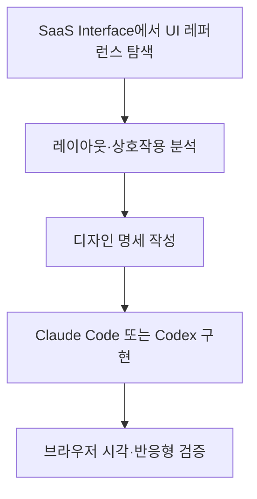

# SaaS Interface

## 한줄 요약
실제 SaaS 제품의 페이지 및 UI 컴포넌트 사례를 탐색·검색·저장할 수 있는 유료 디자인 레퍼런스 갤러리.

## 개요 및 해결 문제
SaaS 대시보드와 관리 도구의 화면 구조를 설계할 때 반복적인 레퍼런스 탐색 시간을 줄이는 서비스. 디자인 구현 라이브러리나 AI Agent는 아니다.

## 핵심 기능
- 페이지: Dashboard, Lists & Tables, Checkout, Pricing, Billing, Settings, Calendar, Boards, Chat, Builder/Editor, Onboarding, Empty State 등
- 컴포넌트: Modal/Dialog, Menu/Picker, Search, Side Panel, Filters, Bulk Actions
- 유료 회원에게 갤러리 검색·저장 및 매월 신규 사례 제공을 안내함

## 아키텍처 및 활용 흐름
내부 서비스 구현 구조는 공개 자료에서 확인되지 않음. 아래는 **제안 워크플로우**다.

## 장점
- 실제 SaaS 제품 사례 중심
- 페이지와 컴포넌트별 탐색
- 구독이 아닌 일회성 결제 안내

## 단점 및 한계
- 무료 공개 영역만으로 유료 갤러리 전체 품질 검증 불가
- 소스코드·Figma 원본·공식 API 제공 여부 확인되지 않음
- 사례 원저작권은 각 제작자에게 있으며 복제·재배포 권한이 포함된다고 볼 수 없음
- 디자인 패턴 참고용이지 UI 구현 자동화 솔루션은 아님

## 비용 (2026-10-23 조회)
- Individual: 할인 표시 $39 (정가 $49)
- Team: 할인 표시 $159 (정가 $199), 최대 5명
- 일회성 결제, 매월 업데이트 안내, 구매 후 48시간 환불 요청 가능
- 가격·프로모션은 변경 가능

## 활용 사례
- SaaS 관리 대시보드, 테이블, 결제·설정·온보딩 화면의 정보 구조 참고
- AI 코딩 도구에 제공할 화면 명세 작성
- 팀 공통 UI 패턴 및 디자인 체크리스트 구성

## 비교
- 컴포넌트 라이브러리(shadcn/ui 등)는 구현 가능한 코드 제공이 중심
- SaaS Interface는 실제 서비스 디자인 사례 탐색이 중심
- 기능이 상호 보완적이며 직접 대체재는 아님

## 활용 아이디어 및 결론
**PoC 가치 있음.** 실제 프로젝트 화면 하나를 선정해 레퍼런스 → 명세 → AI 구현 → 시각 검증을 수행해 시간을 측정한다. 구매 전 무료 사례와 다른 디자인 갤러리로 충분한지 비교한다.

## 참고 자료
- https://saasinterface.com/
- https://saasinterface.com/pricing/
- https://saasinterface.com/terms/
