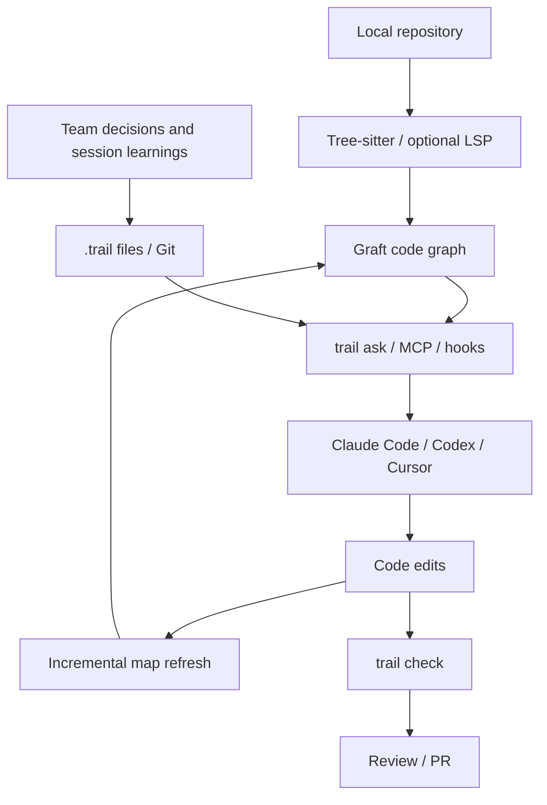

# Trail Code (formerly Graft)

> 코드 호출 그래프와 Git 공유형 Learnings를 이용해 코딩 에이전트의 반복 탐색·맥락 손실을 줄이는 로컬 우선 컨텍스트 계층.

## 개요와 해결 문제

Trail Code는 기존 Graft 코드 맵에 세션·팀의 의사결정 기록(Learnings)을 더한 오픈소스 CLI다. Claude Code, Codex, Cursor 등 에이전트가 작업마다 코드를 다시 읽고 이전 결정과 충돌하는 문제를 겨냥한다. 자체 LLM이나 멀티 에이전트 실행기가 아니다.

## 핵심 기능

- **Graft Map**: Tree-sitter로 파일·심볼·호출/참조 관계를 파싱하고 변경된 부분을 증분 갱신. 선택적 LSP 정밀 엣지와 LLM 요약(`trail build --deep`) 지원.
- **Context retrieval**: `trail ask`, `trail grep`, `trail skeleton`, `trail callers`로 필요한 코드 위치·영향 범위를 좁혀 전달.
- **Learnings**: 팀의 결정·선호·주의사항을 Markdown 파일로 저장하고 Git에서 리뷰·공유. 개인 지식은 로컬에 보관.
- **Agent integration**: Claude Code에는 hook/skill/statusline, Codex 등에는 AGENTS.md 또는 MCP 기반 연동.
- **Guard/check**: `trail check`로 현재 변경과 기존 팀 결정의 충돌 여부 확인.
- **Privacy**: 기본 그래프·검색·검사는 로컬에서 모델 호출 없이 실행. deep 요약은 사용자 제공 모델 키 필요. 익명 텔레메트리 옵션은 별도 점검.

## 실행 구조



그래프는 로컬 캐시로 유지하며 팀 Learnings는 Git에서 버전 관리한다. Hook과 MCP 지원 범위는 호스트마다 다르다.

## 벤치마크 (공식 자체 측정)

| 항목 | 공개 결과 |
|---|---|
| 162회 실행 도구 호출 | 46% 감소 |
| 162회 실행 비캐시 입력 토큰 | 42% 감소 |
| 162회 실행 시간 | 60% 감소 |
| 162회 실행 비용 | 32% 감소 |
| SWE-bench Verified 50문항 | 27/50 → 33/50 해결 |

이는 프로젝트 측 측정이며 독립 재현이나 조직 환경에서의 동일 효과는 확인되지 않았다. 토큰 비용은 모델·캐시·작업 유형에 따라 달라진다.

## 장점

- 반복 코드 탐색과 컨텍스트 중복을 줄일 가능성.
- 기존 AGENTS.md/CLAUDE.md를 대체하지 않고 코드 기반 맥락을 보완.
- Git으로 팀의 판단 근거를 검토 가능.
- 기본 코드 인덱싱에 외부 LLM 호출 불필요.

## 단점·한계

- Tree-sitter의 정적 호출 그래프는 동적 디스패치, 리플렉션, 빌드 생성 코드에서 정확도 한계.
- Learnings 오기록·노후화 시 잘못된 결정을 강화할 위험.
- Hook 주입·인덱싱 갱신의 CPU/IO 및 토큰 오버헤드 측정 필요.
- 외부 제공자 기반 deep 요약 시 코드 반출 정책 검토 필요.
- Windows, Unreal C++ 대형 프로젝트, Perforce 환경의 실측 효과는 확인되지 않음.

## Quick Start

```bash
npm install -g @trailhq/trail-code
trail init --dry-run
trail init --agents claude
trail status
trail ask "Find retry logic"
trail check
```

설치 전 Node 요구 버전 및 생성되는 hook/설정 파일을 확인한다.

## 비교

| 항목 | Trail Code | CLAUDE.md / AGENTS.md | 일반 grep |
|---|---|---|---|
| 코드 구조 | 자동 그래프 | 수동 설명 | 문자열 검색 |
| 팀 결정 | Git Learnings | 수동 갱신 | 없음 |
| 변경 영향 | 호출 관계 기반 | 수동 추론 | 수동 추적 |
| 운영 비용 | 초기 구축·갱신 | 문서 유지 | 반복 탐색 |

## 실무 활용 아이디어

**PoC 가치 있음.** Windows 기반 UE5 C++ 또는 TypeScript 중형 저장소 하나에서 10~20개 동일 작업을 대상으로 기존 에이전트 대비 탐색 호출 수, 토큰, 작업시간, 정확도, graph refresh 시간을 측정한다. Perforce를 쓰는 경우 Learnings Git 공유 흐름을 그대로 전제하지 말고 별도 동기화 설계를 검토한다. 민감 코드에서는 로컬 deterministic 기능부터 테스트한다.

## 결론

Trail Code의 핵심은 **코드가 어디에 있는지(Code Map)** 와 **왜 그렇게 만들었는지(Learnings)** 를 작업에 맞춰 재사용하는 것이다. 대규모 코드베이스의 반복적인 에이전트 온보딩 비용을 줄이는 데 유망하지만, 공식 수치를 그대로 운영 기대치로 사용하지 않는다.

## 참고 자료

- https://github.com/trailhq/Trail-Code
- https://github.com/trailhq/Trail-Code/blob/main/README.md
- https://github.com/trailhq/Trail-Code/blob/main/CHANGELOG.md
- https://trailhq.com/trail-code
