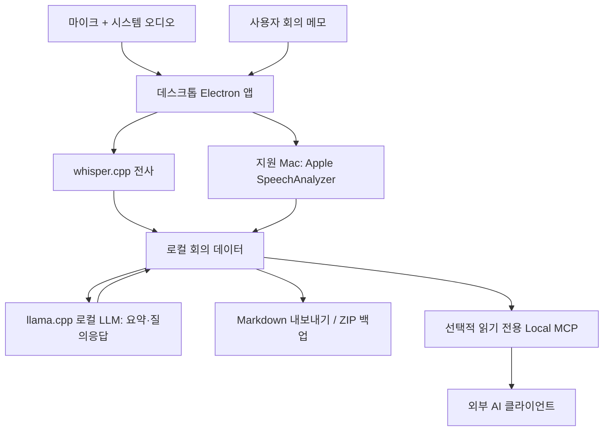

# Yogurt — 로컬 AI 회의록 도구

> 조사일: 2026-11-19 · 원본: [FrigadeHQ/yogurt](https://github.com/FrigadeHQ/yogurt) · 공식 사이트: https://yogurt.so

## 핵심 요약

Yogurt는 Frigade가 제공하는 무료 MIT 라이선스 오픈소스 AI 회의 기록 앱이다. 회의 봇을 참가시키지 않고 PC의 마이크와 시스템 오디오를 캡처해 녹음·전사하고, 로컬 AI로 요약 및 회의별·회의 간 질의응답을 제공한다. Granola의 로컬 우선 대안으로 소개된다. macOS, Windows, Linux를 지원한다.

- **확인된 사실:** 계정 없이 이용 가능하며, 모델 다운로드와 업데이트 확인을 제외한 음성·요약 처리는 로컬에서 수행하도록 안내한다.
- **주요 활용:** 내부 회의의 초안 회의록 작성, 액션 아이템 정리, 기술 논의 검색, Markdown 기반 지식 관리.
- **검증 필요:** 실제 한국어 혼합회의 인식률, CPU/GPU별 실시간 성능, 기업별 녹음 규정, 보안 평가 및 플랫폼별 화자 식별 정확도.

## 기능

| 영역 | 공식 문서에서 확인된 기능 |
| --- | --- |
| 녹음 | 마이크 + 시스템 오디오, 회의 참가 봇 불필요, 회의 종료 자동 정지 기본값 |
| 음성 인식 | whisper.cpp, 지원 Mac에서는 Apple SpeechAnalyzer로 실시간 단어 보조 |
| 언어 | 다국어 모드 99개 언어, 언어 전환 추적, 요약 언어 설정 |
| 회의록 | 사용자 메모와 대화를 결합한 AI 요약, 출처를 연결한 회의 내용 질의응답 |
| 탐색 | 폴더, 제목, 메모, 전사 내용 검색 |
| 이동성 | 노트와 전사 내용 Markdown 복사·내보내기, ZIP 백업·복원 |
| 외부 연동 | 기본 비활성화된 로컬 읽기 전용 MCP 서버 |
| 회의 감지 | Zoom·Teams·Meet와 일부 브라우저 호출 감지, 실제 녹음은 사용자가 시작 |

화자 식별은 **문서 간 표현 차이**가 있다. 프로젝트 최상위 README는 Zoom/Teams/Meet 화자 이름이 Mac/Windows/Linux에서 지원된다고 설명하나, `docs/README.md`는 캘린더 접근 및 회의 화자 이름이 Mac 전용이라고 설명한다. 도입 전 대상 OS/버전의 실제 동작 확인이 필요하다.

## 구성 및 데이터 흐름

위 그림은 공식 README에 공개된 구성요소와 연결 동작을 개념적으로 정리한 것이며 내부 구현 코드의 전체 호출 관계를 재현한 것은 아니다.

### 개발 구성

- Electron + React + TypeScript, electron-vite, pnpm 워크스페이스.
- `app/package.json` 확인 버전: **0.3.46** (조사 시점 main 파일 기준; 배포 최신 버전과 별개).
- 음성 전사: Whisper / `whisper.cpp`; 요약·질문: `llama.cpp` / 로컬 open-weight 모델(Gemma 4, gpt-oss, Qwen3 계열 중 하드웨어에 따라 선택).
- 주요 디렉터리: `app/` (데스크톱 앱), `packages/picker/`, `docs/`, `site/`, `.github/workflows/`.
- 공식 개발 문서의 테스트 명령: `pnpm -C app typecheck`, `pnpm -C app test`, `pnpm -C app e2e`; E2E는 Playwright 및 fake 모드를 활용한다.
- 소스 빌드에는 Node.js 24, pnpm 10.7.0, CMake가 필요하다. Windows는 Rust, Vulkan SDK, Visual Studio C++ Build Tools도 요구된다.

## 설치 및 운영 요구사항

| OS | 공식 요구사항 |
| --- | --- |
| macOS | Apple Silicon, macOS 14.4 이상 |
| Windows | x64, Windows 10 2004 이상 |
| Linux | x64, Ubuntu 22.04 이상 유사 환경, AppImage |
| 공통 | 최소 8GB RAM, 최초 모델 다운로드 필요 |

다운로드: https://github.com/FrigadeHQ/yogurt/releases/latest

로컬 저장 경로:
- macOS: `~/Library/Application Support/Yogurt`
- Windows: `%APPDATA%\Yogurt`
- Linux: `~/.config/Yogurt` 또는 `$XDG_CONFIG_HOME/Yogurt`

처음 실행할 때 모델 다운로드가 필요하고, 하드웨어에 따라 성능 및 모델 다운로드 용량이 크게 달라진다. 공식 도움말은 고사양 Mac에서 큰 노트 모델이 수십 GB에 이를 수 있다고 예시한다. 운영 환경에서는 저장공간까지 확인해야 한다.

## 보안·프라이버시 검토

1. **기본 로컬 처리:** 공식 문서는 오디오·전사·노트·질문을 서버로 업로드하지 않으며 텔레메트리가 없다고 설명한다. 단 모델 다운로드(예: Hugging Face), Apple 음성 자산, GitHub 업데이트 확인은 네트워크를 사용한다.
2. **회의 녹음 동의:** 봇이 참여하지 않아 상대방이 녹음을 인지하지 못할 수 있다. 회의 참석자 고지 및 기업 정책을 준수해야 한다.
3. **기본 녹음 저장:** 음성 파일은 기본 저장이며 설정에서 추후 회의에 대한 저장을 끌 수 있다. 로컬 디스크 암호화 및 백업 관리가 필요하다.
4. **MCP 읽기 권한:** AI 앱 연결은 기본 꺼져 있고 읽기 전용이지만 회의, 녹음, 노트, 전사, 일정 참석자 이름·이메일 등에 접근할 수 있다. Mac/Linux는 0600 권한의 사용자 프로필 소켓, Windows는 실행마다 새 임의 이름의 named pipe를 사용한다. **앱별 토큰은 없으므로 동일 OS 사용자로 실행되는 프로세스의 접근을 주의**해야 한다.
5. **외부 모델 유출 경계:** MCP를 활성화한 외부 AI 클라이언트는 읽은 자료를 자신의 온라인 모델에 전송할 수 있다. 'Yogurt 자체가 로컬 처리'라는 사실이 연동 클라이언트의 비전송을 보장하지는 않는다.
6. **기업 검토:** Enterprise 도입 시 설치 서명 검증, 오디오 권한, 회의 정책, 로컬 보존·삭제·백업, 데이터 반출 경로를 확인한다.

## 장점 및 한계

**장점**
- 회의 봇 없이도 녹음 가능한 로컬 우선 접근.
- 무료·MIT 라이선스, 계정 불필요, OS 선택 폭이 넓음.
- Markdown 내보내기 및 MCP로 개인 Knowledge Base/에이전트 연결 가능.
- 오프라인 모델 처리로 클라우드 STT/LLM 과금 의존도를 줄일 여지.

**한계·주의**
- 최소 RAM 충족과 만족스러운 한국어 실시간 전사 성능은 별개다.
- 대형 모델 다운로드, CPU/GPU 성능, 저장공간 부담.
- 참가자 고지 없는 녹음의 법률·조직 정책 문제.
- 플랫폼별 일정/화자 이름 기능은 공식 문서의 차이가 있어 재검증 필요.
- 외부 AI 앱에 MCP 접근을 제공하면 정보가 클라우드로 나갈 수 있음.
- 현 단계에서 별도 실사용 벤치마크나 Enterprise 보안 감사 결과는 확인하지 않았다.

## Granola와의 비교 관점

Yogurt가 공식적으로 'Granola의 무료 오픈소스 대안'을 표방한다. 다만 이 문서는 Granola의 **동일 날짜 기능·가격·플랫폼 전체를 별도로 검증하지 않았으므로** 정량적인 우열을 판정하지 않는다.

- Yogurt 평가 핵심: 로컬 처리/데이터 통제, 공개 코드, 무료 사용, 음성 인식 품질, Windows 지원.
- Granola 평가 시 추가 확인: 현재 요금·지원 플랫폼·데이터 처리 정책·조직 협업 기능.
- 추천 방향: 기밀 자료와 로컬 관리가 최우선인 개인·소규모 팀에서 Yogurt PoC 우선 고려. SaaS 편의성과 기업 관리 기능은 별도 비교 후 선택.

## 도입 PoC 제안

1. 비기밀 10~20분 한국어 회의를 동의 후 녹음하여 인식 누락·화자 오류를 확인한다.
2. 용어가 많은 기술회의와 한국어/영어 혼합 회의를 각각 실험한다.
3. Windows 장치에서 녹음 권한, 회의 감지, 화자 구분, 전사 지연, CPU/RAM 사용량을 기록한다.
4. Markdown으로 추출해 개인 Wiki나 사내 문서 시스템에 연계한다.
5. MCP는 초기 비활성화하고 데이터 반출 경계를 확정한 뒤 제한적인 환경에서 평가한다.

## 참고 자료

- [GitHub 저장소 및 README](https://github.com/FrigadeHQ/yogurt)
- [공식 도움말](https://github.com/FrigadeHQ/yogurt/blob/main/docs/README.md)
- [소스 빌드·테스트](https://github.com/FrigadeHQ/yogurt/blob/main/docs/building.md)
- [Electron 앱 의존성·버전](https://github.com/FrigadeHQ/yogurt/blob/main/app/package.json)
- [릴리스 다운로드](https://github.com/FrigadeHQ/yogurt/releases/latest)

> 확인 범위: 2026-11-19 기준 main 브랜치의 README, 도움말, 빌드 가이드, package.json을 직접 확인. 실기기 설치·성능 시험은 수행하지 않음.
