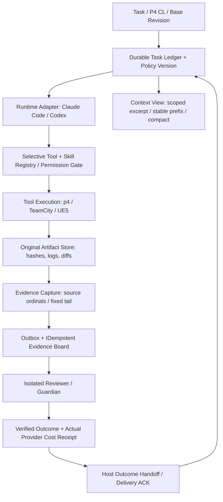

# AI Harness · Context/Token Optimization Scout — 2026-11-06

> **조사 기준:** 2026-11-06 약 06:00 KST / 2026-11-05 약 21:00 UTC. 주 관찰 구간은 2026-11-04 21:01 ~ 2026-11-05 21:00 UTC. GitHub 공식 검색의 merged 시점, PR 본문·changed files·테스트, release published_at을 대조했다. [11/05 Scout](https://github.com/jaywapp/wiki/blob/develop/ai/trend/ai-harness-token-scout-2026-11-05.md), [11/04 Scout](https://github.com/jaywapp/wiki/blob/develop/ai/trend/ai-harness-token-scout-2026-11-04.md), [11/03 Scout](https://github.com/jaywapp/wiki/blob/develop/ai/trend/ai-harness-token-scout-2026-11-03.md), [Orchestration](https://github.com/jaywapp/wiki/blob/develop/ai/Orchestration.md)와 대조했다. 시계열 Scout이므로 **trend** 한 곳에만 게시한다. 아래 벤치마크는 해당 PR 작성자의 자료이며 Perforce/유료 API 독립 재현은 아니다.

## 0. 결론: 오늘 확인된 신규성, 수치의 의미

**오늘은 의미 있는 신규 변경이 있다.** 11/05의 '모델이 읽지 않은 메시지를 Compaction으로 지우지 않기', '선택적인 Thread State 조회', 'MCP Catalog 상한/일관성', 'Turn별 Cache TTL'에서 더 나아가, 오늘은 **원본 Evidence를 원자적 구간으로 수집하고 ACK 기반으로 분배하는 Guardian V3**, **이미 오프로드한 대용량 Tool Output을 grep으로 재팽창시키지 않는 제한**, **Compaction 컷오프의 메시지 ID 고정**, **목록에서 Tool Output을 뒤로 미루는 on-demand 조회**, **모델용 짧은 식별자의 영속 ID 생성**, **Host가 종료 결과를 비동기로 전달하되 종료 전에 flush하는 계약**이 핵심이다.

| 우선순위 | 신규 변경 및 공식 근거 | 확인된 구현/측정 | 적용 판단 |
|---|---|---|---|
| 1 | [Codex Guardian V3 #59669/#59670/#59671](https://github.com/openai/codex/pull/59670) | 원본 불변 Snapshot → 고정 tail / 부분 ACK → 별도 Housekeeper가 Topic Board에 기록. **현재 intake cursor는 메모리 기반** | **PoC 최우선** |
| 2 | [Deep Agents #7526](https://github.com/langchain-ai/deepagents/pull/7526) | grep 결과의 초장문 매칭 줄을 **최대 2,000자**로 제한. 기존 최대 80K 전체 cap의 우회 방지 | **바로 적용 원칙** |
| 3 | [Codex #59601](https://github.com/openai/codex/pull/59601) | 실험적 thread/items/list에서 완료된 성공 명령의 출력 생략, item ID로 전체 요청 | **PoC 최우선** |
| 4 | [Deep Agents #7567](https://github.com/langchain-ai/deepagents/pull/7567) | Summary cutoff index + **cutoff_message_id**. 기록 앞쪽 변경 시 잘못된 범위 요약 예방 | **바로 적용 원칙 / PoC** |
| 5 | [Codex #59540](https://github.com/openai/codex/pull/59540) | 000~999을 먼저 배출하는 deterministic, snapshot 가능한 모델 표시 ID | **PoC** |
| 6 | [Codex #59725](https://github.com/openai/codex/pull/59725) | Turn Outcome Reporter + 종료 시 미완료 Handoff 대기 | **바로 적용 원칙** |
| 7 | [OpenCode #62170](https://github.com/anomalyco/opencode/pull/62170) | 세션 전체 내려받기 제거, 최신 500개·검색 50개 제한. 약 **3.2MB→0.28MB** 예시 | **PoC** |
| 8 | [Codex #59633/#59598](https://github.com/openai/codex/pull/59633) | 명령 세션 최대 16개 상태만 게시 / root-only background Compaction opt-in | **PoC** |
| 9 | [Agent Framework #10106](https://github.com/microsoft/agent-framework/pull/10106) | Anthropic redacted_thinking의 Tool Loop 간 opaque replay 무손실화 | **바로 적용 원칙** |
| 10 | [Deep Agents #7512](https://github.com/langchain-ai/deepagents/pull/7512), [0.7.33](https://github.com/langchain-ai/deepagents/releases/tag/deepagents%3D%3D0.7.33) | Model Refusal을 Success로 기록하지 않고 Parent에게 전달; 미들웨어 기반 Fallback | **바로 적용 원칙** |
| 11 | [Strands #4345/#5819](https://github.com/strands-agents/harness-sdk/pull/4345) | Hook retry 시 소모 latency 누락 수정, provider별 cached inputToken 합산 규칙 문서화 | **바로 적용 원칙** |
| 12 | [LangGraph #9599](https://github.com/langchain-ai/langgraph/pull/9599) | Python SDK에 strict_resume 노출. stale 승인 재개 요청 거절 | **바로 적용 원칙** |
| 13 | [OpenCode #62019](https://github.com/anomalyco/opencode/pull/62019) | MCP 첫 Turn 연결 대기 2초 하드코딩 대신 server startup 정책 적용 | **PoC** |
| 14 | [Codex #59503](https://github.com/openai/codex/pull/59503), [OpenCode #61492/#61494](https://github.com/anomalyco/opencode/pull/61492) | Resume의 Provider 고정 / Model Capability와 Request Options 명확화 | **PoC** |

**절감량의 엄격한 해석:** `2,000자`는 **각 grep 매칭 줄의 표시 상한**이고 `~3.2MB→0.28MB`는 **Desktop UI의 세션 인덱스 전송량 예시**다. `000~999`는 모델용 ID 길이 최적화 알고리즘이다. **동일 품질 작업당 LLM 입력·출력 토큰 절감률, 캐시 할인 효과, 실제 청구액 절감률에 대해 오늘 새로 독립 검증된 수치는 없다.** 효과 예상과 계측을 혼동하지 않는다.

## 1. Codex Guardian V3: Evidence Originality → Incremental Capture → Housekeeping

**원본:** 2026-11-05 15:00~15:03 UTC에 연속 병합된 [#59669](https://github.com/openai/codex/pull/59669), [#59670](https://github.com/openai/codex/pull/59670), [#59671](https://github.com/openai/codex/pull/59671). 변경을 확인한 위치는 `codex-rs/ext/guardian-v3/src/{evidence,housekeeper,sampling}.rs`, `codex-rs/thread-store/src/local/original_history.rs`, `ext/guardian-v3/tests/{evidence,housekeeping}.rs`와 Snapshot Test다.

**신규성:** 전일 #59404가 '모델에 전달되지 않은 Child Mail'을 보호했다면, 이번 패치는 **검증된 원본을 Compaction·Generated Context와 구분해 별도의 Reviewer가 영구적으로 참조할 Evidence로 수집**하는 구현이다. #59669 `EvidenceSnapshot::capture`는 원본 Root History의 ordinal을 Source Position으로 가진다. Accepted User/Assistant, 실제 Tool 실행, Verified Answer, Host 승인 원본은 보존하고 AI가 생성한 요약·컴팩션을 '원본 증거'로 승격시키지 않는다. Fork/Reverse 및 사용자 귀속이 모호한 이력, 불완전 기록은 거부한다.

**Incremental:** #59670은 ThreadStore에 `read_original_history`를 추가한다. 최초 활성화 시 완성된 Tail을 Cursor 시작점으로 잡고 과거 기록은 자동 역주입하지 않는다. `After(position)`는 조회 시점 고정 끝 위치까지의 완전한 Record만 취급하며 partial JSONL과 손상된 suffix를 거절한다. `EvidenceCursor`는 **읽는다고 ACK하지 않는다**. downstream 쓰기가 성공한 Record까지만 부분 ACK하고 읽기 실패에서는 커서를 유지한다. 현재는 **in-memory cursor**이고 Local Storage의 append-only, paginated root history만 지원한다. 외부 DB에서도 영구 복구가 되는 완성형 Event Bus가 아니다.

**Housekeeper:** #59671은 원본을 Token/Tool Output Budget 이하의 배치로 정리한 뒤 독립 Reviewer Runtime이 Topic/Description을 골라 Message Board에 기록한다. 응답 스키마를 검증하고 **모든 Board 쓰기가 성공한 뒤 ACK**. 실패 시 작업을 멈추고 Cursor는 보존한다. 그러나 **중간 Batch 쓰기 후 실패의 재실행 중복을 자동 수리하지 않는다는 소스 주석**이 있어 exactly-once는 아직 주장할 수 없다.

**원리/Trade-off:** 반복 Full-History 로드와 LLM에 모든 Tool 로그를 주입하는 과정을 줄일 여지가 있지만, 분류용 Reviewer 토큰 및 Board 쓰기 비용이 추가된다. 중요한 Benefit는 **Provenance, Audit, Evidence Availability**다. Partial-ACK + 외부 전송의 원자성 부재는 중복 게시를 유발할 수 있고, Topic Classification이 틀리면 검색 Recall이 떨어진다.

**P4/Claude/Codex PoC:** P4 Changelist, TeamCity Build, UE5 File Hash, Tool Approval을 `(task_id, attempt_id, source_seq, event_hash, evidence_uri, policy_version)`으로 Evidence Store에 저장. Raw 원본과 Generated Summary를 다른 타입으로 저장하고, Guardian은 Evidence ID만 분류한다. `(thread_id, ordinal, destination)` Idempotency Key로 Board 기록 중복을 없애고, Cursor도 SQL Transaction Outbox와 함께 영속화한다. 100회 worker-kill/partial write/stream tail corruption Fault Injection, evidence loss 0, duplicate publish 0, attribution mismatch 0, real model USD/verified review를 측정한다. **평가: PoC 최우선; 현재 PR을 그대로 'Durable Exactly-once'로 도입하면 안 된다.**

## 2. Grep Selective Context의 실제 누수 경로 — Deep Agents #7526

2026-11-04 22:57 UTC 병합 [#7526](https://github.com/langchain-ai/deepagents/pull/7526). 파일은 `libs/deepagents/deepagents/middleware/filesystem.py`, 단위 테스트는 `test_middleware.py`. Tool의 아주 큰 반환값은 `/large_tool_results/`에 오프로드할 수 있지만, 단일 줄 Minified JSON/Build Log를 grep하면 **매칭 줄 전체가 출력되어 오프로드된 내용을 다시 Context로 가져오던 문제**였다. 기존 80K 전체 문자 상한만으로는 이를 막지 못했다.

새 로직은 **매칭 한 줄을 최대 2,000자로 클립**하고, 매치 위치 주변 window를 보여주며 `[N chars clipped]`라는 생략 표시를 남긴다. Context Line은 선두(head)를 유지한다. total cap, max_count, grep Tool Contract는 그대로. 약 200K자 한 줄의 깊은 위치에서 검색되는 테스트를 추가했다.

**절감 메커니즘:** Model에 노출되는 Per-Match Output Bound를 강제해, Offload→Search→Model 관문에서 전체 데이터가 재유입되는 것을 방지한다. 예를 들어 200,000자 매칭 1줄의 이론상 최대 가시 출력은 주변 **약 2,000자 + 메타데이터**지만 실제 Provider Tokenizer/다른 Context Line에 따라 토큰 절감률은 다르다. 커다란 Stack Trace의 선행/후행 맥락이 필요한 경우 오진 위험이 있으므로 Match Anchor, Line Number, Source URI/Hash를 동반한 Progressive Expansion이 필요하다.

**P4 적용:** UE5 Cook Log, TeamCity Build Log, P4 Describe에서 줄 수가 적고 한 줄이 큰 JSON을 골라 500건 A/B; max_visible_chars_per_hit=2,000, `fetch_span(uri,start,length)` 추가, 오류 중심 ±500/1000/4000 문자 선택 확대. `input_tokens/verified triage`, relevant error recall, omitted span 재검색 비율, 최대 response bytes를 계측한다. **평가: 바로 적용 원칙.**

## 3. Codex #59601: Thread 목록을 Index로, Command Output을 상세 화면으로

[2026-11-05 08:11 UTC 병합 #59601](https://github.com/openai/codex/pull/59601). `codex-rs/app-server/src/request_processors/thread_processor.rs`, `app-server-protocol/src/protocol/v2/thread.rs`, Python SDK generated types와 `thread_read`/Timeline 테스트에서 확인했다.

실험적 Client가 **특정 turnId**의 `thread/items/list`에 `deferOutput: {"commandExecution": true}`를 전달하면, 종료시각이 기록되고 **exit=0**, 저장된 Output이 있는 Command는 `outputDeferred:true`와 `aggregatedOutput:null`을 반환한다. 필요한 Item은 `thread/items/read(turnId,itemId)`로 전체를 재조회한다. 기본은 전체 출력이며, 여러 Turn에 걸친 목록에는 적용되지 않는다. Fallible conversion으로 '미완성 Object를 완성된 명령 Output으로 오인'하지 않는다.

**효과:** UI/Host의 History 목록 로딩과 Serialization/Transport Bytes를 줄이는 Progressive Disclosure. 이 자체가 곧바로 **모델 Input Token을 줄이는 것은 아니다**. 만약 Summarizer/Agent가 Thread List를 모델 Context로 전달할 때에만 간접 Token 절감이 가능하다. 실패 명령(exe exit!=0) 출력은 숨기지 않아 진단 품질을 지킨다.

**P4:** 1,000 Tool Item/100MB Build Output이 있는 Task Summary Endpoint는 `{id,status,exit_code,command,output_digest,artifact_uri}`만 우선 보이고 실패·요청 Item만 `read(id)`. 50회 A/B에서 List payload, p95 UI load, model usage, failure recall, artifact checksum, 클릭당 추가 요청 비용 측정. **평가: PoC 최우선.**

## 4. Compaction Anchor를 불변 Message ID로 — Deep Agents #7567

[2026-11-05 20:40 UTC 병합 #7567](https://github.com/langchain-ai/deepagents/pull/7567). `libs/deepagents/deepagents/middleware/summarization.py`의 `SummarizationEvent`는 지금까지 `cutoff_index`만 기록했다. 앞부분 메시지가 삭제/복구/추가되면 같은 정수 Index가 다른 메시지를 가리켜 다음 Summary의 유지 경계가 이동했다.

새 `cutoff_message_id`는 **요약 뒤 처음으로 유지할 메시지의 ID**를 기록한다. Sync/Async auto-summarization 및 `compact_conversation` 세 경로에 기록한다. Model View와 Chained Summary는 우선 ID를 찾고, 과거 Event 또는 ID가 삭제된 경우에는 이전 Index 로직으로 Fallback한다. **완전한 Fail-closed는 아니다**. Deep Agents Code/JS는 조사 시점 기존 Index만 읽고, 후속 통합이 남아 있다.

**트레이드오프:** 앞쪽에 새로운 Event가 추가되어도 Context 기준이 안정되며 장기 세션 품질·중복 요약 비용에 도움이 된다. ID가 재사용/삭제될 때 fallback이 잘못된 범위를 고를 수 있다. Summary Event에는 `cutoff_id`, `root_revision`, `summary_hash`, `source_ids`를 함께 기록할 것을 제안한다. **P4:** CL 검증 세션의 1,000개 메시지 앞쪽 1~50개를 삽입/삭제하고 Compaction/Resume 100회, Evidence 누락·재노출 및 summary token 비용을 비교. **평가: 바로 적용 원칙 / PoC.**

## 5. 짧고 충돌 없는 모델용 ID — Codex #59540

[2026-11-05 01:34 UTC 병합 #59540](https://github.com/openai/codex/pull/59540)은 `codex-rs/utils/model-facing-id/src/lib.rs`에 Seed 기반 deterministic ID 발급기를 별도 Crate로 추가했다. Salt를 섞어 Session별 Sequence를 분리하고 먼저 `000`~`999`의 세 자리 Pool을 임의 순서로 소진한다. 그 이후 6자리, 이후 3자리씩 확장. `versioned snapshot`을 저장해 Restart 시 같은 ID를 다시 발급하지 않고 이어간다. Protocol이 자체 Prefix를 가진 경우 suffix만 포맷한다. Pool Exhaustion/Boundary/Restore/유효하지 않은 Snapshot/u64 wraparound 테스트.

**Token 원리:** 긴 UUID나 10자리 정수 대신 짧은 ASCII 3자리 식별자는 **모델별 tokenizer에서 더 적게 인코딩될 가능성**이 있다. PR 작성자는 세 자리 Decimal ID가 한 토큰에 들어감을 전제로 설계했지만 **모든 tokenizer에서 항상 1토큰이라는 보장은 없다**. ID가 Tool Call/Reviewer/Citation 수십 번 반복될 때 누적 효용을 측정할 가치가 있다. Salt·Seed를 보안 토큰, 외부 공개 ID의 접근제어로 오용하지 않는다.

**P4 실험:** Internal Durable UUID는 유지하고 Prompt-visible Alias만 `e042` 등 짧게 준다. Alias↔Immutable ID 맵은 Ledger가 보관. 100~10,000 Event × 3 Model Tokenizer의 실제 token count, 충돌·복원·잘못된 Evidence ID 연결 0, Human readability를 측정. **평가: PoC.**

## 6. Terminal Task 완료와 결과 전달을 다른 ACK로 — Codex #59725

[2026-11-05 19:21 UTC 병합 #59725](https://github.com/openai/codex/pull/59725)은 Host가 설치하는 `AgentTurnOutcomeReporter`를 `StartThreadOptions::thread_extension_init`으로 노출한다. Terminal Turn Event를 먼저 보내고, 이후 Host의 결과 Callback을 Await한다. Parent Native Notification과는 별개다. Graceful Shutdown은 **미완료 결과 Handoff를 기다린 후** Thread-stop Hook을 실행한다. Handoff Registration 종료 후에는 새 Turn을 시작하지 않는다. 완료·오류·Follow-up·Cancellation·Guardian Safety Stop에 대한 테스트가 있다.

**효과:** 완료 결과가 저장·전달되기 전에 Task Process가 종료되어 Lost Result→Worker Retry가 일어나는 것을 줄이는 **lifecycle correctness**. 토큰 절감 자료는 없고 느린 Callback이 종료를 지연시킨다. 정확한 Delivery는 Host 내 ACK만으로 불충분하므로 외부 Destination의 Receipt도 별도 확인한다.

**P4:** `RUNNING→TERMINAL→REPORT_PENDING→DELIVERED` Event를 원자적 Outbox에 기록, Claude/Codex Adapter는 API 교체 가능하게 구성. Graceful Shutdown/강제 Kill을 별도 구분해 100회 실험. Agent 종료 시 Report 중복 0, 누락 0, 중복 P4 Submit 0. **평가: 바로 적용 원칙.**

## 7. 선별적인 세션 검색과 모델 없는 UI 조회 — OpenCode #62170

[2026-11-05 19:25 UTC 병합 #62170](https://github.com/anomalyco/opencode/pull/62170)은 긴 세션의 UI가 백엔드의 `GET /api/session` 검색 기능을 사용하지 않고 Home Index 전체를 반복 요청하던 부분을 교정했다. 기존 Root Session은 **5,815건/1,017개 Project**, 첫 page 5,000건 **2,789,529 bytes**와 후속 815건을 다운로드했다. 키 입력마다 로컬 List에서 수천 Session Entry를 만든 뒤 Filtering했다.

변경 후 Home은 **최신 500개 한 페이지**만 로드하고, Search는 서버마다 **limit=50, parentID=null, archived=false**, 150ms Debounce를 적용한다. 5천 Session Mock에서 전송량 약 **2.8MB+0.4MB→0.28MB**, 입력 후 2 Frame **33~49ms→26~37ms**. 15회 연속 Input Event가 마지막 검색 Request 1회만 발생하도록 e2e, App Unit 2,574건을 검증했다고 작성자는 보고했다.

이는 **Desktop UX/전송비용**, Model Token의 절감 벤치가 아니다. 그러나 `Workspace/Session Index`나 Search-based RAG도 같은 원리를 쓸 수 있다. P4에서 10,000 CL의 Metadata만 인덱싱하고, Description/Diff/Logs는 조건·Revision으로 Server Filter + Page. **평가: PoC.**

## 8. Background Worker 상태 노출과 Compaction 격리 — Codex #59633/#59598

**[#59633](https://github.com/openai/codex/pull/59633)**(11/05 11:14 UTC): Code Mode Script가 명령을 시작하고 Session Handle을 모델에 돌려주지 않은 경우, Retained Command Sessions의 최대 **16개 Snapshot**만 모델에 공개한다. 각 항목은 ID/진행 또는 종료/사용 중 상태를 보이고, 변화 없는 Snapshot은 반복 출력하지 않는다. `write_stdin`이 없을 때도 보존하고 Compaction 뒤 갱신하며 Restart/Feature Off 때 Stale Handle을 지운다. **Feature 기본 OFF**. 남은 세션을 찾아 추가 Shell/Build를 중복 실행하는 비용을 줄이는 가능성은 있으나, 16개를 넘으면 누락 갯수만 표시돼 검색 경로가 필요하다.

**[#59598](https://github.com/openai/codex/pull/59598)**(11/05 08:00 UTC): 기본 비활성 `async_compaction_root_only`는 Background Compaction을 Root Session에만 허용하여 Reviewer/Guardian Child가 자동 요약 때문에 Evidence를 변형·지연시키는 위험을 피한다. 단 Child Context Window Overflow를 별도 처리해야 한다. 사용자에게 제공된 공식 설정이라고 단정하지 않는다.

**P4:** 명령 세션은 (build_id, process_handle, state, last_seen, exit_receipt) Registry에서 조회. Worker가 Tool Handle을 놓쳐도 TeamCity 상태로 Reconcile하고, Child Reviewer는 작고 독립된 Context와 명시적인 Pause/Handoff를 갖는다. **평가: PoC.**

## 9. Provider Native Reasoning을 요약/재실행 중 손상하지 않기 — Agent Framework #10106

[2026-11-05 14:07 UTC 병합 #10106](https://github.com/microsoft/agent-framework/pull/10106). `python/packages/anthropic/agent_framework_anthropic/_chat_client.py`에서 Claude의 `redacted_thinking` block을 Tool Loop가 재생할 때 누락하던 문제를 수정한다. 응답 Parse 시 Opaque Payload는 `Content.protected_data`, Provider-Native Type은 `additional_properties["anthropic"]["reasoning_block"]`으로 보존하고, 후속 `tool_result`와 함께 원순서대로 serialize한다. Streaming 합치기에서 인접 thinking과 identity를 잘못 합치지 않으며 Payload 유실 시 Request 보내기 전에 `ContentError`로 중단. `pause_turn` 및 저장·재개 경로도 포함.

이것은 모델의 숨겨진 추론을 일반 Prompt로 재노출하는 기능이 아니라 **공급자 요구의 opaque State Round-trip**이다. Context 압축을 위해 opaque payload를 임의로 문자열화하거나 삭제하면 Tool Loop를 재시도하게 되어 비용과 품질이 악화될 수 있다. 토큰 절감 직접 실측 없음.

**P4:** Claude Code/Agent Runtime Adapter의 `provider_state_blob`을 모델 요약과 분리, 암호화 저장·Provider 전용 접근·원문 hash를 둔다. 10회 tool_use→redacted_thinking→tool_result→resume, 저장/복원 동등성 및 무단 유출 0을 검사. **평가: 바로 적용 원칙.**

## 10. Refusal/Fallback과 Model Routing이 Task Success를 왜곡하지 않도록

**Deep Agents [#7512](https://github.com/langchain-ai/deepagents/pull/7512)**(11/05 14:23 UTC): 기본 Stack의 `ModelRefusalMiddleware`가 Provider Refusal을 정상 완료로 취급하던 문제를 수정한다. Main Agent는 오류를 발생시키고, 일반 Subagent/Async Child는 Parent에 **refusal task result**를 전달한다. Caller의 `ModelFallbackMiddleware`가 먼저 처리하도록 Middleware 순서를 조정했다. Model-level `with_fallbacks`로는 Refusal을 자동 감지할 수 없다는 차이가 있다. Fallback 시 Tool 비용 증가, Refusal이 정책상 금지인 경우 무조건 재시도하면 안 된다. [deepagents 0.7.33 공식 릴리스](https://github.com/langchain-ai/deepagents/releases/tag/deepagents%3D%3D0.7.33)에 포함된 것으로 명시된다.

**Codex [#59503](https://github.com/openai/codex/pull/59503)**(11/04 22:20 UTC): 기본 Provider가 바뀌어도 기존 Thread Resume는 저장된 Provider를 사용하며, 명시적인 다른 Provider Resume는 거부한다. Missing Provider/Managed Policy 충돌은 오류로 유지. **OpenCode [#61492](https://github.com/anomalyco/opencode/pull/61492)/[#61494](https://github.com/anomalyco/opencode/pull/61494)**(11/05): Model Endpoint의 지원 여부(`tools.strict`, `cache`, `promptCacheKey`, `reasoning.updates`)와 전송 호환성(Wire Quirk)을 분리하고 Options 병합 계층을 단순화했다. 작성자 로컬 36개 샘플, 8,544 모델 Registry에서 **전송 바이트가 달라진 Request 0건**으로 검증; 모델 성능 개선 자체는 없음.

**P4:** `effective_model_id/provider_id/effort/capabilities/policy_hash`를 Attempt Receipt에 저장. Fallback은 자격·승인 재검증, 가격·Provider Data Residency·Cache Prefix 재측정 이후 허용. Refusal/429/5xx/Tool Timeout/Context Overflow를 별도 종료 코드로 보관. **평가: 바로 적용 원칙(정확성), 구현 PoC.**

## 11. Tool Lifecycle, Policy, Session Resume의 신규 좁은 변경

- **[LangGraph #9599](https://github.com/langchain-ai/langgraph/pull/9599)**(11/05 16:15 UTC): 앞서 11/05 Scout에서 다룬 Strict Resume의 **Python SDK 전달 경로**가 새로 완성됐다. `runs.create/stream/wait`에 `strict_resume=True` 추가; 이미 다른 화면에서 승인된 Interrupt는 `UnknownInterruptError`로 거부하고 State 불변. 서버가 지원하지 않으면 필드를 무시할 수 있다는 호환성 주의. [langgraph 1.2.20](https://github.com/langchain-ai/langgraph/releases/tag/1.2.20)은 Core Strict Resume 포함이 확인되지만 이번 SDK PR의 릴리스 포함은 별도 확인 대상이다. **바로 적용 원칙.**
- **[Agent Framework #10109](https://github.com/microsoft/agent-framework/pull/10109)**: 11/04의 Memory Scope와 다른 **Mem0Client 자체 ClearMemoryAsync**가 모든 Scope ID 공백일 때 DELETE를 막는다. 요청 송신 0건 검증, 58/58 Unit Tests (net10.0/net472). P4 RAG/Memory Store는 복구 경로 및 SDK Client 양쪽에 Fail Closed. **바로 적용.**
- **[Agent Framework #9770](https://github.com/microsoft/agent-framework/pull/9770)**: AG-UI가 같은 Turn의 둘 이상 declaration-only Tool Call을 Replay하면서 중복 `TOOL_CALL_START`를 보내던 문제. 마지막 ID 비교 대신 이미 Start한 ID Set으로 1회 실행만 보장. 다음 Turn Provider의 duplicate Tool ID 오류 방지. **바로 적용.**
- **[OpenCode #62019](https://github.com/anomalyco/opencode/pull/62019)**: MCP Startup을 10초 설정했어도 First Turn은 2초만 기다리던 버그를 서버별 `timeout.startup`의 남은 시간으로 수정. 별도 설정 없으면 여전히 2초, 병렬 Waiting 유지. 3.5초 Held Handshake Case와 관련 108 Test. Cold-start Tool Catalog 완전성 향상 대가로 최초 TTFT 증가 가능. **PoC.**
- **[Codex #59530](https://github.com/openai/codex/pull/59530)**: Windows Restricted Token을 포함해 Sandbox Launch 시 Workspace Root/Denied Rule을 다시 Resolve한다. Empty Root→Access 0; Workspace 추가 권한과 Deny Rule 병합을 실행 경계에서 테스트. **바로 적용 원칙.**
- **[Codex #59735](https://github.com/openai/codex/pull/59735)**: Recording된 MCP Call을 **실행하지 않고** 현재 Tool Catalog/Binding/Approval Policy로 직접 Guardian Review. 저장된 Approval을 새로 만들지 않음. Replay 안전 테스트에 적합하나 현재 Tool Definition과 과거 Recording의 버전 차이를 기록할 것. **PoC.**
- **[Agent Framework #10121](https://github.com/microsoft/agent-framework/pull/10121)**: .NET 파일 Hook 기능의 기본값을 false로 변경한 Breaking 수정. 정책·자동 실행의 기본 허용을 피해야 한다는 원칙 외 신규 Token 성능 없음. **바로 적용 원칙.**

## 12. Cost / Token 관측을 망치지 않는 회계 처리

**[Strands SDK #4345](https://github.com/strands-agents/harness-sdk/pull/4345)**(11/05 15:54 UTC): `AfterModelCallEvent` Hook이 성공한 응답을 재시도하도록 해도 *폐기된 응답의 Usage*는 합산했으나 **그 요청의 Latency Metric은 빼먹던 문제**. `strands-py/src/strands/event_loop/event_loop.py`가 재시도 전에 Usage와 Metrics를 함께 적산하도록 수정했다. 관련 Hook Retry 및 Python Unit Suite 테스트. 숨겨진 Retry 시간은 총 비용/지연 비교를 왜곡한다.

**[Strands #5819](https://github.com/strands-agents/harness-sdk/pull/5819)**(11/05 16:39 UTC): Provider별 `inputTokens`가 Cache Read/Write Token을 **이미 포함하는지 여부가 다르다**. 무조건 `inputTokens + cacheReadInputTokens + cacheWriteInputTokens`를 더하면 중복 계상될 수 있음을 Python/TypeScript SDK Docstring에 명시. **이번 PR은 회계 Normalization을 구현한 것이 아니라 문서 수정**이며 후속 [#4618](https://github.com/strands-agents/harness-sdk/issues/4618)이 추적한다.

**권장 비용 영수증 계약:**

```text
provider, model, route, request_id, task_id, attempt_id, turn_id
input_raw, output_raw, reasoning_raw
cache_read_raw, cache_write_raw, input_includes_cache: true|false|unknown
provider_bill_actual, billed_currency, latency_all_attempts_ms
retry_reason, refusal, status, verified_outcome, evidence_uri
```

Raw Provider Usage를 변경하지 않고, 별도 **normalized_input** 및 `bill/verified_task`를 계산한다. `input_includes_cache=unknown`인 경우 성급히 중복 합산하지 않고 불확실성으로 보고한다. **LLM 호출을 생략한 Shell/Condition Poll도 외부 API/CPU 비용을 비교해야 한다.**

## 13. 운영상 중요한 *미해결* Compaction·Transport 재현 사례 (릴리스 기능 아님)

- **[Codex Issue #59534](https://github.com/openai/codex/issues/59534)** (11/05 생성, 조사 시 Open): 사용자 제공 Codex 0.166.0에서 Remote Compaction V2 후 모델 입력 Token이 **244,352→272,173→292,503→312,153**으로 증가. 대화가 **1시간 미만 37회 Compaction**을 반복했다고 보고했다. `replacement_history`는 생성됐지만 다음 요청은 이전 History도 포함한 듯하다. **신고된 현상이지 전 버전 공통 재현/원인 확정 아님**.
- **[Codex Issue #59703](https://github.com/openai/codex/issues/59703)** (11/05 생성, 조사 시 Open): 대형 이미지 History의 WebSocket 16MiB 논리 메시지 한도 근처에서 `Close 1009`, 동일 재시도 5회 및 HTTPS Fallback. 제보자 별도 Probe에서 **16,777,216 bytes 허용 / +1 byte 거절**, 약 38.1MB 이미지 Data URL 보존을 관찰했다고 보고. HTTP로 한 번 Compaction한 후 0.37MB 안팎 History로 정상 복귀한 사례. **공식 병합 수정이 아닌 외부 재현과 공개 포크 패치**다. Provider·Transport별 실제 한도 재측정이 필요.

**P4 예방책:** Context Window Token과 **serialized transport bytes**를 독립 Metric으로 추적. Compaction 이후 `input_tokens_after < before`를 무조건적으로 가정하지 말고 정해진 품질·사용량 가드레일을 위반하면 반복 Compaction을 차단하고 강제 Handoff. 이미지·큰 Log는 원본 Artifact Store/Hash에 두고 Model에는 필요한 Thumbnail/Excerpt만 전달. 동일 실패 요청은 자동 5회 Retry하기 전에 결정론적 Payload Violation인지 분류한다.

## 14. 변경 계층을 혼동하지 않는 공식 릴리스 체크

- [Deep Agents SDK 0.7.33](https://github.com/langchain-ai/deepagents/releases/tag/deepagents%3D%3D0.7.33): **2026-11-05 20:40:31 UTC** 게시. Refusal 처리(#7512), grep 2,000자 Clip(#7526), 실패 Compaction Error Status(#7538), Subagent Checkpoint task ID(#7509) 등이 Changelog에 명시돼 **출시 확인**. #7567은 같은 날 PR 병합이지만 **해당 태그에 포함됐다고 단정하지 않음**.
- [LangGraph 1.2.20](https://github.com/langchain-ai/langgraph/releases/tag/1.2.20): **11/05 02:20 UTC**, 개별 Interrupt ID/Strict Resume 기능 포함. Python SDK #9599는 **이후 병합**된 변경이므로 1.2.20 정식 릴리스와 구별.
- [Claude Code 공식 Releases](https://github.com/anthropics/claude-code/releases): 조사 시점 최신 조회 **v2.1.318(11/04 00:01 UTC)**. 전일 Scout에 분석 완료되어 오늘 새 릴리스로 반복하지 않는다. Claude Code의 Github 내부 소스가 공개된 범위를 넘어서 구현을 단정하지 않는다.
- [Codex Releases](https://github.com/openai/codex/releases): 11/05 게시한 0.168.0-alpha.3/alpha.6 등은 **사전 릴리스**이고 PR들이 모두 알파 태그에 포함됐다고 증명하지 않는다. Merge된 `main` 구현과 사용자 배포 버전은 별도 구분한다.
- [OpenCode Releases](https://github.com/anomalyco/opencode/releases): 확인된 일반 v2.2.5 게시 시점은 **10/30 UTC**. 오늘 11/05 dev 병합 #62019/#62170을 일반 2.2.5에 포함됐다고 표기하지 않는다.

## 15. 제안 아키텍처: P4/TeamCity · Claude Code/Codex Harness

> **다음은 특정 오픈소스 프로젝트의 실제 구성도가 아닌, 위 변경을 통합한 제안 아키텍처**다.



**상태 불변조건:** (a) 원본 Tool Output은 영속 Store에 보존; 모델에는 요약/URI/제한된 span만, (b) Compaction 대상과 Evidence ACK Cursor를 분리, (c) Root/Child/Provider/Workspace Permission을 저장·실행 경계에서 다시 검증, (d) 읽기 전용 Search와 Side-effect P4 Submit을 구분, (e) Child/Host 종료는 원격 Receipt 확인 뒤, (f) 모델 선택/Cache TTL/Reasoning 상태는 Attempt별 영속화, (g) 모든 실패 Retry의 Token/Latency/실제 청구액을 합산.

### PoC A: Context/Tool Output 경계 비용

대상: 100개 UE5/Perforce 오류 조사 작업, 150 MCP Tools, 10KB~100MB Log, 장문 JSON Single Line.
A = Full Tool Catalog + Full Grep + Full Thread List.
B = Deferred Catalog + 2,000자 Match Window + On-demand Item Read.
C = B + Stable Prefix Cache + Artifact URI + 필요한 Span만 검색.

**수집:** total/request input/output/reasoning/cache-read/write, raw & visible bytes, provider actual bill, tool-selection recall, test pass, error root-cause precision/recall, evidence URI/hash complete. **제안 통과:** baseline 대비 verified task success 저하 2%p 이하, 원본 Evidence 100% 보존, 무단 Tool 실행 0, USD/verified-task 10% 이상 절감 또는 p95 latency 20% 이상 감소. KPI는 같은 것으로 오해하지 말고 별도 보고.

### PoC B: Evidence/Handoff Fault Injection

100 Worker Kill, 100 Board Write Failure, Rollout Partial Write/Compaction, P4 Submit Response Timeout, Reviewer Denial, Child Mail Arrival Mid-Compaction을 교차한다. `EvidenceCursor`는 SQL checkpoint에 옮기되 Outbox의 `(source_id,destination)` 유일 제약과 원격 P4 Status 조회로 reconciliation. **목표:** orphan child/중복 Submit/분류된 원본의 유실/잘못된 Approval 승인 0. Timeout만으로 원격 성공 여부를 모른다고 Task 전체를 재실행하지 않는다.

### PoC C: Model/Cache/Cost Accounting

서로 다른 3개 Provider/Model을 이용한 50개 동일 작업, 새 세션/Resume/Router Fallback/Refusal/Hook Retry/5m·30m·12h idle을 교차한다. Provider별 `input_includes_cache`를 명시하고 *실제 청구액*을 Source of Truth로 둔다. **측정:** cache-hit, prefill TTFT, context bytes, input/output/reasoning tokens, summarization/write tokens, all-attempts latency, permission leakage=0, successful action당 Cost. 분류기·저비용 Summary 모델이 추가 호출을 만들기 때문에 '가벼운 모델로 바꾸면 무조건 싼가'를 반증 가능하게 실험한다.

## 16. 미확인·중복 제외·후속 모니터링

1. 범용 RAG Re-ranking, 임베딩 모델, Prompt/Skill 파일 축소에 대해 **오늘 관찰 기간에 새로운 동일 품질 Token/Cost 비교 실험이 검증된 사례는 없음**. 오늘은 grep selective span/Session Server Search/Tool Output Deferral이라는 **실제 코딩 Harness 경계**의 신규 패치만 새 항목으로 인정했다.
2. Guardian V3 Housekeeper는 **실험적 통합 단계**로 보이며 durable intake 및 partial write recovery는 별도 구현 필요. 마치 최종 운영 시스템이 배포된 것처럼 서술하지 않는다.
3. Open SWE 공개 PR 검색에는 관찰 기간 중요 Harness 신규 병합이 확인되지 않았다(검색 결과는 UI Analytics #5089 한 건). 전일의 Stateless Run/Review Bench를 오늘 신규 성과로 재인용하지 않는다.
4. Codex의 #59598/#59633/#59601은 **기본 활성화 기능이 아님**. 개발 브랜치 병합·SDK Schema·공식 고객 배포를 구별한다.
5. 운영 Issue #59534/#59703은 사용자 보고에 기반하고 공식 수정까지 확인되지 않았다. 향후 재현 결과, 원인 수정 PR, 최신 버전 Fix Status 확인이 필요하다.
6. **정량 결론:** 오늘 신규 실측은 Context 밖 네트워크·UI 전송량과 Output 문자 상한 중심이다. 작업 성공률 유지 조건의 신규 LLM Token/청구 USD 절감률 **확인되지 않음**. 가장 가치 높은 다음 검증은 **출처 보존하면서 모델 Context로 흘러드는 Tool Bytes를 줄일 수 있는가**, **실패/재개 비용까지 합산한 USD/verified-task가 개선되는가**다.

## 참고 자료

본문 각 항목의 GitHub PR/Issue/Release 링크가 1차 근거다. 공식 구현은 [Codex](https://github.com/openai/codex), [Deep Agents](https://github.com/langchain-ai/deepagents), [OpenCode](https://github.com/anomalyco/opencode), [Microsoft Agent Framework](https://github.com/microsoft/agent-framework), [LangGraph](https://github.com/langchain-ai/langgraph), [Strands Agents SDK](https://github.com/strands-agents/harness-sdk)에 기반한다. 측정 근거는 해당 Pull Request의 테스트·벤치마크 설명이며, 로컬 Perforce/Claude Code/Codex에 대한 별도 독립 재현을 수행했다고 주장하지 않는다.
