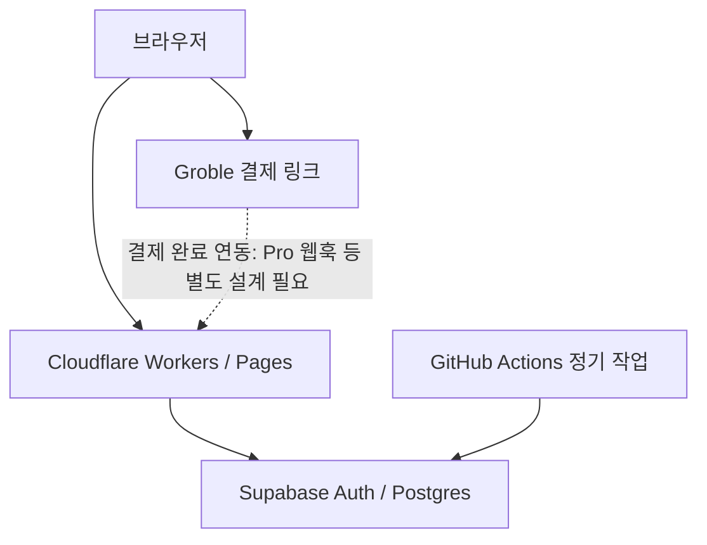

# 2026년 1인 개발자 무료 풀스택 MVP 배포 스택

> 조사일: 2026-11-04. 사용자 제공 스택 제안을 공식 문서 기준으로 검증한 가이드. 무료 시작과 무제한 무료 운영은 다르다.

## 핵심 요약
정적 웹 호스팅 + 관리형 인증/DB + 제한적 배치 + 외부 결제 링크를 결합하면 작은 MVP의 초기 월 고정 인프라 비용을 0원으로 시작할 수 있다. 그러나 서비스별 무료 할당량, 상업 이용 약관, 결제 수수료, 도메인/메일 비용, 세금 의무를 별도로 관리해야 한다.

## 구성요소별 검증
| 구성 | 추천 서비스 | 무료 범위와 주요 제한 |
| --- | --- | --- |
| 웹 프론트/배포 | Cloudflare Pages 또는 Workers | 정적 자산 요청은 무료·무제한. Pages 무료 빌드 월 500회, 파일 최대 20,000개. Functions/Workers 무료 요청은 합산 일 100,000회, CPU 제한 적용. Cloudflare는 새 앱에 Workers를 우선 권장. |
| Next.js 호스팅 | Vercel | Hobby는 개인·비상업적 용도에 한정. 유료 SaaS 운영은 적절한 상업용 플랜 검토. |
| DB/Auth | Supabase | Free: DB 프로젝트당 500MB, MAU 50,000, 스토리지 1GB, egress 5GB, 무료 프로젝트 2개. 비활성 프로젝트 일시 중지 가능. |
| 배치/자동화 | GitHub Actions | GitHub Free에서 포함 실행 시간 월 2,000분. 러너 종류와 공개/비공개 저장소별 과금 규칙 확인. 지속 실행 서버를 대체하지는 않음. |
| 결제 링크 | Groble | 비사업자도 가입 및 판매 가능, 카카오페이/네이버페이/카드 지원. 무료 플랜 일반결제 서비스 수수료 1.5% + 결제망 2.9% 및 수수료 부가세(총 약 4.84%). 자동화 웹훅 등은 Pro 기능. |

## 제안 아키텍처

이는 검증된 배포 사례가 아니라 **제안 구조**다. 결제 완료 여부를 클라이언트 리다이렉트만으로 신뢰하지 말고 서버 측 검증 및 권한 부여 흐름을 별도 설계한다. Supabase는 RLS를 설정하고 service_role/secret 키를 브라우저에 노출하지 않는다.

## 실행 순서
1. 랜딩 페이지와 핵심 가치 제안을 정하고 정적 자산 위주로 배포한다.
2. 필요한 경우에만 Supabase Auth/Postgres를 추가하고 RLS 정책을 테스트한다.
3. GitHub Actions의 schedule을 통해 짧고 재실행 가능한 작업만 자동화한다. 스케줄 지연과 실행 제한을 고려한다.
4. Groble 외부 결제 링크를 연결해 구매 의사를 검증한다. 구독 자동 권한 처리에는 Pro 웹훅 등 추가 구현과 보안 검증이 필요하다.
5. 비용 경고, DB 사용량, 실패 로그, 백업, 결제 수수료, 세금·사업자 등록 의무를 운영 체크리스트에 넣는다.

## 판단 및 주의사항
- 무료 티어는 **초기 고정비 0원**에 유리하지만 트래픽/DB/함수 실행 비용을 영구히 보장하지 않는다.
- Vercel Hobby의 비상업적 사용 제한은 실제 결제 서비스와 충돌할 수 있다.
- Cloudflare 정적 요청의 무제한과 동적 서버 코드의 제한을 혼동하지 않는다.
- Groble은 판매 수수료가 있고 사업자 없이 판매 가능하다는 설명이 세무상 의무 면제를 의미하지 않는다.
- 소셜 로그인은 제공자별 설정·심사·비용 및 OAuth 정책을 따로 확인해야 한다. 카카오 로그인 지원을 별도 검증 없이 무료 확정하지 않는다.

## 출처
- Vercel Terms of Service (2026-10-19): https://vercel.com/legal/terms
- Cloudflare Pages limits (2026-09-05): https://developers.cloudflare.com/pages/platform/limits/
- Cloudflare Pages Functions pricing: https://developers.cloudflare.com/pages/functions/pricing/
- Cloudflare Workers limits (2026-10-12): https://developers.cloudflare.com/workers/platform/limits/
- Cloudflare Pages overview: https://developers.cloudflare.com/pages/
- Supabase billing: https://supabase.com/docs/guides/platform/billing-on-supabase
- GitHub included usage: https://docs.github.com/en/billing/reference/product-usage-included
- Groble FAQ: https://www.groble.im/help/faq
- Groble Pro: https://www.groble.im/pro
